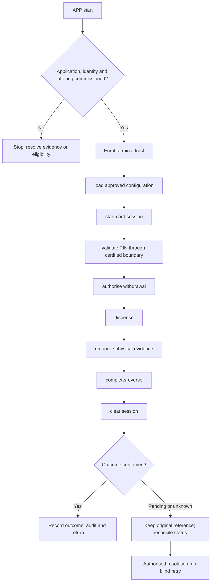

**Proposed application. New-project implementation has not started.**

## Users and responsibility

ATM cardholder; terminal operator; cash custodian; switch/reconciliation teams. Separate the ATM customer client from its administrative fleet console. A physical terminal app must use approved hardware middleware and secure PIN/HSM handling. No general web server endpoint may accept plaintext PIN, CVV or unrestricted card data.

## Required workspaces and features

1. Customer ATM session screens and safe termination.
2. Device trust, card-reader/PIN-pad/dispenser middleware boundary.
3. Withdrawal, balance enquiry and approved receipt services.
4. Terminal health, cash replenishment and journal inspection.
5. Exception/capture/retract/partial-dispense workflow.

Each workspace needs list/search/filter → detail → permitted action → result → return. Include loading, empty, invalid-input, permission-denied, outage, stale-conflict and unknown-result states. Administrative and financial write actions must be distinguished.

## Application flow diagram

## Complete representative journey

Enrol terminal trust → load approved configuration → start card session → validate PIN through certified boundary → authorise withdrawal → dispense → reconcile physical evidence → complete/reverse → clear session.

Record the institution, programme/product version, actor/duty, request/operation reference, business date and authoritative outcome. Mobile/ATM channels need equivalent status semantics without copying web-specific navigation or cookie assumptions.

## Difficult cases

Power loss after approval; partial dispense; no cash with debit; cash retract; tamper alarm; switch disconnect; invalid denomination.

Test successful actions and server denials independently. Closing the screen or cancelling a network request does not reverse a financial operation. Verify original operation status before offering a new instruction.

## Module dependencies and readiness

Relevant module IDs: B07, B10, B17–B24, B30–B32. Select only the institution's permitted subset from the [module register](/banking/module-register). All product policy and permissions stay in shared services. A channel cannot widen limits or convert stored test data into executed banking.

Prove tenant isolation, exact calculations, concurrent access, idempotency, source outages, audit redaction and recovery. Confirm keyboard/accessibility for web clients and certified-device usability for ATM. Do not call this application deployable until its [release gates](/banking/delivery-plan) pass.

## Decisions before implementation

Agree the named user duties, first-release features, deployment boundary and external contracts for this application. ATM hardware and mobile security need their own contract packets. Follow the [decision order](/banking/decisions); no UI or service code is authorised by this proposed document.
