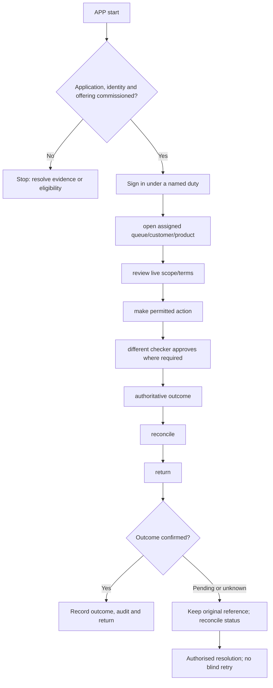

**Proposed application. New-project implementation has not started.**

## Users and responsibility

Institution administrator; branch/Head Office; teller; lending; cards; finance; risk; complaint roles. Bank Admin manages the institution configuration it is delegated. Financial duties are independently granted. Whole-bank operations are covered by the application, not by an unrestricted single identity.

## Required workspaces and features

1. Role-specific home and operating queues.
2. Customer/account servicing with explicit authority.
3. Teller, deposit, payment and loan operations where enabled.
4. Card issuance, billing, disputes and ATM operational views.
5. Reconciliation, EOD, finance, reporting and control workspaces.

Each workspace needs list/search/filter → detail → permitted action → result → return. Include loading, empty, invalid-input, permission-denied, outage, stale-conflict and unknown-result states. Administrative and financial write actions must be distinguished.

## Application flow diagram

## Complete representative journey

Sign in under a named duty → open assigned queue/customer/product → review live scope/terms → make permitted action → different checker approves where required → authoritative outcome → reconcile → return.

Record the institution, programme/product version, actor/duty, request/operation reference, business date and authoritative outcome. Mobile/ATM channels need equivalent status semantics without copying web-specific navigation or cookie assumptions.

## Difficult cases

Bank Admin tries financial self-approval; Head Office exceeds branch scope; teller edits policy; customer restrictions change after quote.

Test successful actions and server denials independently. Closing the screen or cancelling a network request does not reverse a financial operation. Verify original operation status before offering a new instruction.

## Module dependencies and readiness

Relevant module IDs: B01–B35 according to offering and duty. Select only the institution's permitted subset from the [module register](/banking/module-register). All product policy and permissions stay in shared services. A channel cannot widen limits or convert stored test data into executed banking.

Prove tenant isolation, exact calculations, concurrent access, idempotency, source outages, audit redaction and recovery. Confirm keyboard/accessibility for web clients and certified-device usability for ATM. Do not call this application deployable until its [release gates](/banking/delivery-plan) pass.

## Decisions before implementation

Agree the named user duties, first-release features, deployment boundary and external contracts for this application. ATM hardware and mobile security need their own contract packets. Follow the [decision order](/banking/decisions); no UI or service code is authorised by this proposed document.
