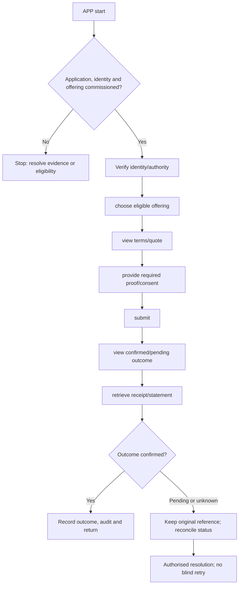

**Proposed application. New-project implementation has not started.**

## Users and responsibility

Verified individual; joint holder; business signatory; permitted cardholder. Business and joint-account mandates are server-enforced. Customer login does not authorise every linked product action. Display authoritative balance/as-of state and unavailable services honestly.

## Required workspaces and features

1. Product discovery and approved onboarding.
2. Own accounts, deposits, loans and cards.
3. Payments, card controls and loan/deposit servicing.
4. Statements, agreements, consents and secure documents.
5. Service requests, disputes, notices and security.

Each workspace needs list/search/filter → detail → permitted action → result → return. Include loading, empty, invalid-input, permission-denied, outage, stale-conflict and unknown-result states. Administrative and financial write actions must be distinguished.

## Application flow diagram

## Complete representative journey

Verify identity/authority → choose eligible offering → view terms/quote → provide required proof/consent → submit → view confirmed/pending outcome → retrieve receipt/statement.

Record the institution, programme/product version, actor/duty, request/operation reference, business date and authoritative outcome. Mobile/ATM channels need equivalent status semantics without copying web-specific navigation or cookie assumptions.

## Difficult cases

Joint mandate needs another signer; customer loses account authority; card blocked while detail open; disclosure version changes before acceptance.

Test successful actions and server denials independently. Closing the screen or cancelling a network request does not reverse a financial operation. Verify original operation status before offering a new instruction.

## Module dependencies and readiness

Relevant module IDs: B04–B09, B11–B22, B27–B30, B32. Select only the institution's permitted subset from the [module register](/banking/module-register). All product policy and permissions stay in shared services. A channel cannot widen limits or convert stored test data into executed banking.

Prove tenant isolation, exact calculations, concurrent access, idempotency, source outages, audit redaction and recovery. Confirm keyboard/accessibility for web clients and certified-device usability for ATM. Do not call this application deployable until its [release gates](/banking/delivery-plan) pass.

## Decisions before implementation

Agree the named user duties, first-release features, deployment boundary and external contracts for this application. ATM hardware and mobile security need their own contract packets. Follow the [decision order](/banking/decisions); no UI or service code is authorised by this proposed document.
