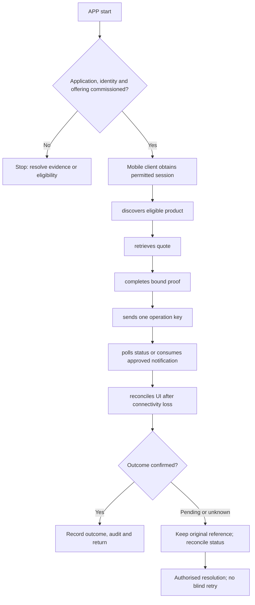

**Proposed application. New-project implementation has not started.**

## Users and responsibility

Client mobile team; verified customer; bank API operators. No native app implementation is included in this documentation task. Authentication protocol, device binding, attestation, deep links and proof contracts require explicit security design; never put static server/provider secrets into a client.

## Required workspaces and features

1. Institution/product discovery with safe public/private separation.
2. Enrollment, proof, token/session/device lifecycle and recovery contracts.
3. Account/card/loan reads with cursor and freshness semantics.
4. Quote, instruction, status, cancellation-eligibility and idempotency.
5. Secure downloads, notifications and version/deprecation support.

Each workspace needs list/search/filter → detail → permitted action → result → return. Include loading, empty, invalid-input, permission-denied, outage, stale-conflict and unknown-result states. Administrative and financial write actions must be distinguished.

## Application flow diagram

## Complete representative journey

Mobile client obtains permitted session → discovers eligible product → retrieves quote → completes bound proof → sends one operation key → polls status or consumes approved notification → reconciles UI after connectivity loss.

Record the institution, programme/product version, actor/duty, request/operation reference, business date and authoritative outcome. Mobile/ATM channels need equivalent status semantics without copying web-specific navigation or cookie assumptions.

## Difficult cases

App reinstall; stolen device; duplicate retry offline; stale quote; background refresh cannot extend sensitive authority; compromised callback.

Test successful actions and server denials independently. Closing the screen or cancelling a network request does not reverse a financial operation. Verify original operation status before offering a new instruction.

## Module dependencies and readiness

Relevant module IDs: B02, B04–B09, B11–B22, B27–B30, B32. Select only the institution's permitted subset from the [module register](/banking/module-register). All product policy and permissions stay in shared services. A channel cannot widen limits or convert stored test data into executed banking.

Prove tenant isolation, exact calculations, concurrent access, idempotency, source outages, audit redaction and recovery. Confirm keyboard/accessibility for web clients and certified-device usability for ATM. Do not call this application deployable until its [release gates](/banking/delivery-plan) pass.

## Decisions before implementation

Agree the named user duties, first-release features, deployment boundary and external contracts for this application. ATM hardware and mobile security need their own contract packets. Follow the [decision order](/banking/decisions); no UI or service code is authorised by this proposed document.
