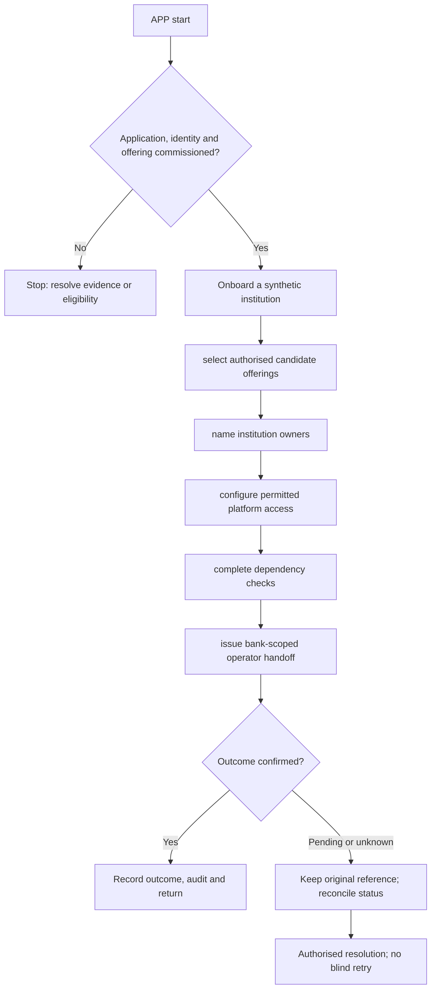

**Proposed application. New-project implementation has not started.**

## Users and responsibility

Platform operator; institution onboarding operator; commissioned access approver. Super Admin is a platform function. Institution financial operations and customer data remain separately scoped and require an explicit, auditable support-access policy if ever granted.

## Required workspaces and features

1. Institution registry, licence evidence and module entitlements.
2. Deployment/environment and health inventory.
3. Programme/provider contract references and commissioning checklists.
4. Platform operator lifecycle and bank assignments.
5. Security/operations overview with redacted metadata.

Each workspace needs list/search/filter → detail → permitted action → result → return. Include loading, empty, invalid-input, permission-denied, outage, stale-conflict and unknown-result states. Administrative and financial write actions must be distinguished.

## Application flow diagram

## Complete representative journey

Onboard a synthetic institution → select authorised candidate offerings → name institution owners → configure permitted platform access → complete dependency checks → issue bank-scoped operator handoff.

Record the institution, programme/product version, actor/duty, request/operation reference, business date and authoritative outcome. Mobile/ATM channels need equivalent status semantics without copying web-specific navigation or cookie assumptions.

## Difficult cases

Bank scope revoked during work; operator tries own approval; institution feature enabled without evidence; last authorised operator removed.

Test successful actions and server denials independently. Closing the screen or cancelling a network request does not reverse a financial operation. Verify original operation status before offering a new instruction.

## Module dependencies and readiness

Relevant module IDs: B01, B02, B03, B30, B32. Select only the institution's permitted subset from the [module register](/banking/module-register). All product policy and permissions stay in shared services. A channel cannot widen limits or convert stored test data into executed banking.

Prove tenant isolation, exact calculations, concurrent access, idempotency, source outages, audit redaction and recovery. Confirm keyboard/accessibility for web clients and certified-device usability for ATM. Do not call this application deployable until its [release gates](/banking/delivery-plan) pass.

## Decisions before implementation

Agree the named user duties, first-release features, deployment boundary and external contracts for this application. ATM hardware and mobile security need their own contract packets. Follow the [decision order](/banking/decisions); no UI or service code is authorised by this proposed document.
