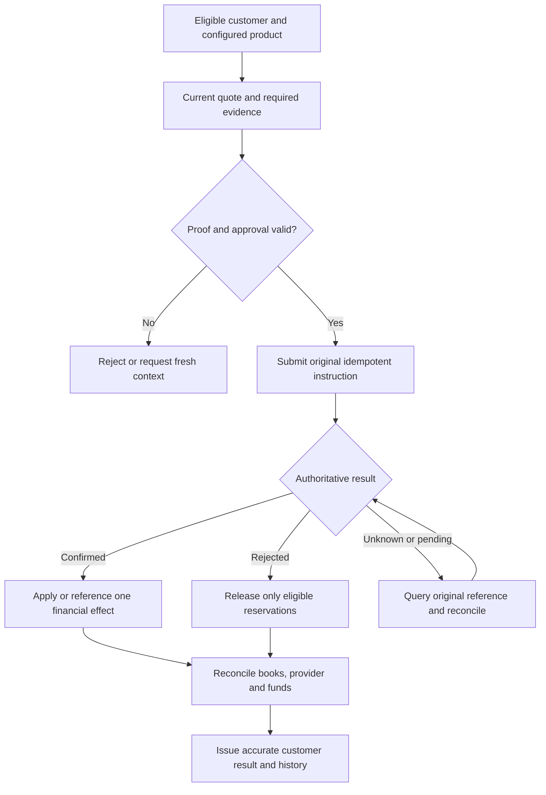

## Shared outcome model

A draft, submitted request, approved instruction, accepted provider message, confirmed financial effect and reconciled settlement are different facts. Product-specific state machines must define their allowed transitions. “Unknown” means the outcome is not established; it is not a safe failure to retry.

This is a proposed financial pattern. Individual modules define the actual states, cancellation eligibility and finality. Administrative saves do not need a financial posting.

| Journey | Modules | Start to finish | Evidence required |
| --- | --- | --- | --- |
| J01 Institution launch | B01–B03, B30, B32 | Legal capability → products/duties → contracts → certification → controlled release | Authorised institution, owners, dependency and release record |
| J02 Customer/account opening | B04–B08, B26, B28 | Consent/evidence → KYC → mandate/terms → account/funding → statement | Verified relationships and authoritative account/book |
| J03 Cash withdrawal | B06–B08, B10, B24 | Proof/funds → approved debit/custody → cash handover → till close | One debit, physical cash and receipt reconcile |
| J04 Deposit maturity | B03, B07, B09, B24, B31 | Placement → accrue/payout → maturity/renewal → reconcile | Exact terms, certificate and linked postings |
| J05 Payment | B06–B07, B11, B24, B30 | Payee/quote/proof → instruction → status/return → settle | Original reference, finality and reconciled funds |
| J06 Loan | B04–B07, B11–B16, B28 | Apply/sanction → accept → disburse → repay → close/release | Lender agreement, schedule, allocation and loan book |
| J07 Debit card | B06–B08, B17–B18, B21–B24 | Issue/activate → hold → clear → reconcile/refund | Card/account and network/book linkage |
| J08 Prepaid | B07, B17, B19, B21–B24 | Verify/load → spend → refund/redeem → safeguarding match | Permitted funding and stored-value liability |
| J09 Credit card | B07, B13, B16–B17, B20–B22, B24 | Underwrite → issue → spend → bill → repay/collect → close | Receivable, statement, allocation and issuer records |
| J10 ATM exception | B07, B10, B18–B24, B27 | Authorise → dispense fault → evidence → resolve debit → notify | Switch, dispenser, journal and confirmed adjustment |
| J11 Business-day close | B07–B11, B14, B20, B24, B29, B31 | Validate inputs → jobs → exceptions → totals → sign-off/date advance | Checkpoints, exact totals and repeat-safe jobs |
| J12 Incident recovery | B02, B24, B30, B32 | Contain → restore → reconcile in-flight outcomes → reauthorise service | Recovery objectives, books, audit and original operations |
| J13 Cheque service | B06–B07, B24, B28, B33–B34 | Book/instrument → present/stop → paid/returned → reconcile | Instrument, mandate and clearing finality |
| J14 Customer digital recovery | B05–B06, B28, B32, B35 | Verify evidence → revoke old authority → fresh enrollment → scoped access | Approved identity/recovery and notice evidence |
| J15 Financial approval | B02–B03, B07, B34 | Intent/quote → independent decision → capacity → execute/status | Exact intent, current authority and one financial effect |

## Mandatory journey checks

For each selected offering/channel: positive success; permission/tenant denial; invalid/stale evidence; duplicate/concurrent command; provider timeout; delayed/duplicate/out-of-order callback; linked reversal; financial/audit atomicity; documents/notices; statement/reconciliation; operational recovery.

The bank decides maker/checker thresholds and emergency authority. No self-approval exception, automatic recovery bypass or financial retry is invented. Use module-specific examples and [scenario coverage](/banking/scenario-matrix) to form acceptance cases.
