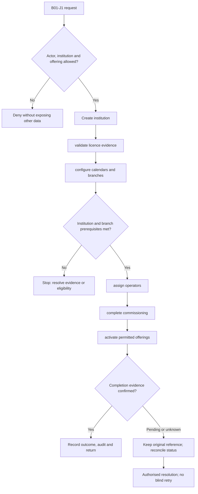
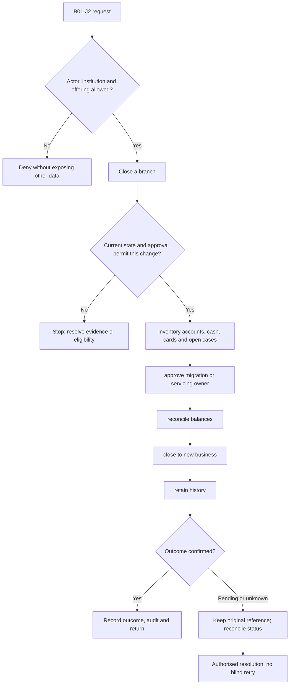

**Review draft • 13 October 2026 • New Banking project • Implementation not started.**

## Purpose and ownership

Operate separate legal institutions, regions, branches and service locations without sharing their customers or books.

Proposed operating roles: Bank operations administrator; branch manager; platform operator. These titles describe duties for review; they do not grant permissions. The bank or authorised regulated entity owns product policy and financial outcomes. Platform operators receive no automatic customer-data, fund-movement or issuer authority.

## Worked Indian example

**Fictional requirements illustration, not seeded data or approved banking policy.** Reference: DEMOBANK / Mumbai Main → Pune Service.

| Stage | Example |
| --- | --- |
| Starting situation | The bank proposes a new Pune service branch while Mumbai remains the servicing owner. |
| Operator/customer actions | An authorised administrator creates Pune as Draft, assigns a proposed manager and routes the record for commissioning. Approval must check unresolved cash, accounts and work before any later closure. |
| Expected normal outcome | Draft → commissioned Active only after accepted checks; existing Mumbai cases retain their recorded owner until an approved transfer. |
| Failure or alternate outcome | Closing Mumbai with open cash custody is blocked; no records disappear. |

No real customer, regulator approval, provider connection or bank operation is asserted. Illustrative amounts have currency INR and scale 2; actual economics/authority must be supplied by the institution.

## Module flow diagrams

These are proposed requirements flows. The detailed policy and contracts still need owner confirmation.

### Flow 1: B01 primary journey

### Flow 2: B01 alternate servicing and recovery journey

## Required features

| Feature | Required behaviour |
| --- | --- |
| B01-F1 | Tenant onboarding with legal-entity ownership and permitted offering selection. The final field schema, permitted actions and acceptance evidence must be approved for each enabled offering. |
| B01-F2 | Region, branch, service-point and cost-centre directories. The final field schema, permitted actions and acceptance evidence must be approved for each enabled offering. |
| B01-F3 | Branch open, suspend, resume and closure workflows with outstanding-work checks. The final field schema, permitted actions and acceptance evidence must be approved for each enabled offering. |
| B01-F4 | Bank contacts, branding and service routing. The final field schema, permitted actions and acceptance evidence must be approved for each enabled offering. |
| B01-F5 | Configuration history, approval and rollback controls. The final field schema, permitted actions and acceptance evidence must be approved for each enabled offering. |

## Configuration to agree

Institution type and licence evidence; branch lifecycle and business calendar; jurisdiction and service routing; effective-dated organization hierarchy. Store approved values in versioned, effective-dated product/programme policy. Capture the exact configuration version used by an instruction. Missing mandatory configuration blocks the dependent action; enabling a menu cannot grant legal authority.

## End-to-end journey 1

Create institution → validate licence evidence → configure calendars and branches → assign operators → complete commissioning → activate permitted offerings.

The journey ends only when its authoritative result, customer/staff-visible result and related book or case history agree. A saved request, queue entry or HTTP acknowledgement is an intermediate state.

## End-to-end journey 2

Close a branch → inventory accounts, cash, cards and open cases → approve migration or servicing owner → reconcile balances → close to new business → retain history.

Every transition needs an authorised actor, original version and recorded reason where required. Cancellation or client disconnection does not prove server rollback. Financial corrections retain their original reference and use linked reversal/adjustment entries rather than deleting history.

## Interfaces and data dependencies

Legal entity and branch IDs; lifecycle events; authoritative outstanding-work and account-ownership contracts. Agree stable institution, product, party and operation references; source version; as-of time; completeness; status/finality; retry rules and correction handling. Where no financial posting occurs, record the administrative/case outcome instead of inventing a journal.

All channel requests use server-verified identity and institution scope. Partner, branch and customer access is narrower than institution membership. Lists, details, search, exports, callbacks and files must enforce the same boundary.

## Current implementation and reuse

**New Banking project: proposed, not built.** Existing M01 has bounded branch creation/editing/activation, Help contacts and routing; no complete closure or commissioning.

Reviewed legacy feature boundaries: `banks`, `organization`, `staff-administration`. See the source inventory on the [gap page](/banking/current-system-gap). Legacy feature presence is a reuse candidate, not acceptance or deployment evidence for this module.

## Acceptance and difficult cases

Explicit cases: Foreign-bank branch access; closure with outstanding cash; stale hierarchy change; suspended institution.

- Allowed success: confirm saved/output values, authoritative status and the exact approved actor/channel.
- Denial: reject foreign institution, unauthorised branch/customer/programme and revoked or expired access without information leakage.
- Reliability: prove stale-version rejection and concurrency behaviour; retryable commands apply one economic effect; unknown financial outcomes are reconciled by original reference.
- Records and usability: preserve redacted audit, monetary precision and document integrity; verify keyboard/mobile, direct links, expired sessions, Back/Forward and return navigation. Internal web navigation preserves its workspace.

Apply the [scenario matrix](/banking/scenario-matrix) and the [shared journey rules](/banking/journeys). Timing, amounts and regulatory applicability are institution-owned inputs, not defaults supplied by this document.

## Pending decision

Who may approve each lifecycle transition, and which dependencies prevent closure?

The [decision register](/banking/decisions) keeps sequencing separate from approval. No implementation begins because this page describes a proposed capability.

[Module register](/banking/module-register) · [Offering compatibility](/banking/offering-matrix)
