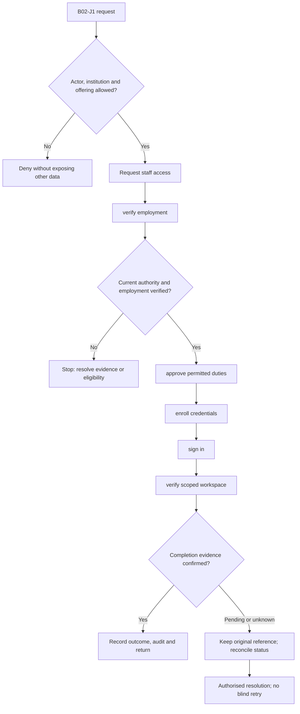
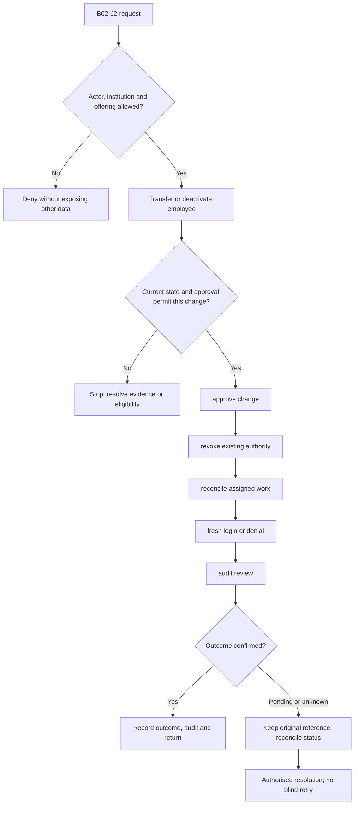

**Review draft • 13 October 2026 • New Banking project • Implementation not started.**

## Purpose and ownership

Give bank employees the exact duties they need and remove access when those duties end.

Proposed operating roles: Security administrator; Bank Admin; access approver; employee. These titles describe duties for review; they do not grant permissions. The bank or authorised regulated entity owns product policy and financial outcomes. Platform operators receive no automatic customer-data, fund-movement or issuer authority.

## Worked Indian example

**Fictional requirements illustration, not seeded data or approved banking policy.** Reference: EMP-001 / Mumbai Main → Pune Service.

| Stage | Example |
| --- | --- |
| Starting situation | A Branch employee currently assigned to Mumbai transfers to Pune. |
| Operator/customer actions | The authorised access administrator submits the current membership version. Approval, if required by the adopted policy, applies the new scope and revokes prior sessions. |
| Expected normal outcome | The old session is denied; a new sign-in sees Pune only. Security history records the approved change. |
| Failure or alternate outcome | Changing the request to Bank Admin or a branch in DEMONBFC is denied. |

No real customer, regulator approval, provider connection or bank operation is asserted. Illustrative amounts have currency INR and scale 2; actual economics/authority must be supplied by the institution.

## Module flow diagrams

These are proposed requirements flows. The detailed policy and contracts still need owner confirmation.

### Flow 1: B02 primary journey

### Flow 2: B02 alternate servicing and recovery journey

## Required features

| Feature | Required behaviour |
| --- | --- |
| B02-F1 | Staff employment evidence and identity lifecycle. The final field schema, permitted actions and acceptance evidence must be approved for each enabled offering. |
| B02-F2 | Role, branch and duty assignments with effective dates. The final field schema, permitted actions and acceptance evidence must be approved for each enabled offering. |
| B02-F3 | Invitation, password and authenticator enrollment. The final field schema, permitted actions and acceptance evidence must be approved for each enabled offering. |
| B02-F4 | Current-session inspection, revocation and access review. The final field schema, permitted actions and acceptance evidence must be approved for each enabled offering. |
| B02-F5 | Independent privileged-access approval and verified recovery. The final field schema, permitted actions and acceptance evidence must be approved for each enabled offering. |

## Configuration to agree

Role/action/resource policy; branch scope; privileged access; maker-checker separation; factor and recovery policy. Store approved values in versioned, effective-dated product/programme policy. Capture the exact configuration version used by an instruction. Missing mandatory configuration blocks the dependent action; enabling a menu cannot grant legal authority.

## End-to-end journey 1

Request staff access → verify employment → approve permitted duties → enroll credentials → sign in → verify scoped workspace.

The journey ends only when its authoritative result, customer/staff-visible result and related book or case history agree. A saved request, queue entry or HTTP acknowledgement is an intermediate state.

## End-to-end journey 2

Transfer or deactivate employee → approve change → revoke existing authority → reconcile assigned work → fresh login or denial → audit review.

Every transition needs an authorised actor, original version and recorded reason where required. Cancellation or client disconnection does not prove server rollback. Financial corrections retain their original reference and use linked reversal/adjustment entries rather than deleting history.

## Interfaces and data dependencies

Verified workforce identity; approval evidence; session/factor versions; security notices. Agree stable institution, product, party and operation references; source version; as-of time; completeness; status/finality; retry rules and correction handling. Where no financial posting occurs, record the administrative/case outcome instead of inventing a journal.

All channel requests use server-verified identity and institution scope. Partner, branch and customer access is narrower than institution membership. Lists, details, search, exports, callbacks and files must enforce the same boundary.

## Current implementation and reuse

**New Banking project: proposed, not built.** Existing M02 supports operational staff, password invitations, scope changes, revocation and a partial WebAuthn path. Real commissioning/recovery remain gaps.

Reviewed legacy feature boundaries: `staff`, `staff-auth`, `staff-access-requests`, `staff-sessions`. See the source inventory on the [gap page](/banking/current-system-gap). Legacy feature presence is a reuse candidate, not acceptance or deployment evidence for this module.

## Acceptance and difficult cases

Explicit cases: Self-approval; role escalation; stale session after transfer; two recovery officers not independent.

- Allowed success: confirm saved/output values, authoritative status and the exact approved actor/channel.
- Denial: reject foreign institution, unauthorised branch/customer/programme and revoked or expired access without information leakage.
- Reliability: prove stale-version rejection and concurrency behaviour; retryable commands apply one economic effect; unknown financial outcomes are reconciled by original reference.
- Records and usability: preserve redacted audit, monetary precision and document integrity; verify keyboard/mobile, direct links, expired sessions, Back/Forward and return navigation. Internal web navigation preserves its workspace.

Apply the [scenario matrix](/banking/scenario-matrix) and the [shared journey rules](/banking/journeys). Timing, amounts and regulatory applicability are institution-owned inputs, not defaults supplied by this document.

## Pending decision

Which roles may request, approve, review and recover access, and who owns commissioning?

The [decision register](/banking/decisions) keeps sequencing separate from approval. No implementation begins because this page describes a proposed capability.

[Module register](/banking/module-register) · [Offering compatibility](/banking/offering-matrix)
