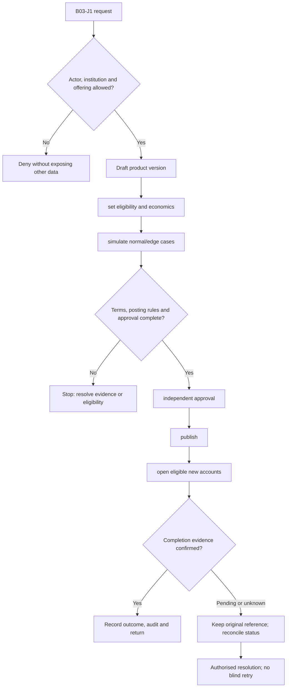
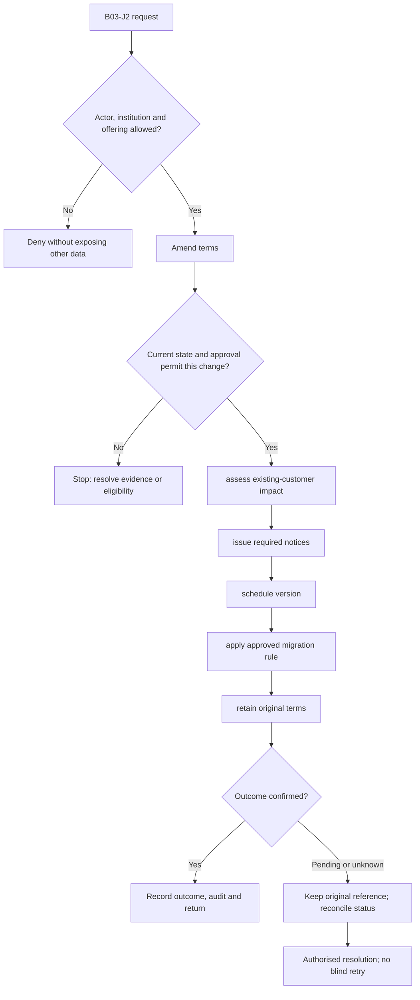

**Review draft • 13 October 2026 • New Banking project • Implementation not started.**

## Purpose and ownership

Define reusable financial products and institution programmes, then publish controlled versions to eligible channels.

Proposed operating roles: Product manager; finance; risk; compliance; product approver. These titles describe duties for review; they do not grant permissions. The bank or authorised regulated entity owns product policy and financial outcomes. Platform operators receive no automatic customer-data, fund-movement or issuer authority.

## Worked Indian example

**Fictional requirements illustration, not seeded data or approved banking policy.** Reference: SAVINGS-DEMO v1 → v2.

| Stage | Example |
| --- | --- |
| Starting situation | A product manager proposes changing the fee schedule for new accounts next month. |
| Operator/customer actions | The manager creates v2, attaches approved pricing/disclosure/posting rules and simulates boundary cases. An authorised independent approver schedules publication. |
| Expected normal outcome | New accounts after the effective boundary use v2; existing v1 agreements keep their terms unless a separately approved migration applies. |
| Failure or alternate outcome | A draft/unapproved fee cannot become effective; publication with missing posting rules is blocked. |

No real customer, regulator approval, provider connection or bank operation is asserted. Illustrative amounts have currency INR and scale 2; actual economics/authority must be supplied by the institution.

## Module flow diagrams

These are proposed requirements flows. The detailed policy and contracts still need owner confirmation.

### Flow 1: B03 primary journey

### Flow 2: B03 alternate servicing and recovery journey

## Required features

| Feature | Required behaviour |
| --- | --- |
| B03-F1 | Product catalogue and configurable parameter schemas. The final field schema, permitted actions and acceptance evidence must be approved for each enabled offering. |
| B03-F2 | Programme ownership, issuer/sponsor and processor assignments. The final field schema, permitted actions and acceptance evidence must be approved for each enabled offering. |
| B03-F3 | Versioned pricing, rate, charge and disclosure packages. The final field schema, permitted actions and acceptance evidence must be approved for each enabled offering. |
| B03-F4 | Approval, simulation, publication and scheduled effective dates. The final field schema, permitted actions and acceptance evidence must be approved for each enabled offering. |
| B03-F5 | Eligibility validation, dependency checks and safe withdrawal. The final field schema, permitted actions and acceptance evidence must be approved for each enabled offering. |

## Configuration to agree

Institution → programme → product version → account terms; eligibility; fees; tax; limits; calendars; posting templates. Store approved values in versioned, effective-dated product/programme policy. Capture the exact configuration version used by an instruction. Missing mandatory configuration blocks the dependent action; enabling a menu cannot grant legal authority.

## End-to-end journey 1

Draft product version → set eligibility and economics → simulate normal/edge cases → independent approval → publish → open eligible new accounts.

The journey ends only when its authoritative result, customer/staff-visible result and related book or case history agree. A saved request, queue entry or HTTP acknowledgement is an intermediate state.

## End-to-end journey 2

Amend terms → assess existing-customer impact → issue required notices → schedule version → apply approved migration rule → retain original terms.

Every transition needs an authorised actor, original version and recorded reason where required. Cancellation or client disconnection does not prove server rollback. Financial corrections retain their original reference and use linked reversal/adjustment entries rather than deleting history.

## Interfaces and data dependencies

Approved commercial terms; versioned calculations; consent/disclosure templates; product-to-ledger mappings. Agree stable institution, product, party and operation references; source version; as-of time; completeness; status/finality; retry rules and correction handling. Where no financial posting occurs, record the administrative/case outcome instead of inventing a journal.

All channel requests use server-verified identity and institution scope. Partner, branch and customer access is narrower than institution membership. Lists, details, search, exports, callbacks and files must enforce the same boundary.

## Current implementation and reuse

**New Banking project: proposed, not built.** Existing catalogue assignment and saved currency controls are foundations; no governed financial product engine.

Reviewed legacy feature boundaries: `platform-configuration`, `bank-governance`, `transaction-controls`. See the source inventory on the [gap page](/banking/current-system-gap). Legacy feature presence is a reuse candidate, not acceptance or deployment evidence for this module.

## Acceptance and difficult cases

Explicit cases: Unapproved rate activation; retroactive version change; ineligible NBFC deposit product; programme cross-tenant leak.

- Allowed success: confirm saved/output values, authoritative status and the exact approved actor/channel.
- Denial: reject foreign institution, unauthorised branch/customer/programme and revoked or expired access without information leakage.
- Reliability: prove stale-version rejection and concurrency behaviour; retryable commands apply one economic effect; unknown financial outcomes are reconciled by original reference.
- Records and usability: preserve redacted audit, monetary precision and document integrity; verify keyboard/mobile, direct links, expired sessions, Back/Forward and return navigation. Internal web navigation preserves its workspace.

Apply the [scenario matrix](/banking/scenario-matrix) and the [shared journey rules](/banking/journeys). Timing, amounts and regulatory applicability are institution-owned inputs, not defaults supplied by this document.

## Pending decision

Who approves commercial terms, and do changes affect new accounts only or existing agreements?

The [decision register](/banking/decisions) keeps sequencing separate from approval. No implementation begins because this page describes a proposed capability.

[Module register](/banking/module-register) · [Offering compatibility](/banking/offering-matrix)
