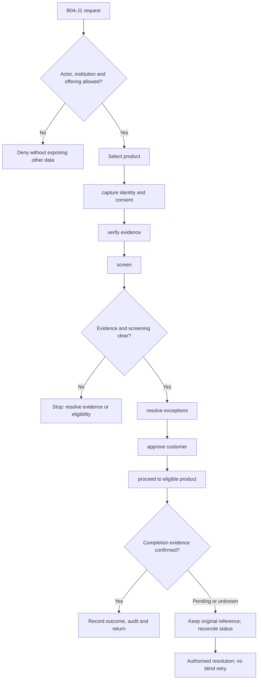
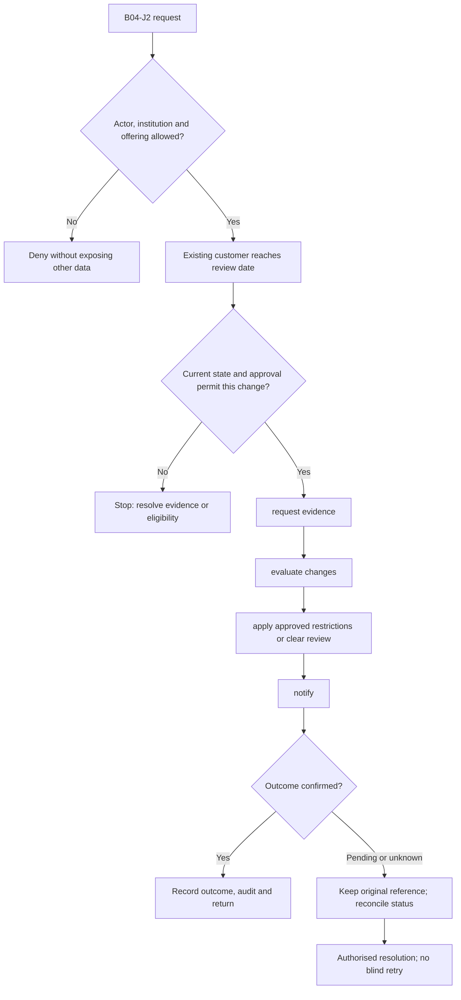

**Review draft • 13 October 2026 • New Banking project • Implementation not started.**

## Purpose and ownership

Create verified individual and business customers before opening regulated products.

Proposed operating roles: Customer; assisted-onboarding officer; KYC reviewer; compliance officer. These titles describe duties for review; they do not grant permissions. The bank or authorised regulated entity owns product policy and financial outcomes. Platform operators receive no automatic customer-data, fund-movement or issuer authority.

## Worked Indian example

**Fictional requirements illustration, not seeded data or approved banking policy.** Reference: CUSTOMER-001 / individual savings application.

| Stage | Example |
| --- | --- |
| Starting situation | An individual requests a DEMOBANK savings account through Customer Web. |
| Operator/customer actions | Capture consent and permitted evidence, verify identity/address, screen against the bank policy, resolve any match and record the authorised KYC decision. |
| Expected normal outcome | A verified party reference is issued only after approval; rejection/pendency is explained without claiming an opened account. |
| Failure or alternate outcome | Expired evidence or an unresolved sanctions match prevents product opening. |

No real customer, regulator approval, provider connection or bank operation is asserted. Illustrative amounts have currency INR and scale 2; actual economics/authority must be supplied by the institution.

## Module flow diagrams

These are proposed requirements flows. The detailed policy and contracts still need owner confirmation.

### Flow 1: B04 primary journey

### Flow 2: B04 alternate servicing and recovery journey

## Required features

| Feature | Required behaviour |
| --- | --- |
| B04-F1 | Individual, minor, joint and business onboarding journeys. The final field schema, permitted actions and acceptance evidence must be approved for each enabled offering. |
| B04-F2 | Identity/address evidence and duplicate detection. The final field schema, permitted actions and acceptance evidence must be approved for each enabled offering. |
| B04-F3 | Business ownership, authorised signatory and beneficial-owner capture. The final field schema, permitted actions and acceptance evidence must be approved for each enabled offering. |
| B04-F4 | Screening, exception review and rejection reasons. The final field schema, permitted actions and acceptance evidence must be approved for each enabled offering. |
| B04-F5 | Periodic review, evidence expiry and consent history. The final field schema, permitted actions and acceptance evidence must be approved for each enabled offering. |

## Configuration to agree

Customer type; identity evidence; beneficial owners; risk tier; consent; re-KYC; supported verification methods. Store approved values in versioned, effective-dated product/programme policy. Capture the exact configuration version used by an instruction. Missing mandatory configuration blocks the dependent action; enabling a menu cannot grant legal authority.

## End-to-end journey 1

Select product → capture identity and consent → verify evidence → screen → resolve exceptions → approve customer → proceed to eligible product.

The journey ends only when its authoritative result, customer/staff-visible result and related book or case history agree. A saved request, queue entry or HTTP acknowledgement is an intermediate state.

## End-to-end journey 2

Existing customer reaches review date → request evidence → evaluate changes → apply approved restrictions or clear review → notify.

Every transition needs an authorised actor, original version and recorded reason where required. Cancellation or client disconnection does not prove server rollback. Financial corrections retain their original reference and use linked reversal/adjustment entries rather than deleting history.

## Interfaces and data dependencies

Bank-approved KYC policy; verification and screening interfaces; consent/evidence storage contracts. Agree stable institution, product, party and operation references; source version; as-of time; completeness; status/finality; retry rules and correction handling. Where no financial posting occurs, record the administrative/case outcome instead of inventing a journal.

All channel requests use server-verified identity and institution scope. Partner, branch and customer access is narrower than institution membership. Lists, details, search, exports, callbacks and files must enforce the same boundary.

## Current implementation and reuse

**New Banking project: proposed, not built.** No operational KYC module exists in the current repository; synthetic identities are not verified customers.

Reviewed legacy feature boundaries: `consumer-access`, `consumer-account-links (synthetic foundations only)`. See the source inventory on the [gap page](/banking/current-system-gap). Legacy feature presence is a reuse candidate, not acceptance or deployment evidence for this module.

## Acceptance and difficult cases

Explicit cases: Expired evidence; duplicate person; mismatched PAN data; sanctions match; joint signer lacks authority.

- Allowed success: confirm saved/output values, authoritative status and the exact approved actor/channel.
- Denial: reject foreign institution, unauthorised branch/customer/programme and revoked or expired access without information leakage.
- Reliability: prove stale-version rejection and concurrency behaviour; retryable commands apply one economic effect; unknown financial outcomes are reconciled by original reference.
- Records and usability: preserve redacted audit, monetary precision and document integrity; verify keyboard/mobile, direct links, expired sessions, Back/Forward and return navigation. Internal web navigation preserves its workspace.

Apply the [scenario matrix](/banking/scenario-matrix) and the [shared journey rules](/banking/journeys). Timing, amounts and regulatory applicability are institution-owned inputs, not defaults supplied by this document.

## Pending decision

Which customer types and verification methods belong in the first institution release?

The [decision register](/banking/decisions) keeps sequencing separate from approval. No implementation begins because this page describes a proposed capability.

[Module register](/banking/module-register) · [Offering compatibility](/banking/offering-matrix)
