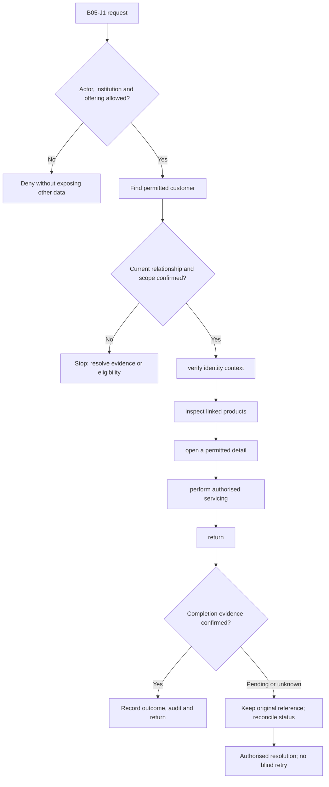
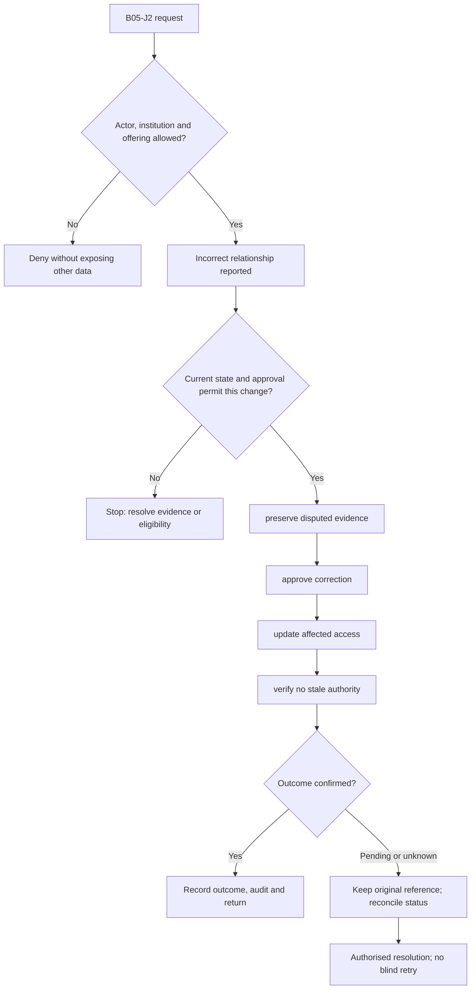

**Review draft • 13 October 2026 • New Banking project • Implementation not started.**

## Purpose and ownership

Show a verified, scoped relationship between parties, accounts, cards, loans and servicing branches.

Proposed operating roles: Relationship manager; branch officer; customer service. These titles describe duties for review; they do not grant permissions. The bank or authorised regulated entity owns product policy and financial outcomes. Platform operators receive no automatic customer-data, fund-movement or issuer authority.

## Worked Indian example

**Fictional requirements illustration, not seeded data or approved banking policy.** Reference: CUSTOMER-001 / ACC-001 and CARD-001.

| Stage | Example |
| --- | --- |
| Starting situation | A Mumbai officer searches an exact bank-issued customer reference. |
| Operator/customer actions | The server resolves the reference inside DEMOBANK, checks current branch/relationship authority and returns only permitted product links with as-of information. |
| Expected normal outcome | The officer opens ACC-001 only if the relationship and scope are current. DEMONBFC's matching reference is not returned. |
| Failure or alternate outcome | A removed or incomplete relationship cannot be treated as current authority. |

No real customer, regulator approval, provider connection or bank operation is asserted. Illustrative amounts have currency INR and scale 2; actual economics/authority must be supplied by the institution.

## Module flow diagrams

These are proposed requirements flows. The detailed policy and contracts still need owner confirmation.

### Flow 1: B05 primary journey

### Flow 2: B05 alternate servicing and recovery journey

## Required features

| Feature | Required behaviour |
| --- | --- |
| B05-F1 | Exact customer search and authorised identity matching. The final field schema, permitted actions and acceptance evidence must be approved for each enabled offering. |
| B05-F2 | Customer-to-account/card/loan relationships. The final field schema, permitted actions and acceptance evidence must be approved for each enabled offering. |
| B05-F3 | Joint holders, nominees, guardians and business signatories. The final field schema, permitted actions and acceptance evidence must be approved for each enabled offering. |
| B05-F4 | Consolidated holdings with source/as-of labels. The final field schema, permitted actions and acceptance evidence must be approved for each enabled offering. |
| B05-F5 | Controlled corrections, merges and relationship history. The final field schema, permitted actions and acceptance evidence must be approved for each enabled offering. |

## Configuration to agree

Party/account relationships; signatory mandates; branch scope; masking; freshness; legal restrictions. Store approved values in versioned, effective-dated product/programme policy. Capture the exact configuration version used by an instruction. Missing mandatory configuration blocks the dependent action; enabling a menu cannot grant legal authority.

## End-to-end journey 1

Find permitted customer → verify identity context → inspect linked products → open a permitted detail → perform authorised servicing → return.

The journey ends only when its authoritative result, customer/staff-visible result and related book or case history agree. A saved request, queue entry or HTTP acknowledgement is an intermediate state.

## End-to-end journey 2

Incorrect relationship reported → preserve disputed evidence → approve correction → update affected access → verify no stale authority.

Every transition needs an authorised actor, original version and recorded reason where required. Cancellation or client disconnection does not prove server rollback. Financial corrections retain their original reference and use linked reversal/adjustment entries rather than deleting history.

## Interfaces and data dependencies

Stable party namespace; complete relationship graph; correction order; no-match/freshness semantics. Agree stable institution, product, party and operation references; source version; as-of time; completeness; status/finality; retry rules and correction handling. Where no financial posting occurs, record the administrative/case outcome instead of inventing a journal.

All channel requests use server-verified identity and institution scope. Partner, branch and customer access is narrower than institution membership. Lists, details, search, exports, callbacks and files must enforce the same boundary.

## Current implementation and reuse

**New Banking project: proposed, not built.** Existing account snapshots/scoped enquiry are partial. The approved minimal customer lookup lacks its authoritative read contract.

Reviewed legacy feature boundaries: `staff-enquiry`, `account-snapshots`, `source-mappings`. See the source inventory on the [gap page](/banking/current-system-gap). Legacy feature presence is a reuse candidate, not acceptance or deployment evidence for this module.

## Acceptance and difficult cases

Explicit cases: Same reference in two banks; removed relationship; stale source; incomplete linked-account page.

- Allowed success: confirm saved/output values, authoritative status and the exact approved actor/channel.
- Denial: reject foreign institution, unauthorised branch/customer/programme and revoked or expired access without information leakage.
- Reliability: prove stale-version rejection and concurrency behaviour; retryable commands apply one economic effect; unknown financial outcomes are reconciled by original reference.
- Records and usability: preserve redacted audit, monetary precision and document integrity; verify keyboard/mobile, direct links, expired sessions, Back/Forward and return navigation. Internal web navigation preserves its workspace.

Apply the [scenario matrix](/banking/scenario-matrix) and the [shared journey rules](/banking/journeys). Timing, amounts and regulatory applicability are institution-owned inputs, not defaults supplied by this document.

## Pending decision

Which system owns party identifiers and the complete relationship graph?

The [decision register](/banking/decisions) keeps sequencing separate from approval. No implementation begins because this page describes a proposed capability.

[Module register](/banking/module-register) · [Offering compatibility](/banking/offering-matrix)
