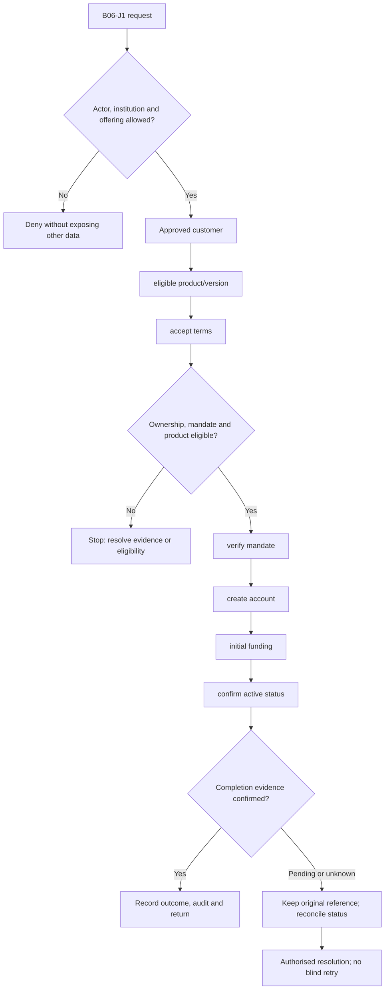
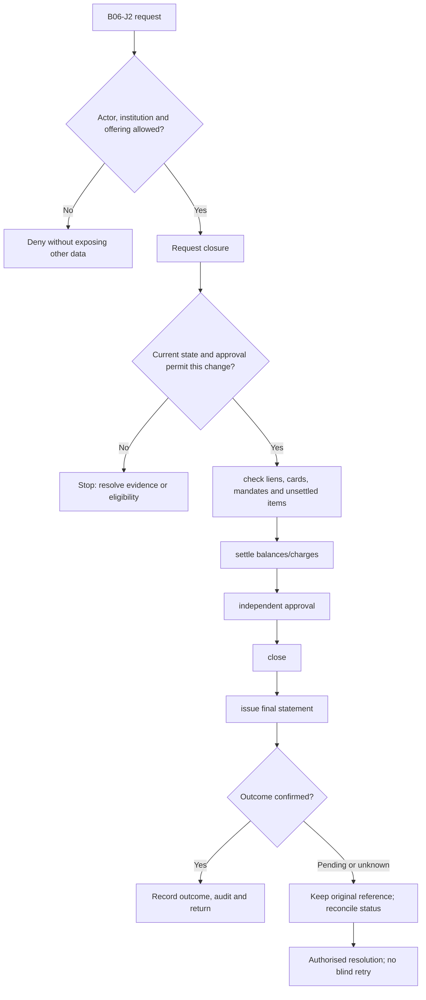

**Review draft • 13 October 2026 • New Banking project • Implementation not started.**

## Purpose and ownership

Open, operate, restrict and close an account with accurate ownership and authority.

Proposed operating roles: Account-opening officer; customer; operations approver. These titles describe duties for review; they do not grant permissions. The bank or authorised regulated entity owns product policy and financial outcomes. Platform operators receive no automatic customer-data, fund-movement or issuer authority.

## Worked Indian example

**Fictional requirements illustration, not seeded data or approved banking policy.** Reference: ACC-001 / joint savings mandate.

| Stage | Example |
| --- | --- |
| Starting situation | Two verified holders request an account requiring both holders for specified instructions. |
| Operator/customer actions | Capture holder/nominee roles, accepted product version and mandate. Complete required proof/approvals, open and fund using one instruction reference. |
| Expected normal outcome | The account book, mandate and customer view agree; a restricted instruction waits for the second required authorisation. |
| Failure or alternate outcome | One holder cannot close the account or remove another holder by bypassing the mandate. |

No real customer, regulator approval, provider connection or bank operation is asserted. Illustrative amounts have currency INR and scale 2; actual economics/authority must be supplied by the institution.

## Module flow diagrams

These are proposed requirements flows. The detailed policy and contracts still need owner confirmation.

### Flow 1: B06 primary journey

### Flow 2: B06 alternate servicing and recovery journey

## Required features

| Feature | Required behaviour |
| --- | --- |
| B06-F1 | Account opening and numbering. The final field schema, permitted actions and acceptance evidence must be approved for each enabled offering. |
| B06-F2 | Holder, nominee and mandate management. The final field schema, permitted actions and acceptance evidence must be approved for each enabled offering. |
| B06-F3 | Freeze, debit/credit restriction and dormancy handling. The final field schema, permitted actions and acceptance evidence must be approved for each enabled offering. |
| B06-F4 | Lien/hold creation and release with authority. The final field schema, permitted actions and acceptance evidence must be approved for each enabled offering. |
| B06-F5 | Closure, residual-balance handling and history retention. The final field schema, permitted actions and acceptance evidence must be approved for each enabled offering. |

## Configuration to agree

Account numbering; ownership types; signatory mandate; status transitions; lien/hold rules; closure checks. Store approved values in versioned, effective-dated product/programme policy. Capture the exact configuration version used by an instruction. Missing mandatory configuration blocks the dependent action; enabling a menu cannot grant legal authority.

## End-to-end journey 1

Approved customer → eligible product/version → accept terms → verify mandate → create account → initial funding → confirm active status.

The journey ends only when its authoritative result, customer/staff-visible result and related book or case history agree. A saved request, queue entry or HTTP acknowledgement is an intermediate state.

## End-to-end journey 2

Request closure → check liens, cards, mandates and unsettled items → settle balances/charges → independent approval → close → issue final statement.

Every transition needs an authorised actor, original version and recorded reason where required. Cancellation or client disconnection does not prove server rollback. Financial corrections retain their original reference and use linked reversal/adjustment entries rather than deleting history.

## Interfaces and data dependencies

Authoritative account state; ownership; holds; balance/closure quote; instruction/status contracts. Agree stable institution, product, party and operation references; source version; as-of time; completeness; status/finality; retry rules and correction handling. Where no financial posting occurs, record the administrative/case outcome instead of inventing a journal.

All channel requests use server-verified identity and institution scope. Partner, branch and customer access is narrower than institution membership. Lists, details, search, exports, callbacks and files must enforce the same boundary.

## Current implementation and reuse

**New Banking project: proposed, not built.** Current linked-account reads and snapshots do not open, freeze or close bank accounts.

Reviewed legacy feature boundaries: `consumer-accounts`, `consumer-account-links`, `account-snapshots`. See the source inventory on the [gap page](/banking/current-system-gap). Legacy feature presence is a reuse candidate, not acceptance or deployment evidence for this module.

## Acceptance and difficult cases

Explicit cases: Joint mandate failure; legal freeze; closure with unsettled card presentment; duplicate opening request.

- Allowed success: confirm saved/output values, authoritative status and the exact approved actor/channel.
- Denial: reject foreign institution, unauthorised branch/customer/programme and revoked or expired access without information leakage.
- Reliability: prove stale-version rejection and concurrency behaviour; retryable commands apply one economic effect; unknown financial outcomes are reconciled by original reference.
- Records and usability: preserve redacted audit, monetary precision and document integrity; verify keyboard/mobile, direct links, expired sessions, Back/Forward and return navigation. Internal web navigation preserves its workspace.

Apply the [scenario matrix](/banking/scenario-matrix) and the [shared journey rules](/banking/journeys). Timing, amounts and regulatory applicability are institution-owned inputs, not defaults supplied by this document.

## Pending decision

Will Banking own the account book or orchestrate an existing core banking system?

The [decision register](/banking/decisions) keeps sequencing separate from approval. No implementation begins because this page describes a proposed capability.

[Module register](/banking/module-register) · [Offering compatibility](/banking/offering-matrix)
