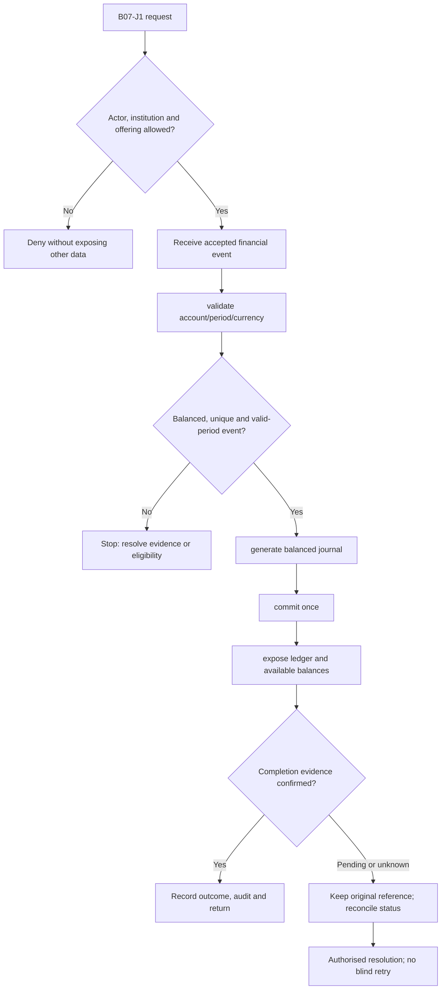
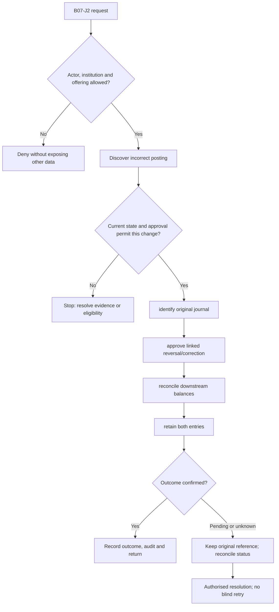

**Review draft • 13 October 2026 • New Banking project • Implementation not started.**

## Purpose and ownership

Maintain balanced, traceable books or integrate a clearly designated external system of record.

Proposed operating roles: Finance maker; finance checker; accountant; auditor. These titles describe duties for review; they do not grant permissions. The bank or authorised regulated entity owns product policy and financial outcomes. Platform operators receive no automatic customer-data, fund-movement or issuer authority.

## Worked Indian example

**Fictional requirements illustration, not seeded data or approved banking policy.** Reference: JRN-001 / illustrative INR 1,000.00 cash deposit.

| Stage | Example |
| --- | --- |
| Starting situation | The chosen owned-ledger option receives confirmed cash-deposit evidence. |
| Operator/customer actions | Post equal INR 1,000.00 amounts: debit cash asset and credit customer deposit liability, linked to one operation and business date. |
| Expected normal outcome | The journal balances; customer deposit liability increases once. In external-core mode, its authoritative journal is referenced instead of double-posted. |
| Failure or alternate outcome | A replay returns the existing effect; an unbalanced journal is rejected. |

No real customer, regulator approval, provider connection or bank operation is asserted. Illustrative amounts have currency INR and scale 2; actual economics/authority must be supplied by the institution.

## Module flow diagrams

These are proposed requirements flows. The detailed policy and contracts still need owner confirmation.

### Flow 1: B07 primary journey

### Flow 2: B07 alternate servicing and recovery journey

## Required features

| Feature | Required behaviour |
| --- | --- |
| B07-F1 | Double-entry journals and product subledgers. The final field schema, permitted actions and acceptance evidence must be approved for each enabled offering. |
| B07-F2 | Available/ledger balance and reservation semantics. The final field schema, permitted actions and acceptance evidence must be approved for each enabled offering. |
| B07-F3 | Fees, interest, tax and suspense postings. The final field schema, permitted actions and acceptance evidence must be approved for each enabled offering. |
| B07-F4 | Controlled reversal, adjustment and back-valued posting. The final field schema, permitted actions and acceptance evidence must be approved for each enabled offering. |
| B07-F5 | Trial balance, period close and immutable financial history. The final field schema, permitted actions and acceptance evidence must be approved for each enabled offering. |

## Configuration to agree

Chart of accounts; subledger ownership; currencies; valuation; posting templates; period controls; rounding. Store approved values in versioned, effective-dated product/programme policy. Capture the exact configuration version used by an instruction. Missing mandatory configuration blocks the dependent action; enabling a menu cannot grant legal authority.

## End-to-end journey 1

Receive accepted financial event → validate account/period/currency → generate balanced journal → commit once → expose ledger and available balances.

The journey ends only when its authoritative result, customer/staff-visible result and related book or case history agree. A saved request, queue entry or HTTP acknowledgement is an intermediate state.

## End-to-end journey 2

Discover incorrect posting → identify original journal → approve linked reversal/correction → reconcile downstream balances → retain both entries.

Every transition needs an authorised actor, original version and recorded reason where required. Cancellation or client disconnection does not prove server rollback. Financial corrections retain their original reference and use linked reversal/adjustment entries rather than deleting history.

## Interfaces and data dependencies

Owned ledger or external posting/read contract; atomicity; exact money; reconciliation and finality. Agree stable institution, product, party and operation references; source version; as-of time; completeness; status/finality; retry rules and correction handling. Where no financial posting occurs, record the administrative/case outcome instead of inventing a journal.

All channel requests use server-verified identity and institution scope. Partner, branch and customer access is narrower than institution membership. Lists, details, search, exports, callbacks and files must enforce the same boundary.

## Current implementation and reuse

**New Banking project: proposed, not built.** No operational ledger exists. Imported transaction history is not a posting engine.

Reviewed legacy feature boundaries: `transaction-history (read history only)`. See the source inventory on the [gap page](/banking/current-system-gap). Legacy feature presence is a reuse candidate, not acceptance or deployment evidence for this module.

## Acceptance and difficult cases

Explicit cases: Unbalanced journal; duplicate event; concurrent debit; closed period; rounding residue.

- Allowed success: confirm saved/output values, authoritative status and the exact approved actor/channel.
- Denial: reject foreign institution, unauthorised branch/customer/programme and revoked or expired access without information leakage.
- Reliability: prove stale-version rejection and concurrency behaviour; retryable commands apply one economic effect; unknown financial outcomes are reconciled by original reference.
- Records and usability: preserve redacted audit, monetary precision and document integrity; verify keyboard/mobile, direct links, expired sessions, Back/Forward and return navigation. Internal web navigation preserves its workspace.

Apply the [scenario matrix](/banking/scenario-matrix) and the [shared journey rules](/banking/journeys). Timing, amounts and regulatory applicability are institution-owned inputs, not defaults supplied by this document.

## Pending decision

Which book is authoritative, and who approves chart of accounts, posting rules and period reopening?

The [decision register](/banking/decisions) keeps sequencing separate from approval. No implementation begins because this page describes a proposed capability.

[Module register](/banking/module-register) · [Offering compatibility](/banking/offering-matrix)
