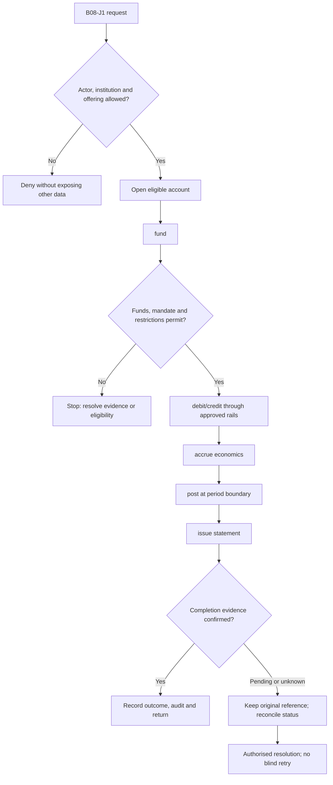
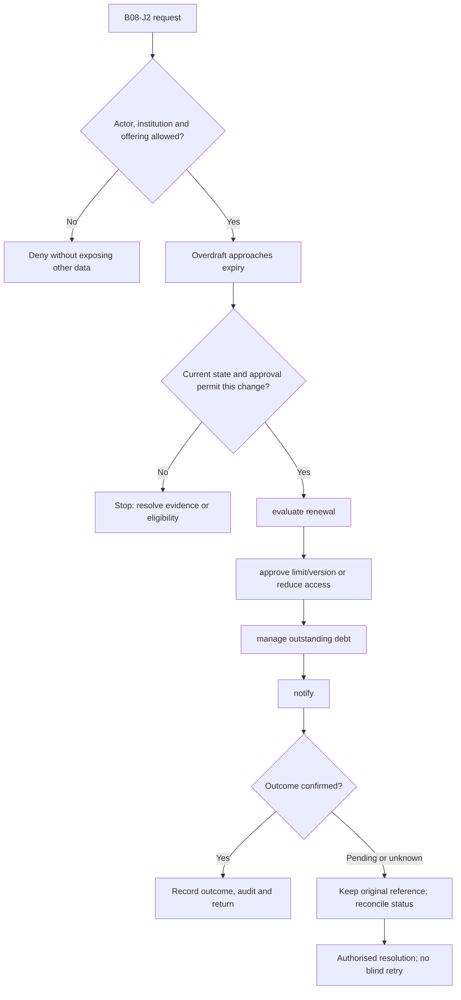

**Review draft • 13 October 2026 • New Banking project • Implementation not started.**

## Purpose and ownership

Operate transaction accounts, including interest, charges and authorised overdraft behaviour.

Proposed operating roles: Customer; branch officer; deposit operations; finance. These titles describe duties for review; they do not grant permissions. The bank or authorised regulated entity owns product policy and financial outcomes. Platform operators receive no automatic customer-data, fund-movement or issuer authority.

## Worked Indian example

**Fictional requirements illustration, not seeded data or approved banking policy.** Reference: ACC-001 / INR 5,000.00 available.

| Stage | Example |
| --- | --- |
| Starting situation | A customer requests an INR 1,000.00 debit with no fee or overdraft in this illustration. |
| Operator/customer actions | Validate current mandate/restrictions, reserve INR 1,000.00 and confirm/post under the adopted core contract. |
| Expected normal outcome | Available funds become INR 4,000.00. Interest and fee posting follow their separately accepted schedule, not an invented default. |
| Failure or alternate outcome | Two concurrent INR 4,000.00 debits cannot both succeed against INR 5,000.00 available. |

No real customer, regulator approval, provider connection or bank operation is asserted. Illustrative amounts have currency INR and scale 2; actual economics/authority must be supplied by the institution.

## Module flow diagrams

These are proposed requirements flows. The detailed policy and contracts still need owner confirmation.

### Flow 1: B08 primary journey

### Flow 2: B08 alternate servicing and recovery journey

## Required features

| Feature | Required behaviour |
| --- | --- |
| B08-F1 | Savings/current-account servicing and statements. The final field schema, permitted actions and acceptance evidence must be approved for each enabled offering. |
| B08-F2 | Interest accrual, capitalisation and tax treatment. The final field schema, permitted actions and acceptance evidence must be approved for each enabled offering. |
| B08-F3 | Minimum-balance evaluation and approved charges. The final field schema, permitted actions and acceptance evidence must be approved for each enabled offering. |
| B08-F4 | Overdraft utilisation, expiry and excess handling. The final field schema, permitted actions and acceptance evidence must be approved for each enabled offering. |
| B08-F5 | Dormancy, nomination and periodic customer notices. The final field schema, permitted actions and acceptance evidence must be approved for each enabled offering. |

## Configuration to agree

Rate tiers; minimum balance; accrual basis; charge exemptions; overdraft eligibility and limit; tax policy. Store approved values in versioned, effective-dated product/programme policy. Capture the exact configuration version used by an instruction. Missing mandatory configuration blocks the dependent action; enabling a menu cannot grant legal authority.

## End-to-end journey 1

Open eligible account → fund → debit/credit through approved rails → accrue economics → post at period boundary → issue statement.

The journey ends only when its authoritative result, customer/staff-visible result and related book or case history agree. A saved request, queue entry or HTTP acknowledgement is an intermediate state.

## End-to-end journey 2

Overdraft approaches expiry → evaluate renewal → approve limit/version or reduce access → manage outstanding debt → notify.

Every transition needs an authorised actor, original version and recorded reason where required. Cancellation or client disconnection does not prove server rollback. Financial corrections retain their original reference and use linked reversal/adjustment entries rather than deleting history.

## Interfaces and data dependencies

Account book; rate/charge engine; business calendar; tax; overdraft sanction/status. Agree stable institution, product, party and operation references; source version; as-of time; completeness; status/finality; retry rules and correction handling. Where no financial posting occurs, record the administrative/case outcome instead of inventing a journal.

All channel requests use server-verified identity and institution scope. Partner, branch and customer access is narrower than institution membership. Lists, details, search, exports, callbacks and files must enforce the same boundary.

## Current implementation and reuse

**New Banking project: proposed, not built.** Existing account reads are partial; no savings/current interest or overdraft engine.

Reviewed legacy feature boundaries: `consumer-accounts`, `consumer-transactions`. See the source inventory on the [gap page](/banking/current-system-gap). Legacy feature presence is a reuse candidate, not acceptance or deployment evidence for this module.

## Acceptance and difficult cases

Explicit cases: Insufficient available balance; frozen debit; rate change mid-cycle; overdraft limit race.

- Allowed success: confirm saved/output values, authoritative status and the exact approved actor/channel.
- Denial: reject foreign institution, unauthorised branch/customer/programme and revoked or expired access without information leakage.
- Reliability: prove stale-version rejection and concurrency behaviour; retryable commands apply one economic effect; unknown financial outcomes are reconciled by original reference.
- Records and usability: preserve redacted audit, monetary precision and document integrity; verify keyboard/mobile, direct links, expired sessions, Back/Forward and return navigation. Internal web navigation preserves its workspace.

Apply the [scenario matrix](/banking/scenario-matrix) and the [shared journey rules](/banking/journeys). Timing, amounts and regulatory applicability are institution-owned inputs, not defaults supplied by this document.

## Pending decision

Which account variants, interest bases and overdraft policies are first-release products?

The [decision register](/banking/decisions) keeps sequencing separate from approval. No implementation begins because this page describes a proposed capability.

[Module register](/banking/module-register) · [Offering compatibility](/banking/offering-matrix)
