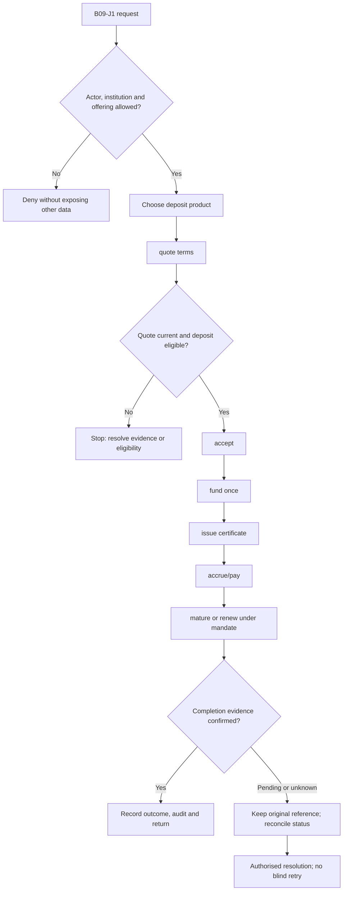
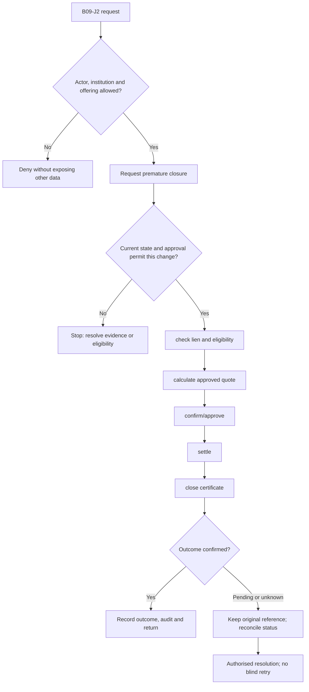

**Review draft • 13 October 2026 • New Banking project • Implementation not started.**

## Purpose and ownership

Manage deposit placement, scheduled funding, maturity and premature closure.

Proposed operating roles: Customer; deposit officer; approver; finance. These titles describe duties for review; they do not grant permissions. The bank or authorised regulated entity owns product policy and financial outcomes. Platform operators receive no automatic customer-data, fund-movement or issuer authority.

## Worked Indian example

**Fictional requirements illustration, not seeded data or approved banking policy.** Reference: FD-001 / INR 50,000.00 principal.

| Stage | Example |
| --- | --- |
| Starting situation | A customer proposes a 12-month term deposit; the rate and maturity rules still require approval. |
| Operator/customer actions | Obtain an authoritative quote, accept the exact version, fund once and issue the deposit advice. At maturity run the adopted payout/renewal instruction. |
| Expected normal outcome | Deposit principal, funding reference, agreed terms and certificate agree. No maturity amount is invented before rate policy exists. |
| Failure or alternate outcome | A lien or expired quote prevents premature closure until the required authority/updated quote exists. |

No real customer, regulator approval, provider connection or bank operation is asserted. Illustrative amounts have currency INR and scale 2; actual economics/authority must be supplied by the institution.

## Module flow diagrams

These are proposed requirements flows. The detailed policy and contracts still need owner confirmation.

### Flow 1: B09 primary journey

### Flow 2: B09 alternate servicing and recovery journey

## Required features

| Feature | Required behaviour |
| --- | --- |
| B09-F1 | FD/RD placement and approved rate quote. The final field schema, permitted actions and acceptance evidence must be approved for each enabled offering. |
| B09-F2 | Funding, advice and deposit certificate. The final field schema, permitted actions and acceptance evidence must be approved for each enabled offering. |
| B09-F3 | Interest accrual, payout and withholding. The final field schema, permitted actions and acceptance evidence must be approved for each enabled offering. |
| B09-F4 | Maturity, renewal and overdue treatment. The final field schema, permitted actions and acceptance evidence must be approved for each enabled offering. |
| B09-F5 | Premature closure, lien and partial-withdrawal eligibility. The final field schema, permitted actions and acceptance evidence must be approved for each enabled offering. |

## Configuration to agree

Tenor; payout; renewal; instalment rules; penalty; tax; lien eligibility; day-count and rounding. Store approved values in versioned, effective-dated product/programme policy. Capture the exact configuration version used by an instruction. Missing mandatory configuration blocks the dependent action; enabling a menu cannot grant legal authority.

## End-to-end journey 1

Choose deposit product → quote terms → accept → fund once → issue certificate → accrue/pay → mature or renew under mandate.

The journey ends only when its authoritative result, customer/staff-visible result and related book or case history agree. A saved request, queue entry or HTTP acknowledgement is an intermediate state.

## End-to-end journey 2

Request premature closure → check lien and eligibility → calculate approved quote → confirm/approve → settle → close certificate.

Every transition needs an authorised actor, original version and recorded reason where required. Cancellation or client disconnection does not prove server rollback. Financial corrections retain their original reference and use linked reversal/adjustment entries rather than deleting history.

## Interfaces and data dependencies

Deposit book; rate/penalty calculator; funding instruction; certificate; maturity status. Agree stable institution, product, party and operation references; source version; as-of time; completeness; status/finality; retry rules and correction handling. Where no financial posting occurs, record the administrative/case outcome instead of inventing a journal.

All channel requests use server-verified identity and institution scope. Partner, branch and customer access is narrower than institution membership. Lists, details, search, exports, callbacks and files must enforce the same boundary.

## Current implementation and reuse

**New Banking project: proposed, not built.** No operational deposit servicing exists.

Reviewed legacy feature boundaries: `platform-configuration (catalogue only)`. See the source inventory on the [gap page](/banking/current-system-gap). Legacy feature presence is a reuse candidate, not acceptance or deployment evidence for this module.

## Acceptance and difficult cases

Explicit cases: Missed RD instalment; expired quote; blocked deposit; duplicate maturity job.

- Allowed success: confirm saved/output values, authoritative status and the exact approved actor/channel.
- Denial: reject foreign institution, unauthorised branch/customer/programme and revoked or expired access without information leakage.
- Reliability: prove stale-version rejection and concurrency behaviour; retryable commands apply one economic effect; unknown financial outcomes are reconciled by original reference.
- Records and usability: preserve redacted audit, monetary precision and document integrity; verify keyboard/mobile, direct links, expired sessions, Back/Forward and return navigation. Internal web navigation preserves its workspace.

Apply the [scenario matrix](/banking/scenario-matrix) and the [shared journey rules](/banking/journeys). Timing, amounts and regulatory applicability are institution-owned inputs, not defaults supplied by this document.

## Pending decision

Which deposit variants, payout/renewal options and premature-closure rules are approved?

The [decision register](/banking/decisions) keeps sequencing separate from approval. No implementation begins because this page describes a proposed capability.

[Module register](/banking/module-register) · [Offering compatibility](/banking/offering-matrix)
