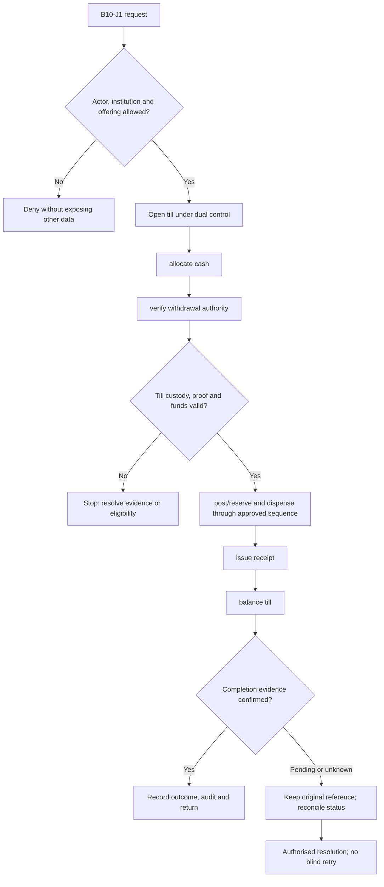
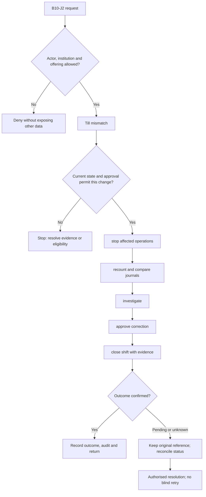

**Review draft • 13 October 2026 • New Banking project • Implementation not started.**

## Purpose and ownership

Control physical cash and teller duties alongside the financial books.

Proposed operating roles: Teller; cash supervisor; vault custodian; cash auditor. These titles describe duties for review; they do not grant permissions. The bank or authorised regulated entity owns product policy and financial outcomes. Platform operators receive no automatic customer-data, fund-movement or issuer authority.

## Worked Indian example

**Fictional requirements illustration, not seeded data or approved banking policy.** Reference: TILL-001 / INR 20,000.00 opening cash.

| Stage | Example |
| --- | --- |
| Starting situation | A teller receives a dual-controlled till and an authorised INR 2,000.00 withdrawal. |
| Operator/customer actions | Confirm funds and withdrawal proof, complete posting/cash-delivery under the accepted sequence, and count denominations. |
| Expected normal outcome | Assuming no other activity, physical till cash is INR 18,000.00; the account and cash books reconcile to the receipt. |
| Failure or alternate outcome | A power loss after handover creates a cash exception; it cannot be solved by issuing a second payout. |

No real customer, regulator approval, provider connection or bank operation is asserted. Illustrative amounts have currency INR and scale 2; actual economics/authority must be supplied by the institution.

## Module flow diagrams

These are proposed requirements flows. The detailed policy and contracts still need owner confirmation.

### Flow 1: B10 primary journey

### Flow 2: B10 alternate servicing and recovery journey

## Required features

| Feature | Required behaviour |
| --- | --- |
| B10-F1 | Teller opening, shift assignment and cash allocation. The final field schema, permitted actions and acceptance evidence must be approved for each enabled offering. |
| B10-F2 | Cash deposit/withdrawal with proof and limits. The final field schema, permitted actions and acceptance evidence must be approved for each enabled offering. |
| B10-F3 | Vault/till transfers and denomination counts. The final field schema, permitted actions and acceptance evidence must be approved for each enabled offering. |
| B10-F4 | Cash over/short exceptions and controlled correction. The final field schema, permitted actions and acceptance evidence must be approved for each enabled offering. |
| B10-F5 | End-of-shift balancing and sealed handover. The final field schema, permitted actions and acceptance evidence must be approved for each enabled offering. |

## Configuration to agree

Till/vault limits; denomination inventory; dual custody; cash verification; branch calendar; over/short thresholds. Store approved values in versioned, effective-dated product/programme policy. Capture the exact configuration version used by an instruction. Missing mandatory configuration blocks the dependent action; enabling a menu cannot grant legal authority.

## End-to-end journey 1

Open till under dual control → allocate cash → verify withdrawal authority → post/reserve and dispense through approved sequence → issue receipt → balance till.

The journey ends only when its authoritative result, customer/staff-visible result and related book or case history agree. A saved request, queue entry or HTTP acknowledgement is an intermediate state.

## End-to-end journey 2

Till mismatch → stop affected operations → recount and compare journals → investigate → approve correction → close shift with evidence.

Every transition needs an authorised actor, original version and recorded reason where required. Cancellation or client disconnection does not prove server rollback. Financial corrections retain their original reference and use linked reversal/adjustment entries rather than deleting history.

## Interfaces and data dependencies

Cash custody ledger; account posting; receipt; denomination inventory; branch close dependencies. Agree stable institution, product, party and operation references; source version; as-of time; completeness; status/finality; retry rules and correction handling. Where no financial posting occurs, record the administrative/case outcome instead of inventing a journal.

All channel requests use server-verified identity and institution scope. Partner, branch and customer access is narrower than institution membership. Lists, details, search, exports, callbacks and files must enforce the same boundary.

## Current implementation and reuse

**New Banking project: proposed, not built.** No teller, denomination inventory or vault operations exist.

Reviewed legacy feature boundaries: No operational source module was found. Legacy feature presence is a reuse candidate, not acceptance or deployment evidence for this module.

## Acceptance and difficult cases

Explicit cases: Counterfeit note; interrupted payout; insufficient denominations; supervisor self-approval.

- Allowed success: confirm saved/output values, authoritative status and the exact approved actor/channel.
- Denial: reject foreign institution, unauthorised branch/customer/programme and revoked or expired access without information leakage.
- Reliability: prove stale-version rejection and concurrency behaviour; retryable commands apply one economic effect; unknown financial outcomes are reconciled by original reference.
- Records and usability: preserve redacted audit, monetary precision and document integrity; verify keyboard/mobile, direct links, expired sessions, Back/Forward and return navigation. Internal web navigation preserves its workspace.

Apply the [scenario matrix](/banking/scenario-matrix) and the [shared journey rules](/banking/journeys). Timing, amounts and regulatory applicability are institution-owned inputs, not defaults supplied by this document.

## Pending decision

Does the platform own cash inventory and teller posting, or integrate an existing cash system?

The [decision register](/banking/decisions) keeps sequencing separate from approval. No implementation begins because this page describes a proposed capability.

[Module register](/banking/module-register) · [Offering compatibility](/banking/offering-matrix)
