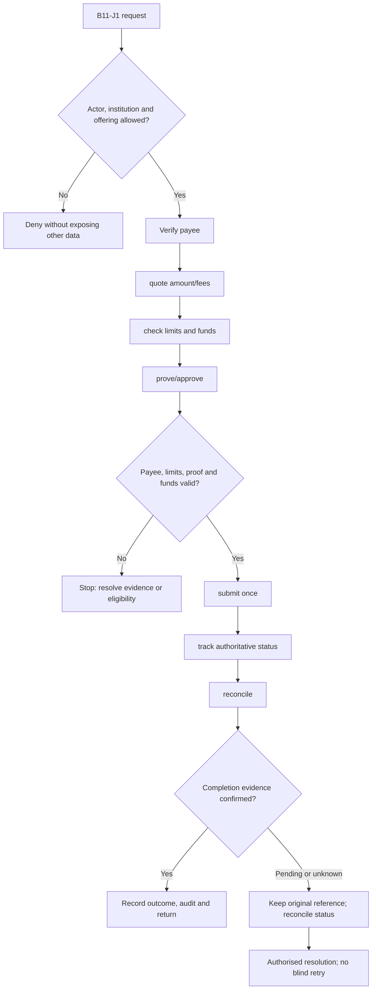
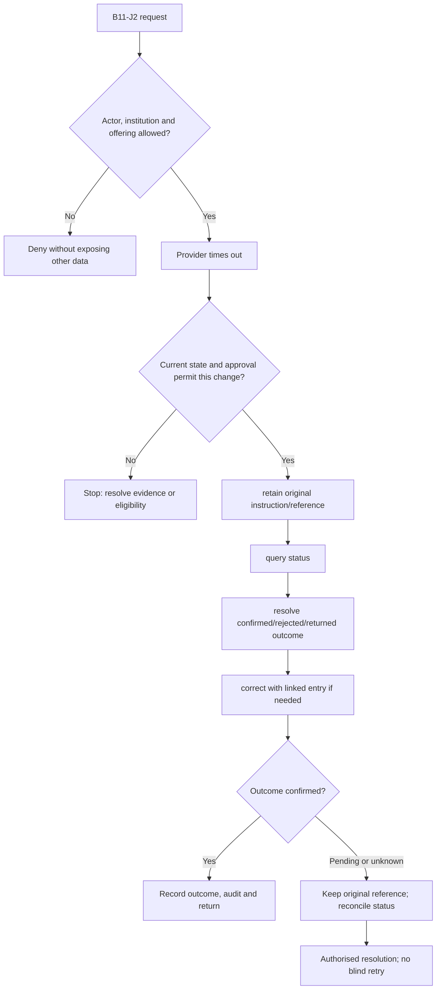

**Review draft • 13 October 2026 • New Banking project • Implementation not started.**

## Purpose and ownership

Execute permitted payments with verified payees, proof, status recovery and reconciliation.

Proposed operating roles: Customer; payment maker/checker; operations exception officer. These titles describe duties for review; they do not grant permissions. The bank or authorised regulated entity owns product policy and financial outcomes. Platform operators receive no automatic customer-data, fund-movement or issuer authority.

## Worked Indian example

**Fictional requirements illustration, not seeded data or approved banking policy.** Reference: PAY-001 / INR 2,500.00 domestic transfer.

| Stage | Example |
| --- | --- |
| Starting situation | A customer transfers to a verified permitted payee; this illustration excludes fees. |
| Operator/customer actions | Quote, enforce limits/funds, bind proof to amount/payee and submit using PAY-001 exactly once. Read authoritative outcome. |
| Expected normal outcome | The payer/payee/rail references and reconciled debit agree. Pending is displayed until the bank confirms final status. |
| Failure or alternate outcome | On timeout, query PAY-001; do not submit PAY-002 merely because the screen lost its response. |

No real customer, regulator approval, provider connection or bank operation is asserted. Illustrative amounts have currency INR and scale 2; actual economics/authority must be supplied by the institution.

## Module flow diagrams

These are proposed requirements flows. The detailed policy and contracts still need owner confirmation.

### Flow 1: B11 primary journey

### Flow 2: B11 alternate servicing and recovery journey

## Required features

| Feature | Required behaviour |
| --- | --- |
| B11-F1 | Beneficiary create/verify/activate/revoke. The final field schema, permitted actions and acceptance evidence must be approved for each enabled offering. |
| B11-F2 | Internal transfer and enabled domestic payment rails. The final field schema, permitted actions and acceptance evidence must be approved for each enabled offering. |
| B11-F3 | Scheduled/standing instructions and mandate lifecycle. The final field schema, permitted actions and acceptance evidence must be approved for each enabled offering. |
| B11-F4 | Quote, proof, approval and idempotent submission. The final field schema, permitted actions and acceptance evidence must be approved for each enabled offering. |
| B11-F5 | Returns, failed/unknown status and reconciliation. The final field schema, permitted actions and acceptance evidence must be approved for each enabled offering. |

## Configuration to agree

Enabled rails; cutoffs; beneficiary verification; cooling periods; transaction/daily limits; fees; approval matrix. Store approved values in versioned, effective-dated product/programme policy. Capture the exact configuration version used by an instruction. Missing mandatory configuration blocks the dependent action; enabling a menu cannot grant legal authority.

## End-to-end journey 1

Verify payee → quote amount/fees → check limits and funds → prove/approve → submit once → track authoritative status → reconcile.

The journey ends only when its authoritative result, customer/staff-visible result and related book or case history agree. A saved request, queue entry or HTTP acknowledgement is an intermediate state.

## End-to-end journey 2

Provider times out → retain original instruction/reference → query status → resolve confirmed/rejected/returned outcome → correct with linked entry if needed.

Every transition needs an authorised actor, original version and recorded reason where required. Cancellation or client disconnection does not prove server rollback. Financial corrections retain their original reference and use linked reversal/adjustment entries rather than deleting history.

## Interfaces and data dependencies

Rail eligibility; account verification; instruction/status; settlement; return/reversal contracts. Agree stable institution, product, party and operation references; source version; as-of time; completeness; status/finality; retry rules and correction handling. Where no financial posting occurs, record the administrative/case outcome instead of inventing a journal.

All channel requests use server-verified identity and institution scope. Partner, branch and customer access is narrower than institution membership. Lists, details, search, exports, callbacks and files must enforce the same boundary.

## Current implementation and reuse

**New Banking project: proposed, not built.** No payment execution engine exists; saved limits do not enforce rail operations.

Reviewed legacy feature boundaries: `transaction-controls`, `transaction-history (configuration/read only)`. See the source inventory on the [gap page](/banking/current-system-gap). Legacy feature presence is a reuse candidate, not acceptance or deployment evidence for this module.

## Acceptance and difficult cases

Explicit cases: Duplicate click; cutoff transition; beneficiary changed after approval; unknown bank response.

- Allowed success: confirm saved/output values, authoritative status and the exact approved actor/channel.
- Denial: reject foreign institution, unauthorised branch/customer/programme and revoked or expired access without information leakage.
- Reliability: prove stale-version rejection and concurrency behaviour; retryable commands apply one economic effect; unknown financial outcomes are reconciled by original reference.
- Records and usability: preserve redacted audit, monetary precision and document integrity; verify keyboard/mobile, direct links, expired sessions, Back/Forward and return navigation. Internal web navigation preserves its workspace.

Apply the [scenario matrix](/banking/scenario-matrix) and the [shared journey rules](/banking/journeys). Timing, amounts and regulatory applicability are institution-owned inputs, not defaults supplied by this document.

## Pending decision

Which non-UPI rails and beneficiary/proof policies belong in the first release? UPI remains a separate scope decision.

The [decision register](/banking/decisions) keeps sequencing separate from approval. No implementation begins because this page describes a proposed capability.

[Module register](/banking/module-register) · [Offering compatibility](/banking/offering-matrix)
