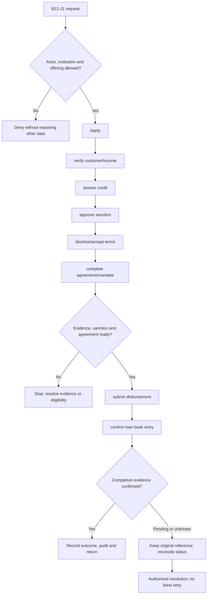
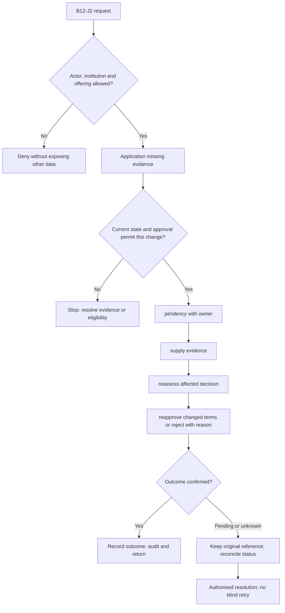

**Review draft • 13 October 2026 • New Banking project • Implementation not started.**

## Purpose and ownership

Turn an application into a documented lending agreement without confusing approval with disbursement.

Proposed operating roles: Borrower; relationship officer; credit maker/checker; lender operations. These titles describe duties for review; they do not grant permissions. The bank or authorised regulated entity owns product policy and financial outcomes. Platform operators receive no automatic customer-data, fund-movement or issuer authority.

## Worked Indian example

**Fictional requirements illustration, not seeded data or approved banking policy.** Reference: APP-001 / INR 120,000.00 loan request.

| Stage | Example |
| --- | --- |
| Starting situation | DEMONBFC receives a personal-loan application. |
| Operator/customer actions | Collect approved KYC/income evidence, assess credit, obtain sanction, present accepted KFS/agreement and complete disbursement prerequisites. |
| Expected normal outcome | An application approval remains separate from confirmed disbursement and creation of LN-001. |
| Failure or alternate outcome | A signed agreement with an unverified payout destination cannot trigger disbursement. |

No real customer, regulator approval, provider connection or bank operation is asserted. Illustrative amounts have currency INR and scale 2; actual economics/authority must be supplied by the institution.

## Module flow diagrams

These are proposed requirements flows. The detailed policy and contracts still need owner confirmation.

### Flow 1: B12 primary journey

### Flow 2: B12 alternate servicing and recovery journey

## Required features

| Feature | Required behaviour |
| --- | --- |
| B12-F1 | Assisted and self-service applications with resumable pendency. The final field schema, permitted actions and acceptance evidence must be approved for each enabled offering. |
| B12-F2 | Individual/business borrower and co-borrower evidence. The final field schema, permitted actions and acceptance evidence must be approved for each enabled offering. |
| B12-F3 | Eligibility, credit assessment and documented deviations. The final field schema, permitted actions and acceptance evidence must be approved for each enabled offering. |
| B12-F4 | Offer/KFS/agreement generation and acceptance. The final field schema, permitted actions and acceptance evidence must be approved for each enabled offering. |
| B12-F5 | Disbursement readiness and handed-off servicing account. The final field schema, permitted actions and acceptance evidence must be approved for each enabled offering. |

## Configuration to agree

Loan products; required evidence; eligibility; loan-to-value; fees; KFS; consent; e-sign; mandate requirements. Store approved values in versioned, effective-dated product/programme policy. Capture the exact configuration version used by an instruction. Missing mandatory configuration blocks the dependent action; enabling a menu cannot grant legal authority.

## End-to-end journey 1

Apply → verify customer/income → assess credit → approve sanction → disclose/accept terms → complete agreement/mandate → submit disbursement → confirm loan book entry.

The journey ends only when its authoritative result, customer/staff-visible result and related book or case history agree. A saved request, queue entry or HTTP acknowledgement is an intermediate state.

## End-to-end journey 2

Application missing evidence → pendency with owner → supply evidence → reassess affected decision → reapprove changed terms or reject with reason.

Every transition needs an authorised actor, original version and recorded reason where required. Cancellation or client disconnection does not prove server rollback. Financial corrections retain their original reference and use linked reversal/adjustment entries rather than deleting history.

## Interfaces and data dependencies

KYC/income/bureau; underwriting; document signature; disbursement; loan account/status. Agree stable institution, product, party and operation references; source version; as-of time; completeness; status/finality; retry rules and correction handling. Where no financial posting occurs, record the administrative/case outcome instead of inventing a journal.

All channel requests use server-verified identity and institution scope. Partner, branch and customer access is narrower than institution membership. Lists, details, search, exports, callbacks and files must enforce the same boundary.

## Current implementation and reuse

**New Banking project: proposed, not built.** No LOS exists; catalogue entries and support forms are not loan applications.

Reviewed legacy feature boundaries: No operational source module was found. Legacy feature presence is a reuse candidate, not acceptance or deployment evidence for this module.

## Acceptance and difficult cases

Explicit cases: Offer expired; income revised after approval; unsigned agreement; wrong disbursement beneficiary.

- Allowed success: confirm saved/output values, authoritative status and the exact approved actor/channel.
- Denial: reject foreign institution, unauthorised branch/customer/programme and revoked or expired access without information leakage.
- Reliability: prove stale-version rejection and concurrency behaviour; retryable commands apply one economic effect; unknown financial outcomes are reconciled by original reference.
- Records and usability: preserve redacted audit, monetary precision and document integrity; verify keyboard/mobile, direct links, expired sessions, Back/Forward and return navigation. Internal web navigation preserves its workspace.

Apply the [scenario matrix](/banking/scenario-matrix) and the [shared journey rules](/banking/journeys). Timing, amounts and regulatory applicability are institution-owned inputs, not defaults supplied by this document.

## Pending decision

Which loan products and borrower segments should be supported first?

The [decision register](/banking/decisions) keeps sequencing separate from approval. No implementation begins because this page describes a proposed capability.

[Module register](/banking/module-register) · [Offering compatibility](/banking/offering-matrix)
