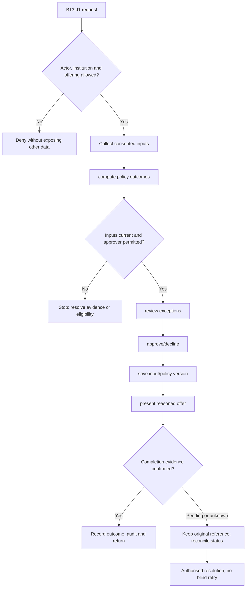
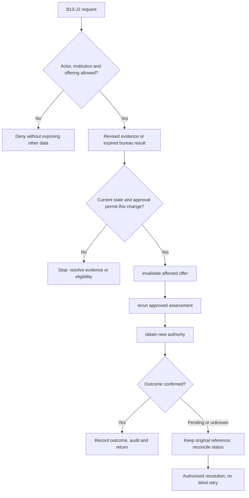

**Review draft • 13 October 2026 • New Banking project • Implementation not started.**

## Purpose and ownership

Record reproducible, authorised credit decisions and policy exceptions.

Proposed operating roles: Credit analyst; credit approver; policy owner; risk officer. These titles describe duties for review; they do not grant permissions. The bank or authorised regulated entity owns product policy and financial outcomes. Platform operators receive no automatic customer-data, fund-movement or issuer authority.

## Worked Indian example

**Fictional requirements illustration, not seeded data or approved banking policy.** Reference: APP-001 / policy CREDIT-DEMO-v1.

| Stage | Example |
| --- | --- |
| Starting situation | An analyst assesses the INR 120,000.00 application using a versioned policy. |
| Operator/customer actions | Record consented income/bureau inputs, compute explainable outcomes and route any deviation to the authorised credit approver. |
| Expected normal outcome | The decision can be reproduced from its input and policy version; sanctioned amount and reason are recorded. |
| Failure or alternate outcome | The analyst cannot approve their own prohibited deviation or reuse an expired bureau result. |

No real customer, regulator approval, provider connection or bank operation is asserted. Illustrative amounts have currency INR and scale 2; actual economics/authority must be supplied by the institution.

## Module flow diagrams

These are proposed requirements flows. The detailed policy and contracts still need owner confirmation.

### Flow 1: B13 primary journey

### Flow 2: B13 alternate servicing and recovery journey

## Required features

| Feature | Required behaviour |
| --- | --- |
| B13-F1 | Versioned policy rules and decision inputs. The final field schema, permitted actions and acceptance evidence must be approved for each enabled offering. |
| B13-F2 | Bureau/exposure and affordability assessment. The final field schema, permitted actions and acceptance evidence must be approved for each enabled offering. |
| B13-F3 | Manual review and documented policy deviations. The final field schema, permitted actions and acceptance evidence must be approved for each enabled offering. |
| B13-F4 | Independent sanction authority and exception controls. The final field schema, permitted actions and acceptance evidence must be approved for each enabled offering. |
| B13-F5 | Decision explanation, appeals and historical reproducibility. The final field schema, permitted actions and acceptance evidence must be approved for each enabled offering. |

## Configuration to agree

Score/policy versions; exposures; affordability; delegation; deviation limits; manual review; reason codes. Store approved values in versioned, effective-dated product/programme policy. Capture the exact configuration version used by an instruction. Missing mandatory configuration blocks the dependent action; enabling a menu cannot grant legal authority.

## End-to-end journey 1

Collect consented inputs → compute policy outcomes → review exceptions → approve/decline → save input/policy version → present reasoned offer.

The journey ends only when its authoritative result, customer/staff-visible result and related book or case history agree. A saved request, queue entry or HTTP acknowledgement is an intermediate state.

## End-to-end journey 2

Revised evidence or expired bureau result → invalidate affected offer → rerun approved assessment → obtain new authority.

Every transition needs an authorised actor, original version and recorded reason where required. Cancellation or client disconnection does not prove server rollback. Financial corrections retain their original reference and use linked reversal/adjustment entries rather than deleting history.

## Interfaces and data dependencies

Permitted bureau data; policy engine; exposure; sanctions; adverse-decision notices. Agree stable institution, product, party and operation references; source version; as-of time; completeness; status/finality; retry rules and correction handling. Where no financial posting occurs, record the administrative/case outcome instead of inventing a journal.

All channel requests use server-verified identity and institution scope. Partner, branch and customer access is narrower than institution membership. Lists, details, search, exports, callbacks and files must enforce the same boundary.

## Current implementation and reuse

**New Banking project: proposed, not built.** No operational underwriting or credit policy engine exists.

Reviewed legacy feature boundaries: No operational source module was found. Legacy feature presence is a reuse candidate, not acceptance or deployment evidence for this module.

## Acceptance and difficult cases

Explicit cases: Stale bureau; missing income; self-sanction; aggregate exposure across programmes.

- Allowed success: confirm saved/output values, authoritative status and the exact approved actor/channel.
- Denial: reject foreign institution, unauthorised branch/customer/programme and revoked or expired access without information leakage.
- Reliability: prove stale-version rejection and concurrency behaviour; retryable commands apply one economic effect; unknown financial outcomes are reconciled by original reference.
- Records and usability: preserve redacted audit, monetary precision and document integrity; verify keyboard/mobile, direct links, expired sessions, Back/Forward and return navigation. Internal web navigation preserves its workspace.

Apply the [scenario matrix](/banking/scenario-matrix) and the [shared journey rules](/banking/journeys). Timing, amounts and regulatory applicability are institution-owned inputs, not defaults supplied by this document.

## Pending decision

Who owns the policy, models, overrides and sanction delegation?

The [decision register](/banking/decisions) keeps sequencing separate from approval. No implementation begins because this page describes a proposed capability.

[Module register](/banking/module-register) · [Offering compatibility](/banking/offering-matrix)
