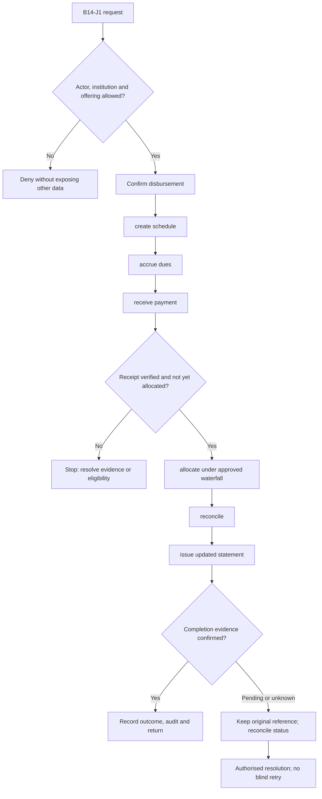
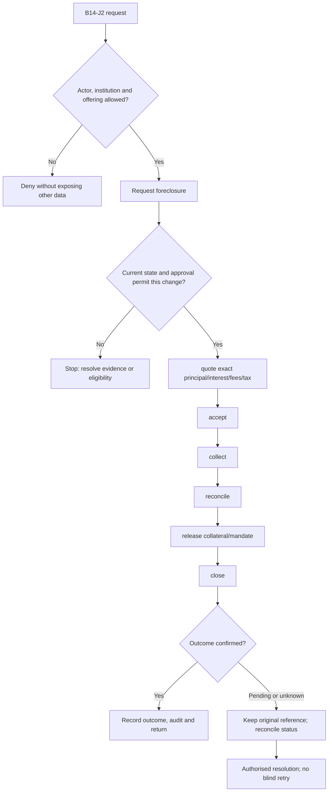

**Review draft • 13 October 2026 • New Banking project • Implementation not started.**

## Purpose and ownership

Maintain contractual loan balances, schedules and lifecycle changes accurately.

Proposed operating roles: Borrower; loan servicer; finance; servicing approver. These titles describe duties for review; they do not grant permissions. The bank or authorised regulated entity owns product policy and financial outcomes. Platform operators receive no automatic customer-data, fund-movement or issuer authority.

## Worked Indian example

**Fictional requirements illustration, not seeded data or approved banking policy.** Reference: LN-001 / principal INR 120,000.00.

| Stage | Example |
| --- | --- |
| Starting situation | A confirmed INR 10,000.00 repayment arrives. The fictional example allocation is INR 1,000.00 interest plus INR 9,000.00 principal. |
| Operator/customer actions | Match the receipt, apply the approved allocation version once, update dues and reconcile payment/ledger. This split is illustrative and does not adopt an interest rate or waterfall. |
| Expected normal outcome | Remaining principal is INR 111,000.00; the customer statement shows the linked INR 10,000.00 receipt and its components. |
| Failure or alternate outcome | If that receipt is returned, reverse its allocation by reference and restore affected balances; never delete its history. |

No real customer, regulator approval, provider connection or bank operation is asserted. Illustrative amounts have currency INR and scale 2; actual economics/authority must be supplied by the institution.

## Module flow diagrams

These are proposed requirements flows. The detailed policy and contracts still need owner confirmation.

### Flow 1: B14 primary journey

### Flow 2: B14 alternate servicing and recovery journey

## Required features

| Feature | Required behaviour |
| --- | --- |
| B14-F1 | Disbursement and schedule generation. The final field schema, permitted actions and acceptance evidence must be approved for each enabled offering. |
| B14-F2 | Accrual, billing, allocation and repayment reversals. The final field schema, permitted actions and acceptance evidence must be approved for each enabled offering. |
| B14-F3 | Part payment, foreclosure quote and closure. The final field schema, permitted actions and acceptance evidence must be approved for each enabled offering. |
| B14-F4 | Reschedule/restructure/waiver with approved authority. The final field schema, permitted actions and acceptance evidence must be approved for each enabled offering. |
| B14-F5 | Statements, certificates and bureau-ready loan facts. The final field schema, permitted actions and acceptance evidence must be approved for each enabled offering. |

## Configuration to agree

Amortisation; rate reset; repayment waterfall; due dates; grace; penal charges; prepayment; restructuring. Store approved values in versioned, effective-dated product/programme policy. Capture the exact configuration version used by an instruction. Missing mandatory configuration blocks the dependent action; enabling a menu cannot grant legal authority.

## End-to-end journey 1

Confirm disbursement → create schedule → accrue dues → receive payment → allocate under approved waterfall → reconcile → issue updated statement.

The journey ends only when its authoritative result, customer/staff-visible result and related book or case history agree. A saved request, queue entry or HTTP acknowledgement is an intermediate state.

## End-to-end journey 2

Request foreclosure → quote exact principal/interest/fees/tax → accept → collect → reconcile → release collateral/mandate → close.

Every transition needs an authorised actor, original version and recorded reason where required. Cancellation or client disconnection does not prove server rollback. Financial corrections retain their original reference and use linked reversal/adjustment entries rather than deleting history.

## Interfaces and data dependencies

Loan book; schedule/calculation version; payment/return; allocation; closure quote; bureau reporting. Agree stable institution, product, party and operation references; source version; as-of time; completeness; status/finality; retry rules and correction handling. Where no financial posting occurs, record the administrative/case outcome instead of inventing a journal.

All channel requests use server-verified identity and institution scope. Partner, branch and customer access is narrower than institution membership. Lists, details, search, exports, callbacks and files must enforce the same boundary.

## Current implementation and reuse

**New Banking project: proposed, not built.** No LMS or repayment allocation exists.

Reviewed legacy feature boundaries: No operational source module was found. Legacy feature presence is a reuse candidate, not acceptance or deployment evidence for this module.

## Acceptance and difficult cases

Explicit cases: Partial payment; reversal after close; rate reset mid-period; duplicate mandate debit.

- Allowed success: confirm saved/output values, authoritative status and the exact approved actor/channel.
- Denial: reject foreign institution, unauthorised branch/customer/programme and revoked or expired access without information leakage.
- Reliability: prove stale-version rejection and concurrency behaviour; retryable commands apply one economic effect; unknown financial outcomes are reconciled by original reference.
- Records and usability: preserve redacted audit, monetary precision and document integrity; verify keyboard/mobile, direct links, expired sessions, Back/Forward and return navigation. Internal web navigation preserves its workspace.

Apply the [scenario matrix](/banking/scenario-matrix) and the [shared journey rules](/banking/journeys). Timing, amounts and regulatory applicability are institution-owned inputs, not defaults supplied by this document.

## Pending decision

Which schedule, allocation and servicing-change policies apply to each loan product?

The [decision register](/banking/decisions) keeps sequencing separate from approval. No implementation begins because this page describes a proposed capability.

[Module register](/banking/module-register) · [Offering compatibility](/banking/offering-matrix)
