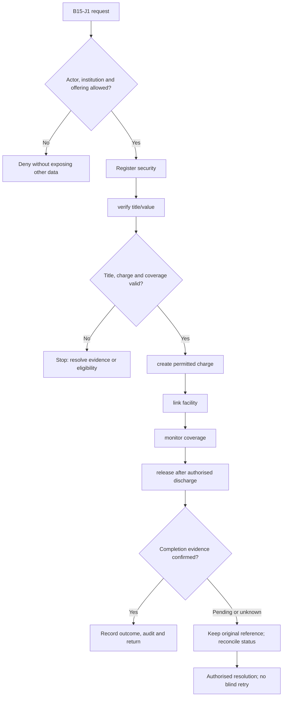
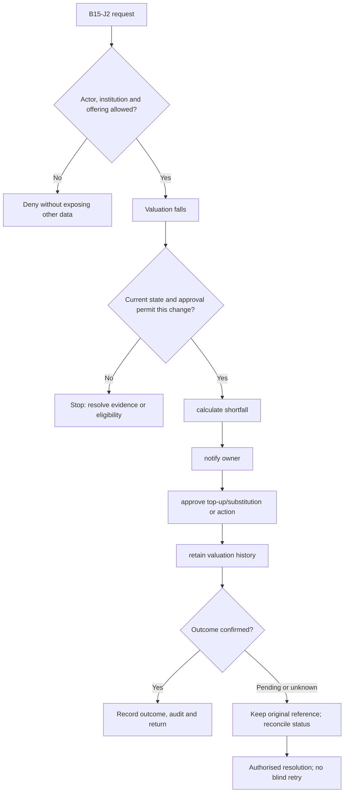

**Review draft • 13 October 2026 • New Banking project • Implementation not started.**

## Purpose and ownership

Track pledged assets and enforce release only when the secured obligation permits it.

Proposed operating roles: Collateral officer; valuer; legal reviewer; credit approver. These titles describe duties for review; they do not grant permissions. The bank or authorised regulated entity owns product policy and financial outcomes. Platform operators receive no automatic customer-data, fund-movement or issuer authority.

## Worked Indian example

**Fictional requirements illustration, not seeded data or approved banking policy.** Reference: SEC-001 / loan LN-001.

| Stage | Example |
| --- | --- |
| Starting situation | A property is proposed as security for a loan. |
| Operator/customer actions | Verify title and valuation, record the approved charge, allocate security to LN-001 and monitor the permitted coverage rule. |
| Expected normal outcome | Security ownership, valuation version, charge evidence and linked facility are visible to authorised roles. |
| Failure or alternate outcome | A partial release that violates approved coverage or retains an outstanding charge is blocked. |

No real customer, regulator approval, provider connection or bank operation is asserted. Illustrative amounts have currency INR and scale 2; actual economics/authority must be supplied by the institution.

## Module flow diagrams

These are proposed requirements flows. The detailed policy and contracts still need owner confirmation.

### Flow 1: B15 primary journey

### Flow 2: B15 alternate servicing and recovery journey

## Required features

| Feature | Required behaviour |
| --- | --- |
| B15-F1 | Asset and ownership registry. The final field schema, permitted actions and acceptance evidence must be approved for each enabled offering. |
| B15-F2 | Valuation, legal evidence and charge creation. The final field schema, permitted actions and acceptance evidence must be approved for each enabled offering. |
| B15-F3 | Collateral-to-facility allocation and encumbrance. The final field schema, permitted actions and acceptance evidence must be approved for each enabled offering. |
| B15-F4 | Revaluation, insurance expiry and shortfall monitoring. The final field schema, permitted actions and acceptance evidence must be approved for each enabled offering. |
| B15-F5 | Substitution, partial release and final discharge. The final field schema, permitted actions and acceptance evidence must be approved for each enabled offering. |

## Configuration to agree

Asset types; title/charge checks; valuation frequency; LTV; insurance; pooled security; release authority. Store approved values in versioned, effective-dated product/programme policy. Capture the exact configuration version used by an instruction. Missing mandatory configuration blocks the dependent action; enabling a menu cannot grant legal authority.

## End-to-end journey 1

Register security → verify title/value → create permitted charge → link facility → monitor coverage → release after authorised discharge.

The journey ends only when its authoritative result, customer/staff-visible result and related book or case history agree. A saved request, queue entry or HTTP acknowledgement is an intermediate state.

## End-to-end journey 2

Valuation falls → calculate shortfall → notify owner → approve top-up/substitution or action → retain valuation history.

Every transition needs an authorised actor, original version and recorded reason where required. Cancellation or client disconnection does not prove server rollback. Financial corrections retain their original reference and use linked reversal/adjustment entries rather than deleting history.

## Interfaces and data dependencies

Asset ownership/valuation; registry charge evidence; facility balances; release confirmation. Agree stable institution, product, party and operation references; source version; as-of time; completeness; status/finality; retry rules and correction handling. Where no financial posting occurs, record the administrative/case outcome instead of inventing a journal.

All channel requests use server-verified identity and institution scope. Partner, branch and customer access is narrower than institution membership. Lists, details, search, exports, callbacks and files must enforce the same boundary.

## Current implementation and reuse

**New Banking project: proposed, not built.** No collateral/security management exists.

Reviewed legacy feature boundaries: No operational source module was found. Legacy feature presence is a reuse candidate, not acceptance or deployment evidence for this module.

## Acceptance and difficult cases

Explicit cases: Same asset double pledged; stale valuation; partial release breaches coverage; missing charge evidence.

- Allowed success: confirm saved/output values, authoritative status and the exact approved actor/channel.
- Denial: reject foreign institution, unauthorised branch/customer/programme and revoked or expired access without information leakage.
- Reliability: prove stale-version rejection and concurrency behaviour; retryable commands apply one economic effect; unknown financial outcomes are reconciled by original reference.
- Records and usability: preserve redacted audit, monetary precision and document integrity; verify keyboard/mobile, direct links, expired sessions, Back/Forward and return navigation. Internal web navigation preserves its workspace.

Apply the [scenario matrix](/banking/scenario-matrix) and the [shared journey rules](/banking/journeys). Timing, amounts and regulatory applicability are institution-owned inputs, not defaults supplied by this document.

## Pending decision

Which asset classes and valuation/release authorities are in the initial lending offering?

The [decision register](/banking/decisions) keeps sequencing separate from approval. No implementation begins because this page describes a proposed capability.

[Module register](/banking/module-register) · [Offering compatibility](/banking/offering-matrix)
