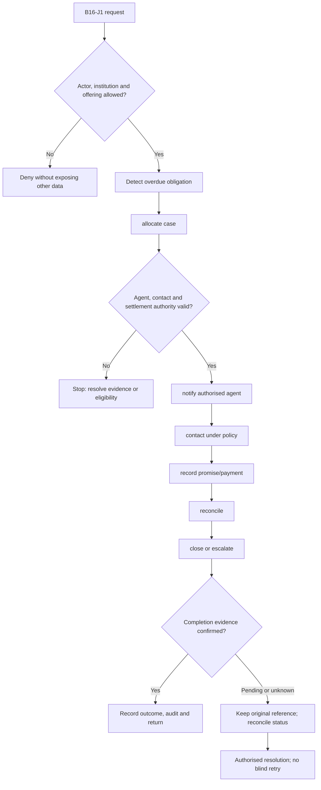
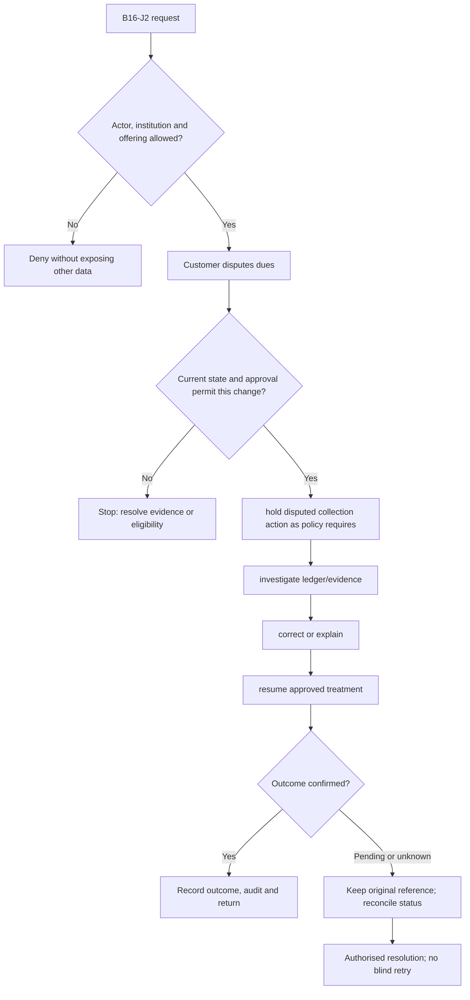

**Review draft • 13 October 2026 • New Banking project • Implementation not started.**

## Purpose and ownership

Resolve arrears through authorised, recorded customer contact and financial outcomes.

Proposed operating roles: Collections manager; authorised agent; borrower; settlement approver. These titles describe duties for review; they do not grant permissions. The bank or authorised regulated entity owns product policy and financial outcomes. Platform operators receive no automatic customer-data, fund-movement or issuer authority.

## Worked Indian example

**Fictional requirements illustration, not seeded data or approved banking policy.** Reference: CASE-001 / overdue LN-001.

| Stage | Example |
| --- | --- |
| Starting situation | A loan has an overdue instalment according to its authoritative schedule. |
| Operator/customer actions | Assign an authorised collector, send required notice, record permitted contact and any promise/payment, and reconcile the receipt before closing arrears. |
| Expected normal outcome | The case shows contact authority and verified repayment outcome, not a promise treated as collected money. |
| Failure or alternate outcome | A disputed/returned receipt reopens the relevant financial position under policy; an agent cannot waive dues without authority. |

No real customer, regulator approval, provider connection or bank operation is asserted. Illustrative amounts have currency INR and scale 2; actual economics/authority must be supplied by the institution.

## Module flow diagrams

These are proposed requirements flows. The detailed policy and contracts still need owner confirmation.

### Flow 1: B16 primary journey

### Flow 2: B16 alternate servicing and recovery journey

## Required features

| Feature | Required behaviour |
| --- | --- |
| B16-F1 | Arrears/DPD queues with verified account balances. The final field schema, permitted actions and acceptance evidence must be approved for each enabled offering. |
| B16-F2 | Agent assignment and customer notice. The final field schema, permitted actions and acceptance evidence must be approved for each enabled offering. |
| B16-F3 | Contact attempts, disputes and promises to pay. The final field schema, permitted actions and acceptance evidence must be approved for each enabled offering. |
| B16-F4 | Settlement, restructure and write-off authority. The final field schema, permitted actions and acceptance evidence must be approved for each enabled offering. |
| B16-F5 | Recovery receipts, reversals and portfolio monitoring. The final field schema, permitted actions and acceptance evidence must be approved for each enabled offering. |

## Configuration to agree

DPD definitions; allocation strategies; permitted contact policy; settlement/waiver authority; legal escalation. Store approved values in versioned, effective-dated product/programme policy. Capture the exact configuration version used by an instruction. Missing mandatory configuration blocks the dependent action; enabling a menu cannot grant legal authority.

## End-to-end journey 1

Detect overdue obligation → allocate case → notify authorised agent → contact under policy → record promise/payment → reconcile → close or escalate.

The journey ends only when its authoritative result, customer/staff-visible result and related book or case history agree. A saved request, queue entry or HTTP acknowledgement is an intermediate state.

## End-to-end journey 2

Customer disputes dues → hold disputed collection action as policy requires → investigate ledger/evidence → correct or explain → resume approved treatment.

Every transition needs an authorised actor, original version and recorded reason where required. Cancellation or client disconnection does not prove server rollback. Financial corrections retain their original reference and use linked reversal/adjustment entries rather than deleting history.

## Interfaces and data dependencies

Loan/card dues; agent identity; notice delivery; repayment evidence; settlement approvals. Agree stable institution, product, party and operation references; source version; as-of time; completeness; status/finality; retry rules and correction handling. Where no financial posting occurs, record the administrative/case outcome instead of inventing a journal.

All channel requests use server-verified identity and institution scope. Partner, branch and customer access is narrower than institution membership. Lists, details, search, exports, callbacks and files must enforce the same boundary.

## Current implementation and reuse

**New Banking project: proposed, not built.** No collections engine exists; support ownership is not collections assignment.

Reviewed legacy feature boundaries: No operational source module was found. Legacy feature presence is a reuse candidate, not acceptance or deployment evidence for this module.

## Acceptance and difficult cases

Explicit cases: Payment already received; wrong agent; breached promise; unauthorised waiver; reversed recovery receipt.

- Allowed success: confirm saved/output values, authoritative status and the exact approved actor/channel.
- Denial: reject foreign institution, unauthorised branch/customer/programme and revoked or expired access without information leakage.
- Reliability: prove stale-version rejection and concurrency behaviour; retryable commands apply one economic effect; unknown financial outcomes are reconciled by original reference.
- Records and usability: preserve redacted audit, monetary precision and document integrity; verify keyboard/mobile, direct links, expired sessions, Back/Forward and return navigation. Internal web navigation preserves its workspace.

Apply the [scenario matrix](/banking/scenario-matrix) and the [shared journey rules](/banking/journeys). Timing, amounts and regulatory applicability are institution-owned inputs, not defaults supplied by this document.

## Pending decision

Who may collect, settle, waive, write off or refer legal recovery, under which conduct policy?

The [decision register](/banking/decisions) keeps sequencing separate from approval. No implementation begins because this page describes a proposed capability.

[Module register](/banking/module-register) · [Offering compatibility](/banking/offering-matrix)
