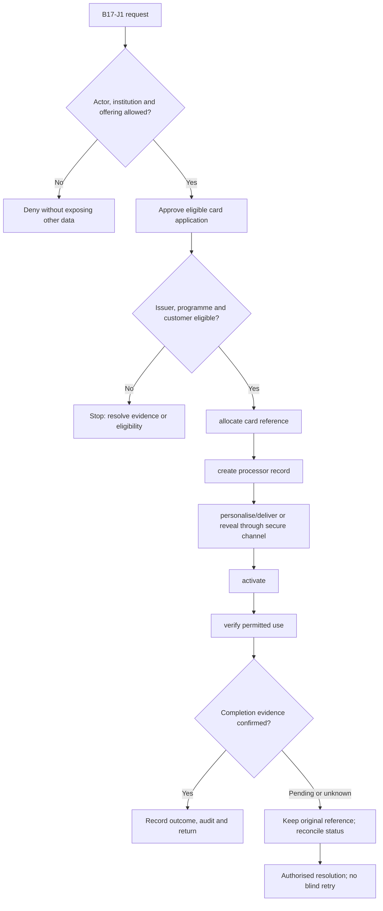
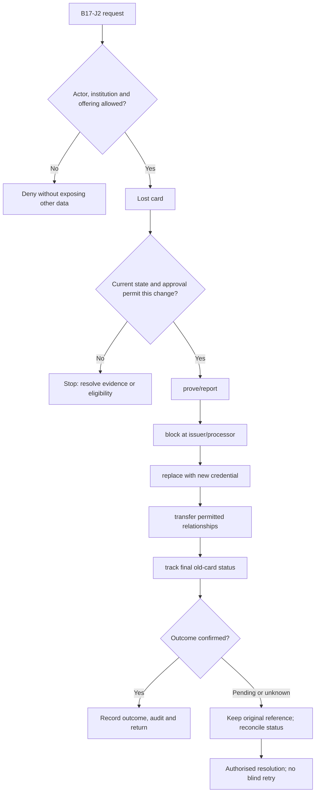

**Review draft • 13 October 2026 • New Banking project • Implementation not started.**

## Purpose and ownership

Manage issuer-owned debit, prepaid and credit programmes and the physical/virtual card lifecycle.

Proposed operating roles: Issuer programme manager; card operations; fulfilment partner; customer. These titles describe duties for review; they do not grant permissions. The bank or authorised regulated entity owns product policy and financial outcomes. Platform operators receive no automatic customer-data, fund-movement or issuer authority.

## Worked Indian example

**Fictional requirements illustration, not seeded data or approved banking policy.** Reference: DEMO-DEBIT / CARD-001.

| Stage | Example |
| --- | --- |
| Starting situation | A verified eligible customer requests a physical debit card linked to ACC-001. |
| Operator/customer actions | Check issuer/programme authority, create one processor reference, personalise and track delivery, verify activation proof and enable approved channels. |
| Expected normal outcome | The card is usable only after confirmed activation; ordinary screens show a masked/tokenised reference. |
| Failure or alternate outcome | Lost issuance response is resolved against the original processor reference rather than allocating another card. |

No real customer, regulator approval, provider connection or bank operation is asserted. Illustrative amounts have currency INR and scale 2; actual economics/authority must be supplied by the institution.

## Module flow diagrams

These are proposed requirements flows. The detailed policy and contracts still need owner confirmation.

### Flow 1: B17 primary journey

### Flow 2: B17 alternate servicing and recovery journey

## Required features

| Feature | Required behaviour |
| --- | --- |
| B17-F1 | Programme/BIN range and processor assignments. The final field schema, permitted actions and acceptance evidence must be approved for each enabled offering. |
| B17-F2 | Application, approval and card-account linkage. The final field schema, permitted actions and acceptance evidence must be approved for each enabled offering. |
| B17-F3 | Virtual issue and physical personalisation/order/inventory. The final field schema, permitted actions and acceptance evidence must be approved for each enabled offering. |
| B17-F4 | Delivery, activation, renewals and replacement. The final field schema, permitted actions and acceptance evidence must be approved for each enabled offering. |
| B17-F5 | Card controls, lost/stolen handling and closure. The final field schema, permitted actions and acceptance evidence must be approved for each enabled offering. |

## Configuration to agree

Issuer and sponsor; BIN/IIN/network ownership; processor; card type; form factor; eligibility; inventory; product terms. Store approved values in versioned, effective-dated product/programme policy. Capture the exact configuration version used by an instruction. Missing mandatory configuration blocks the dependent action; enabling a menu cannot grant legal authority.

## End-to-end journey 1

Approve eligible card application → allocate card reference → create processor record → personalise/deliver or reveal through secure channel → activate → verify permitted use.

The journey ends only when its authoritative result, customer/staff-visible result and related book or case history agree. A saved request, queue entry or HTTP acknowledgement is an intermediate state.

## End-to-end journey 2

Lost card → prove/report → block at issuer/processor → replace with new credential → transfer permitted relationships → track final old-card status.

Every transition needs an authorised actor, original version and recorded reason where required. Cancellation or client disconnection does not prove server rollback. Financial corrections retain their original reference and use linked reversal/adjustment entries rather than deleting history.

## Interfaces and data dependencies

Issuer/network/processor contract; tokenised card references; fulfilment; activation and final status. Agree stable institution, product, party and operation references; source version; as-of time; completeness; status/finality; retry rules and correction handling. Where no financial posting occurs, record the administrative/case outcome instead of inventing a journal.

All channel requests use server-verified identity and institution scope. Partner, branch and customer access is narrower than institution membership. Lists, details, search, exports, callbacks and files must enforce the same boundary.

## Current implementation and reuse

**New Banking project: proposed, not built.** No operational CMS or card inventory exists.

Reviewed legacy feature boundaries: No operational source module was found. Legacy feature presence is a reuse candidate, not acceptance or deployment evidence for this module.

## Acceptance and difficult cases

Explicit cases: Delivered to wrong address; duplicate issuance; processor success with lost response; replacement linkage leak.

- Allowed success: confirm saved/output values, authoritative status and the exact approved actor/channel.
- Denial: reject foreign institution, unauthorised branch/customer/programme and revoked or expired access without information leakage.
- Reliability: prove stale-version rejection and concurrency behaviour; retryable commands apply one economic effect; unknown financial outcomes are reconciled by original reference.
- Records and usability: preserve redacted audit, monetary precision and document integrity; verify keyboard/mobile, direct links, expired sessions, Back/Forward and return navigation. Internal web navigation preserves its workspace.

Apply the [scenario matrix](/banking/scenario-matrix) and the [shared journey rules](/banking/journeys). Timing, amounts and regulatory applicability are institution-owned inputs, not defaults supplied by this document.

## Pending decision

Which entity is the issuer, which networks/processors are contracted, and which programmes may launch?

The [decision register](/banking/decisions) keeps sequencing separate from approval. No implementation begins because this page describes a proposed capability.

[Module register](/banking/module-register) · [Offering compatibility](/banking/offering-matrix)
