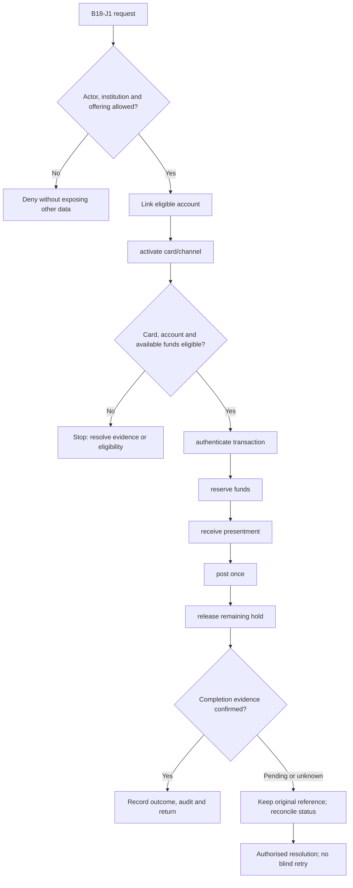
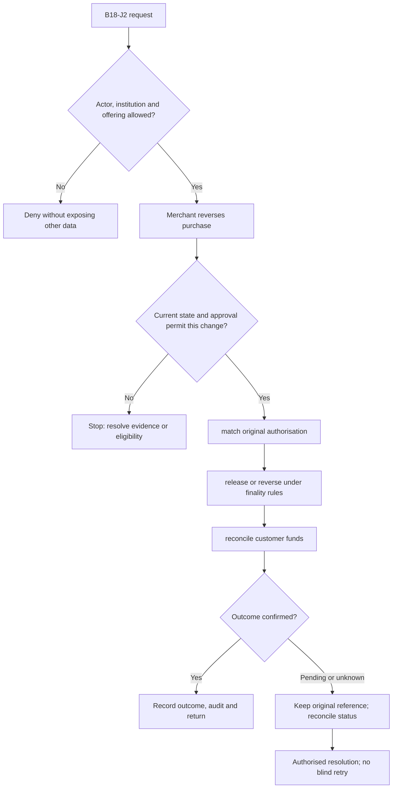

**Review draft • 13 October 2026 • New Banking project • Implementation not started.**

## Purpose and ownership

Allow card spending against a permitted deposit account while preserving available funds and holds.

Proposed operating roles: Cardholder; debit-card operations; fraud reviewer. These titles describe duties for review; they do not grant permissions. The bank or authorised regulated entity owns product policy and financial outcomes. Platform operators receive no automatic customer-data, fund-movement or issuer authority.

## Worked Indian example

**Fictional requirements illustration, not seeded data or approved banking policy.** Reference: CARD-001 / INR 1,000.00 purchase.

| Stage | Example |
| --- | --- |
| Starting situation | ACC-001 has INR 5,000.00 available before an illustrative fee-free debit-card purchase. |
| Operator/customer actions | Approve/reserve INR 1,000.00, match its presentment and post once; release unused reservation. |
| Expected normal outcome | Available funds fall to INR 4,000.00; hold and final ledger entries remain traceable. |
| Failure or alternate outcome | A reversal before clearing releases the hold; a later refund follows the original transaction and adopted posting policy. |

No real customer, regulator approval, provider connection or bank operation is asserted. Illustrative amounts have currency INR and scale 2; actual economics/authority must be supplied by the institution.

## Module flow diagrams

These are proposed requirements flows. The detailed policy and contracts still need owner confirmation.

### Flow 1: B18 primary journey

### Flow 2: B18 alternate servicing and recovery journey

## Required features

| Feature | Required behaviour |
| --- | --- |
| B18-F1 | Debit card-to-account linkage and consent. The final field schema, permitted actions and acceptance evidence must be approved for each enabled offering. |
| B18-F2 | POS/e-commerce/ATM channel controls. The final field schema, permitted actions and acceptance evidence must be approved for each enabled offering. |
| B18-F3 | Authorisation holds and available balance. The final field schema, permitted actions and acceptance evidence must be approved for each enabled offering. |
| B18-F4 | PIN issue/change through approved secure components. The final field schema, permitted actions and acceptance evidence must be approved for each enabled offering. |
| B18-F5 | Refund, reversal, replacement and account-closure dependencies. The final field schema, permitted actions and acceptance evidence must be approved for each enabled offering. |

## Configuration to agree

Eligible funding accounts; primary/add-on mandate; channels; domestic/international; limits; fees; PIN lifecycle. Store approved values in versioned, effective-dated product/programme policy. Capture the exact configuration version used by an instruction. Missing mandatory configuration blocks the dependent action; enabling a menu cannot grant legal authority.

## End-to-end journey 1

Link eligible account → activate card/channel → authenticate transaction → reserve funds → receive presentment → post once → release remaining hold.

The journey ends only when its authoritative result, customer/staff-visible result and related book or case history agree. A saved request, queue entry or HTTP acknowledgement is an intermediate state.

## End-to-end journey 2

Merchant reverses purchase → match original authorisation → release or reverse under finality rules → reconcile customer funds.

Every transition needs an authorised actor, original version and recorded reason where required. Cancellation or client disconnection does not prove server rollback. Financial corrections retain their original reference and use linked reversal/adjustment entries rather than deleting history.

## Interfaces and data dependencies

Deposit balance/holds; issuer authorisation; clearing; secure PIN; network settlement. Agree stable institution, product, party and operation references; source version; as-of time; completeness; status/finality; retry rules and correction handling. Where no financial posting occurs, record the administrative/case outcome instead of inventing a journal.

All channel requests use server-verified identity and institution scope. Partner, branch and customer access is narrower than institution membership. Lists, details, search, exports, callbacks and files must enforce the same boundary.

## Current implementation and reuse

**New Banking project: proposed, not built.** No debit card processing exists.

Reviewed legacy feature boundaries: No operational source module was found. Legacy feature presence is a reuse candidate, not acceptance or deployment evidence for this module.

## Acceptance and difficult cases

Explicit cases: Frozen account; insufficient funds under parallel spends; presentment after block; refund after replacement.

- Allowed success: confirm saved/output values, authoritative status and the exact approved actor/channel.
- Denial: reject foreign institution, unauthorised branch/customer/programme and revoked or expired access without information leakage.
- Reliability: prove stale-version rejection and concurrency behaviour; retryable commands apply one economic effect; unknown financial outcomes are reconciled by original reference.
- Records and usability: preserve redacted audit, monetary precision and document integrity; verify keyboard/mobile, direct links, expired sessions, Back/Forward and return navigation. Internal web navigation preserves its workspace.

Apply the [scenario matrix](/banking/scenario-matrix) and the [shared journey rules](/banking/journeys). Timing, amounts and regulatory applicability are institution-owned inputs, not defaults supplied by this document.

## Pending decision

Which deposit accounts, channel permissions and hold/presentment rules govern debit cards?

The [decision register](/banking/decisions) keeps sequencing separate from approval. No implementation begins because this page describes a proposed capability.

[Module register](/banking/module-register) · [Offering compatibility](/banking/offering-matrix)
