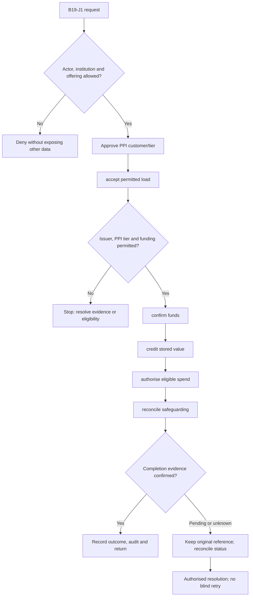
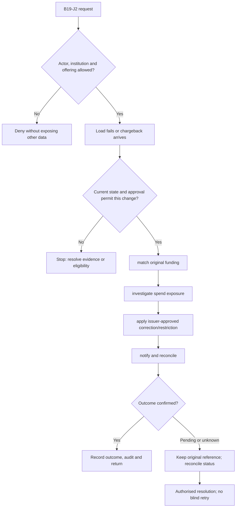

**Review draft • 13 October 2026 • New Banking project • Implementation not started.**

## Purpose and ownership

Operate permitted prepaid stored-value programmes without treating their balance as a bank deposit or credit line.

Proposed operating roles: PPI issuer; programme operations; cardholder; reconciliation officer. These titles describe duties for review; they do not grant permissions. The bank or authorised regulated entity owns product policy and financial outcomes. Platform operators receive no automatic customer-data, fund-movement or issuer authority.

## Worked Indian example

**Fictional requirements illustration, not seeded data or approved banking policy.** Reference: PPI-001 / INR 2,000.00 confirmed load.

| Stage | Example |
| --- | --- |
| Starting situation | An authorised fictional programme receives a permitted prefunded load. |
| Operator/customer actions | Verify customer tier/source, confirm funding, credit stored value once, then authorise and clear an INR 600.00 spend with no fees. |
| Expected normal outcome | Stored value becomes INR 1,400.00 and reconciles to the programme's safeguarding evidence. |
| Failure or alternate outcome | A duplicate load callback cannot double value; prohibited funding remains denied even when another credit product exists. |

No real customer, regulator approval, provider connection or bank operation is asserted. Illustrative amounts have currency INR and scale 2; actual economics/authority must be supplied by the institution.

## Module flow diagrams

These are proposed requirements flows. The detailed policy and contracts still need owner confirmation.

### Flow 1: B19 primary journey

### Flow 2: B19 alternate servicing and recovery journey

## Required features

| Feature | Required behaviour |
| --- | --- |
| B19-F1 | PPI onboarding, KYC tier and programme restrictions. The final field schema, permitted actions and acceptance evidence must be approved for each enabled offering. |
| B19-F2 | Load/reload with verified source and settlement. The final field schema, permitted actions and acceptance evidence must be approved for each enabled offering. |
| B19-F3 | Spend, refunds and available stored-value balance. The final field schema, permitted actions and acceptance evidence must be approved for each enabled offering. |
| B19-F4 | Upgrade, expiry, redemption and closure. The final field schema, permitted actions and acceptance evidence must be approved for each enabled offering. |
| B19-F5 | Safeguarding/escrow reconciliation and programme reporting. The final field schema, permitted actions and acceptance evidence must be approved for each enabled offering. |

## Configuration to agree

Issuer authorisation; PPI category/KYC level; permitted loads/spend/transfer/cash-out; expiry; safeguarding. Store approved values in versioned, effective-dated product/programme policy. Capture the exact configuration version used by an instruction. Missing mandatory configuration blocks the dependent action; enabling a menu cannot grant legal authority.

## End-to-end journey 1

Approve PPI customer/tier → accept permitted load → confirm funds → credit stored value → authorise eligible spend → reconcile safeguarding.

The journey ends only when its authoritative result, customer/staff-visible result and related book or case history agree. A saved request, queue entry or HTTP acknowledgement is an intermediate state.

## End-to-end journey 2

Load fails or chargeback arrives → match original funding → investigate spend exposure → apply issuer-approved correction/restriction → notify and reconcile.

Every transition needs an authorised actor, original version and recorded reason where required. Cancellation or client disconnection does not prove server rollback. Financial corrections retain their original reference and use linked reversal/adjustment entries rather than deleting history.

## Interfaces and data dependencies

Authorised PPI issuer; load provenance; stored-value ledger; safeguarding bank; redemption/status. Agree stable institution, product, party and operation references; source version; as-of time; completeness; status/finality; retry rules and correction handling. Where no financial posting occurs, record the administrative/case outcome instead of inventing a journal.

All channel requests use server-verified identity and institution scope. Partner, branch and customer access is narrower than institution membership. Lists, details, search, exports, callbacks and files must enforce the same boundary.

## Current implementation and reuse

**New Banking project: proposed, not built.** No wallet, PPI balance or safeguarding ledger exists.

Reviewed legacy feature boundaries: No operational source module was found. Legacy feature presence is a reuse candidate, not acceptance or deployment evidence for this module.

## Acceptance and difficult cases

Explicit cases: Prohibited load source; tier limit crossed; refund after expiry; duplicate load webhook; escrow mismatch.

- Allowed success: confirm saved/output values, authoritative status and the exact approved actor/channel.
- Denial: reject foreign institution, unauthorised branch/customer/programme and revoked or expired access without information leakage.
- Reliability: prove stale-version rejection and concurrency behaviour; retryable commands apply one economic effect; unknown financial outcomes are reconciled by original reference.
- Records and usability: preserve redacted audit, monetary precision and document integrity; verify keyboard/mobile, direct links, expired sessions, Back/Forward and return navigation. Internal web navigation preserves its workspace.

Apply the [scenario matrix](/banking/scenario-matrix) and the [shared journey rules](/banking/journeys). Timing, amounts and regulatory applicability are institution-owned inputs, not defaults supplied by this document.

## Pending decision

Which authorised issuer and PPI category are intended, and which funding/use/redemption actions are permitted?

The [decision register](/banking/decisions) keeps sequencing separate from approval. No implementation begins because this page describes a proposed capability.

[Module register](/banking/module-register) · [Offering compatibility](/banking/offering-matrix)
