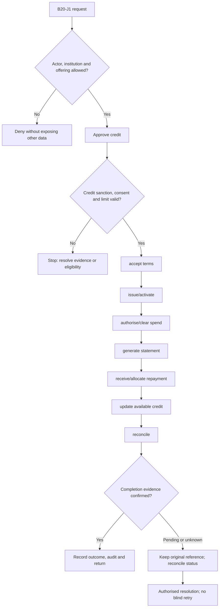
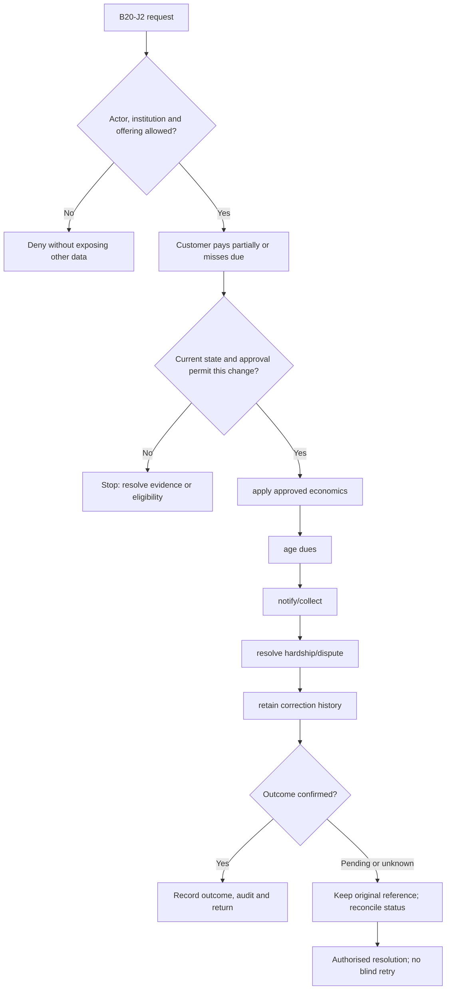

**Review draft • 13 October 2026 • New Banking project • Implementation not started.**

## Purpose and ownership

Manage revolving credit from underwriting to statements, repayment, collections and closure.

Proposed operating roles: Cardholder; credit-card operations; risk; billing; collections. These titles describe duties for review; they do not grant permissions. The bank or authorised regulated entity owns product policy and financial outcomes. Platform operators receive no automatic customer-data, fund-movement or issuer authority.

## Worked Indian example

**Fictional requirements illustration, not seeded data or approved banking policy.** Reference: CC-001 / INR 50,000.00 example sanctioned limit.

| Stage | Example |
| --- | --- |
| Starting situation | A credit card makes an illustrative INR 3,000.00 purchase, with no other holds or fees. |
| Operator/customer actions | Reserve and clear the purchase, generate the adopted statement, receive repayment and apply its approved allocation. |
| Expected normal outcome | After matching purchase, available credit is INR 47,000.00; a confirmed full INR 3,000.00 repayment restores INR 50,000.00 in this simplified example. |
| Failure or alternate outcome | A minimum/partial payment does not mean paid in full. Interest, grace and minimum-due rules must come from accepted product terms. |

No real customer, regulator approval, provider connection or bank operation is asserted. Illustrative amounts have currency INR and scale 2; actual economics/authority must be supplied by the institution.

## Module flow diagrams

These are proposed requirements flows. The detailed policy and contracts still need owner confirmation.

### Flow 1: B20 primary journey

### Flow 2: B20 alternate servicing and recovery journey

## Required features

| Feature | Required behaviour |
| --- | --- |
| B20-F1 | Application, underwriting, sanction and consent. The final field schema, permitted actions and acceptance evidence must be approved for each enabled offering. |
| B20-F2 | Account/primary/add-on limits and exposure. The final field schema, permitted actions and acceptance evidence must be approved for each enabled offering. |
| B20-F3 | Statement generation, due dates and receivables. The final field schema, permitted actions and acceptance evidence must be approved for each enabled offering. |
| B20-F4 | Repayment allocation, interest/charges and instalments. The final field schema, permitted actions and acceptance evidence must be approved for each enabled offering. |
| B20-F5 | Limit changes, delinquency, disputes and closure. The final field schema, permitted actions and acceptance evidence must be approved for each enabled offering. |

## Configuration to agree

Credit/cash limits; statement cycle; due date; interest/grace; fees; minimum due; allocation; instalments; closure. Store approved values in versioned, effective-dated product/programme policy. Capture the exact configuration version used by an instruction. Missing mandatory configuration blocks the dependent action; enabling a menu cannot grant legal authority.

## End-to-end journey 1

Approve credit → accept terms → issue/activate → authorise/clear spend → generate statement → receive/allocate repayment → update available credit → reconcile.

The journey ends only when its authoritative result, customer/staff-visible result and related book or case history agree. A saved request, queue entry or HTTP acknowledgement is an intermediate state.

## End-to-end journey 2

Customer pays partially or misses due → apply approved economics → age dues → notify/collect → resolve hardship/dispute → retain correction history.

Every transition needs an authorised actor, original version and recorded reason where required. Cancellation or client disconnection does not prove server rollback. Financial corrections retain their original reference and use linked reversal/adjustment entries rather than deleting history.

## Interfaces and data dependencies

Issuer eligibility; credit policy; exact billing/interest; repayment; bureau; clearing/settlement. Agree stable institution, product, party and operation references; source version; as-of time; completeness; status/finality; retry rules and correction handling. Where no financial posting occurs, record the administrative/case outcome instead of inventing a journal.

All channel requests use server-verified identity and institution scope. Partner, branch and customer access is narrower than institution membership. Lists, details, search, exports, callbacks and files must enforce the same boundary.

## Current implementation and reuse

**New Banking project: proposed, not built.** No credit-card account engine, billing or repayment allocation exists.

Reviewed legacy feature boundaries: No operational source module was found. Legacy feature presence is a reuse candidate, not acceptance or deployment evidence for this module.

## Acceptance and difficult cases

Explicit cases: Full versus minimum payment; refund across cycle; cash advance; add-on combined limit; unbilled closure.

- Allowed success: confirm saved/output values, authoritative status and the exact approved actor/channel.
- Denial: reject foreign institution, unauthorised branch/customer/programme and revoked or expired access without information leakage.
- Reliability: prove stale-version rejection and concurrency behaviour; retryable commands apply one economic effect; unknown financial outcomes are reconciled by original reference.
- Records and usability: preserve redacted audit, monetary precision and document integrity; verify keyboard/mobile, direct links, expired sessions, Back/Forward and return navigation. Internal web navigation preserves its workspace.

Apply the [scenario matrix](/banking/scenario-matrix) and the [shared journey rules](/banking/journeys). Timing, amounts and regulatory applicability are institution-owned inputs, not defaults supplied by this document.

## Pending decision

Which credit variants, billing/interest rules, repayment waterfall and limit-change authority apply?

The [decision register](/banking/decisions) keeps sequencing separate from approval. No implementation begins because this page describes a proposed capability.

[Module register](/banking/module-register) · [Offering compatibility](/banking/offering-matrix)
