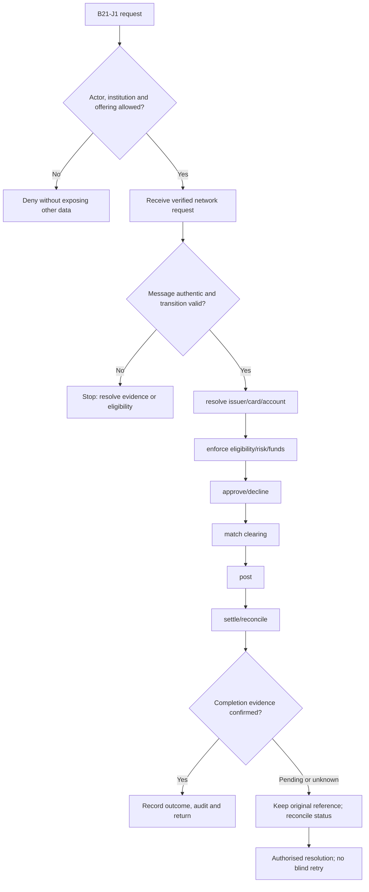
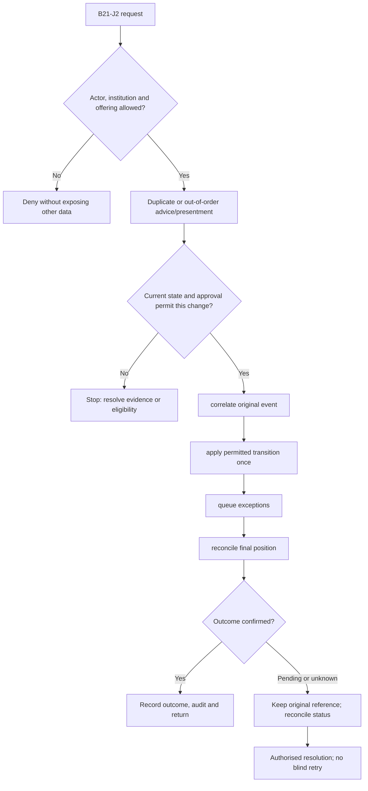

**Review draft • 13 October 2026 • New Banking project • Implementation not started.**

## Purpose and ownership

Process network messages and financial events with one economic effect per transaction.

Proposed operating roles: Issuer processor; network; fraud operations; settlement finance. These titles describe duties for review; they do not grant permissions. The bank or authorised regulated entity owns product policy and financial outcomes. Platform operators receive no automatic customer-data, fund-movement or issuer authority.

## Worked Indian example

**Fictional requirements illustration, not seeded data or approved banking policy.** Reference: AUTH-001 → CLEAR-001 → SETTLE-001.

| Stage | Example |
| --- | --- |
| Starting situation | An issuer approves an INR 1,000.00 card transaction and later receives clearing. |
| Operator/customer actions | Correlate verified messages, maintain one hold, post the adopted presentment once and reconcile settlement fees/positions. |
| Expected normal outcome | Authorisation, clearing, journal and settlement references form one traceable lifecycle. |
| Failure or alternate outcome | Duplicate clearing, late advice and unmatched presentment enter adopted exception handling; none blindly double-debit. |

No real customer, regulator approval, provider connection or bank operation is asserted. Illustrative amounts have currency INR and scale 2; actual economics/authority must be supplied by the institution.

## Module flow diagrams

These are proposed requirements flows. The detailed policy and contracts still need owner confirmation.

### Flow 1: B21 primary journey

### Flow 2: B21 alternate servicing and recovery journey

## Required features

| Feature | Required behaviour |
| --- | --- |
| B21-F1 | Real-time authorisation and funds/credit reservations. The final field schema, permitted actions and acceptance evidence must be approved for each enabled offering. |
| B21-F2 | Advice, completion, reversal and hold expiry. The final field schema, permitted actions and acceptance evidence must be approved for each enabled offering. |
| B21-F3 | Clearing/presentment matching and late/unmatched items. The final field schema, permitted actions and acceptance evidence must be approved for each enabled offering. |
| B21-F4 | Network fees, settlement positions and suspense. The final field schema, permitted actions and acceptance evidence must be approved for each enabled offering. |
| B21-F5 | Token/3DS/SCA boundaries and processor health. The final field schema, permitted actions and acceptance evidence must be approved for each enabled offering. |

## Configuration to agree

Message mapping; authorisation rules; stand-in permissions; timeout/hold expiry; clearing tolerance; settlement calendar. Store approved values in versioned, effective-dated product/programme policy. Capture the exact configuration version used by an instruction. Missing mandatory configuration blocks the dependent action; enabling a menu cannot grant legal authority.

## End-to-end journey 1

Receive verified network request → resolve issuer/card/account → enforce eligibility/risk/funds → approve/decline → match clearing → post → settle/reconcile.

The journey ends only when its authoritative result, customer/staff-visible result and related book or case history agree. A saved request, queue entry or HTTP acknowledgement is an intermediate state.

## End-to-end journey 2

Duplicate or out-of-order advice/presentment → correlate original event → apply permitted transition once → queue exceptions → reconcile final position.

Every transition needs an authorised actor, original version and recorded reason where required. Cancellation or client disconnection does not prove server rollback. Financial corrections retain their original reference and use linked reversal/adjustment entries rather than deleting history.

## Interfaces and data dependencies

Contracted processor/network schemas; HSM boundary; authoritative authorisation/clearing/settlement feeds. Agree stable institution, product, party and operation references; source version; as-of time; completeness; status/finality; retry rules and correction handling. Where no financial posting occurs, record the administrative/case outcome instead of inventing a journal.

All channel requests use server-verified identity and institution scope. Partner, branch and customer access is narrower than institution membership. Lists, details, search, exports, callbacks and files must enforce the same boundary.

## Current implementation and reuse

**New Banking project: proposed, not built.** No switch, network message processing or card settlement engine exists.

Reviewed legacy feature boundaries: No operational source module was found. Legacy feature presence is a reuse candidate, not acceptance or deployment evidence for this module.

## Acceptance and difficult cases

Explicit cases: Auth approved but response lost; partial/late presentment; force-post; offline approval; duplicate reversal.

- Allowed success: confirm saved/output values, authoritative status and the exact approved actor/channel.
- Denial: reject foreign institution, unauthorised branch/customer/programme and revoked or expired access without information leakage.
- Reliability: prove stale-version rejection and concurrency behaviour; retryable commands apply one economic effect; unknown financial outcomes are reconciled by original reference.
- Records and usability: preserve redacted audit, monetary precision and document integrity; verify keyboard/mobile, direct links, expired sessions, Back/Forward and return navigation. Internal web navigation preserves its workspace.

Apply the [scenario matrix](/banking/scenario-matrix) and the [shared journey rules](/banking/journeys). Timing, amounts and regulatory applicability are institution-owned inputs, not defaults supplied by this document.

## Pending decision

Do we own issuer processing or orchestrate a contracted processor, and who defines network finality?

The [decision register](/banking/decisions) keeps sequencing separate from approval. No implementation begins because this page describes a proposed capability.

[Module register](/banking/module-register) · [Offering compatibility](/banking/offering-matrix)
