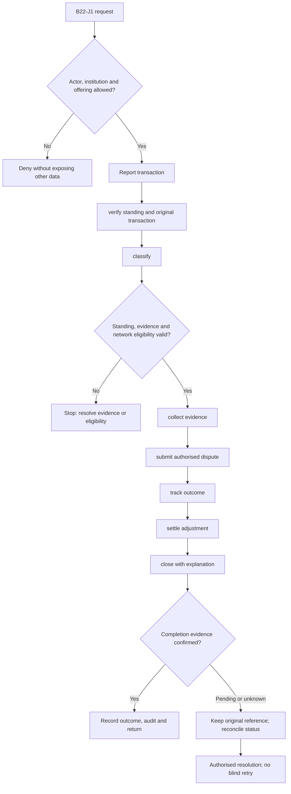
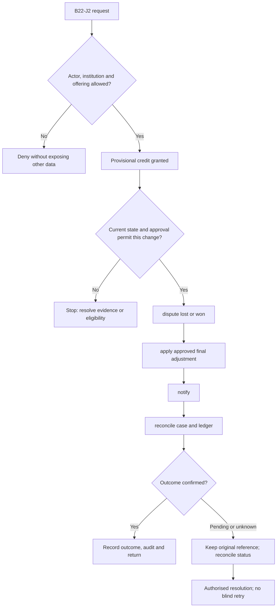

**Review draft • 13 October 2026 • New Banking project • Implementation not started.**

## Purpose and ownership

Resolve payment/card disputes with evidence, deadlines and controlled financial adjustment.

Proposed operating roles: Customer; dispute officer; network specialist; finance approver. These titles describe duties for review; they do not grant permissions. The bank or authorised regulated entity owns product policy and financial outcomes. Platform operators receive no automatic customer-data, fund-movement or issuer authority.

## Worked Indian example

**Fictional requirements illustration, not seeded data or approved banking policy.** Reference: DISP-001 / disputed INR 600.00 purchase.

| Stage | Example |
| --- | --- |
| Starting situation | A customer reports a transaction they do not recognise. |
| Operator/customer actions | Verify standing, classify the dispute, preserve evidence/deadlines and submit through the issuer's approved network process. |
| Expected normal outcome | The case ends with an authoritative dispute result, customer response and reconciled financial adjustment if warranted. |
| Failure or alternate outcome | Provisional credit is not final refund; a lost case needs an authorised linked correction and notice. |

No real customer, regulator approval, provider connection or bank operation is asserted. Illustrative amounts have currency INR and scale 2; actual economics/authority must be supplied by the institution.

## Module flow diagrams

These are proposed requirements flows. The detailed policy and contracts still need owner confirmation.

### Flow 1: B22 primary journey

### Flow 2: B22 alternate servicing and recovery journey

## Required features

| Feature | Required behaviour |
| --- | --- |
| B22-F1 | Complaint-to-transaction dispute capture. The final field schema, permitted actions and acceptance evidence must be approved for each enabled offering. |
| B22-F2 | Evidence collection, deadlines and owner queues. The final field schema, permitted actions and acceptance evidence must be approved for each enabled offering. |
| B22-F3 | Chargeback/representment and network status. The final field schema, permitted actions and acceptance evidence must be approved for each enabled offering. |
| B22-F4 | Provisional/permanent adjustments and reversals. The final field schema, permitted actions and acceptance evidence must be approved for each enabled offering. |
| B22-F5 | Customer communications and case closure. The final field schema, permitted actions and acceptance evidence must be approved for each enabled offering. |

## Configuration to agree

Reason codes; evidence; deadlines; provisional-credit policy; representment and write-off authority. Store approved values in versioned, effective-dated product/programme policy. Capture the exact configuration version used by an instruction. Missing mandatory configuration blocks the dependent action; enabling a menu cannot grant legal authority.

## End-to-end journey 1

Report transaction → verify standing and original transaction → classify → collect evidence → submit authorised dispute → track outcome → settle adjustment → close with explanation.

The journey ends only when its authoritative result, customer/staff-visible result and related book or case history agree. A saved request, queue entry or HTTP acknowledgement is an intermediate state.

## End-to-end journey 2

Provisional credit granted → dispute lost or won → apply approved final adjustment → notify → reconcile case and ledger.

Every transition needs an authorised actor, original version and recorded reason where required. Cancellation or client disconnection does not prove server rollback. Financial corrections retain their original reference and use linked reversal/adjustment entries rather than deleting history.

## Interfaces and data dependencies

Network dispute rules/status; original transaction; evidence store; adjustment journals. Agree stable institution, product, party and operation references; source version; as-of time; completeness; status/finality; retry rules and correction handling. Where no financial posting occurs, record the administrative/case outcome instead of inventing a journal.

All channel requests use server-verified identity and institution scope. Partner, branch and customer access is narrower than institution membership. Lists, details, search, exports, callbacks and files must enforce the same boundary.

## Current implementation and reuse

**New Banking project: proposed, not built.** No financial disputes or chargeback module exists. General support is only a partial case foundation.

Reviewed legacy feature boundaries: `service-requests (non-financial General support only)`. See the source inventory on the [gap page](/banking/current-system-gap). Legacy feature presence is a reuse candidate, not acceptance or deployment evidence for this module.

## Acceptance and difficult cases

Explicit cases: Duplicate dispute; deadline approaching; original refund already received; credit recovery after case loss.

- Allowed success: confirm saved/output values, authoritative status and the exact approved actor/channel.
- Denial: reject foreign institution, unauthorised branch/customer/programme and revoked or expired access without information leakage.
- Reliability: prove stale-version rejection and concurrency behaviour; retryable commands apply one economic effect; unknown financial outcomes are reconciled by original reference.
- Records and usability: preserve redacted audit, monetary precision and document integrity; verify keyboard/mobile, direct links, expired sessions, Back/Forward and return navigation. Internal web navigation preserves its workspace.

Apply the [scenario matrix](/banking/scenario-matrix) and the [shared journey rules](/banking/journeys). Timing, amounts and regulatory applicability are institution-owned inputs, not defaults supplied by this document.

## Pending decision

Who may grant provisional credit, submit network disputes and approve loss/write-off?

The [decision register](/banking/decisions) keeps sequencing separate from approval. No implementation begins because this page describes a proposed capability.

[Module register](/banking/module-register) · [Offering compatibility](/banking/offering-matrix)
