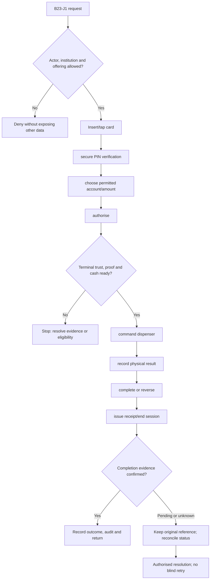
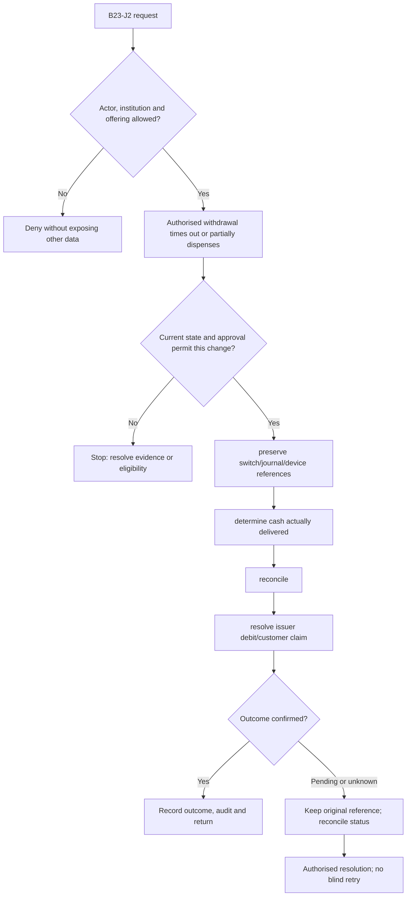

**Review draft • 13 October 2026 • New Banking project • Implementation not started.**

## Purpose and ownership

Operate a secure ATM customer session and terminal fleet through certified devices and switch interfaces.

Proposed operating roles: ATM customer; terminal operator; cash custodian; switch operations. These titles describe duties for review; they do not grant permissions. The bank or authorised regulated entity owns product policy and financial outcomes. Platform operators receive no automatic customer-data, fund-movement or issuer authority.

## Worked Indian example

**Fictional requirements illustration, not seeded data or approved banking policy.** Reference: ATM-001 / INR 2,000.00 request.

| Stage | Example |
| --- | --- |
| Starting situation | An illustrative terminal authorises INR 2,000.00 but its device journal reports only INR 1,000.00 dispensed. |
| Operator/customer actions | Capture issuer/switch, dispenser and electronic-journal references, classify partial dispense and route reconciliation under contracted rules. |
| Expected normal outcome | Final customer debit matches the authorised resolved cash outcome; the unresolved amount stays an exception until authoritative resolution. |
| Failure or alternate outcome | The terminal must not dispense another INR 2,000.00 automatically or claim a full reversal before issuer confirmation. |

No real customer, regulator approval, provider connection or bank operation is asserted. Illustrative amounts have currency INR and scale 2; actual economics/authority must be supplied by the institution.

## Module flow diagrams

These are proposed requirements flows. The detailed policy and contracts still need owner confirmation.

### Flow 1: B23 primary journey

### Flow 2: B23 alternate servicing and recovery journey

## Required features

| Feature | Required behaviour |
| --- | --- |
| B23-F1 | ATM terminal registration, trust and health. The final field schema, permitted actions and acceptance evidence must be approved for each enabled offering. |
| B23-F2 | Card/PIN session and permitted account enquiry. The final field schema, permitted actions and acceptance evidence must be approved for each enabled offering. |
| B23-F3 | Withdrawal authorisation, dispense and completion. The final field schema, permitted actions and acceptance evidence must be approved for each enabled offering. |
| B23-F4 | Electronic journal, reversal and cash reconciliation. The final field schema, permitted actions and acceptance evidence must be approved for each enabled offering. |
| B23-F5 | Cash replenishment, faults, card capture and maintenance mode. The final field schema, permitted actions and acceptance evidence must be approved for each enabled offering. |

## Configuration to agree

Terminal identity/model; acquirer/issuer routing; screen/language; denominations; withdrawal limits; cash/retract policy. Store approved values in versioned, effective-dated product/programme policy. Capture the exact configuration version used by an instruction. Missing mandatory configuration blocks the dependent action; enabling a menu cannot grant legal authority.

## End-to-end journey 1

Insert/tap card → secure PIN verification → choose permitted account/amount → authorise → command dispenser → record physical result → complete or reverse → issue receipt/end session.

The journey ends only when its authoritative result, customer/staff-visible result and related book or case history agree. A saved request, queue entry or HTTP acknowledgement is an intermediate state.

## End-to-end journey 2

Authorised withdrawal times out or partially dispenses → preserve switch/journal/device references → determine cash actually delivered → reconcile → resolve issuer debit/customer claim.

Every transition needs an authorised actor, original version and recorded reason where required. Cancellation or client disconnection does not prove server rollback. Financial corrections retain their original reference and use linked reversal/adjustment entries rather than deleting history.

## Interfaces and data dependencies

Certified terminal middleware; encrypted PIN/HSM; switch protocol; dispenser/journal events; issuer/acquirer settlement. Agree stable institution, product, party and operation references; source version; as-of time; completeness; status/finality; retry rules and correction handling. Where no financial posting occurs, record the administrative/case outcome instead of inventing a journal.

All channel requests use server-verified identity and institution scope. Partner, branch and customer access is narrower than institution membership. Lists, details, search, exports, callbacks and files must enforce the same boundary.

## Current implementation and reuse

**New Banking project: proposed, not built.** No ATM app, switch/device integration or cash reconciliation exists.

Reviewed legacy feature boundaries: No operational source module was found. Legacy feature presence is a reuse candidate, not acceptance or deployment evidence for this module.

## Acceptance and difficult cases

Explicit cases: Cash retract; partial dispense; debit with no cash; cash delivered with timeout; power loss; duplicate completion.

- Allowed success: confirm saved/output values, authoritative status and the exact approved actor/channel.
- Denial: reject foreign institution, unauthorised branch/customer/programme and revoked or expired access without information leakage.
- Reliability: prove stale-version rejection and concurrency behaviour; retryable commands apply one economic effect; unknown financial outcomes are reconciled by original reference.
- Records and usability: preserve redacted audit, monetary precision and document integrity; verify keyboard/mobile, direct links, expired sessions, Back/Forward and return navigation. Internal web navigation preserves its workspace.

Apply the [scenario matrix](/banking/scenario-matrix) and the [shared journey rules](/banking/journeys). Timing, amounts and regulatory applicability are institution-owned inputs, not defaults supplied by this document.

## Pending decision

Is the ATM app a physical terminal client or an operations console? Which terminal vendor, switch and services are required?

The [decision register](/banking/decisions) keeps sequencing separate from approval. No implementation begins because this page describes a proposed capability.

[Module register](/banking/module-register) · [Offering compatibility](/banking/offering-matrix)
