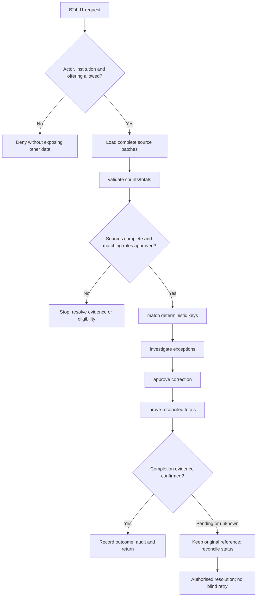
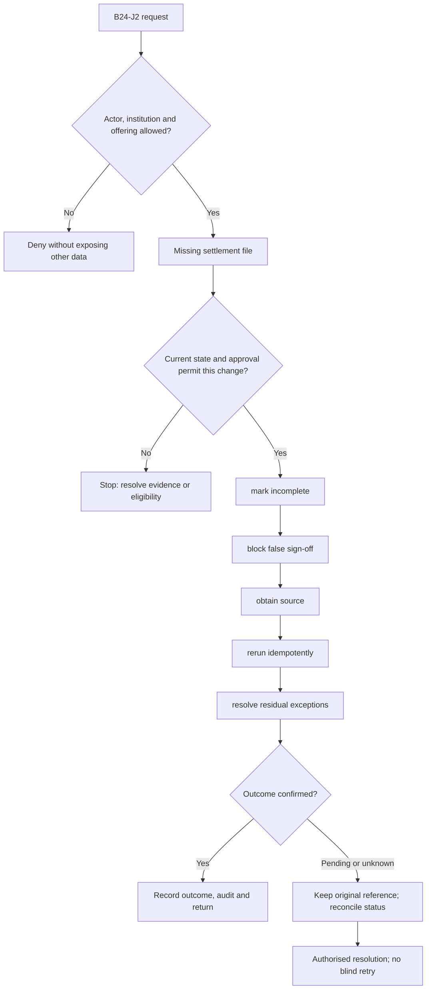

**Review draft • 13 October 2026 • New Banking project • Implementation not started.**

## Purpose and ownership

Prove that instructions, bank books, provider outcomes and settlement funds agree.

Proposed operating roles: Reconciliation analyst; exception maker/checker; finance. These titles describe duties for review; they do not grant permissions. The bank or authorised regulated entity owns product policy and financial outcomes. Platform operators receive no automatic customer-data, fund-movement or issuer authority.

## Worked Indian example

**Fictional requirements illustration, not seeded data or approved banking policy.** Reference: RECON-001 / three-source comparison.

| Stage | Example |
| --- | --- |
| Starting situation | The ledger contains INR 1,000.00, the processor clearing contains INR 1,000.00, but the complete settlement source has no matching item. |
| Operator/customer actions | Validate file completeness/control totals, open an exception and investigate timing/reference before approving any adjustment. |
| Expected normal outcome | Sign-off remains incomplete until an explained reconciled result exists. |
| Failure or alternate outcome | An empty/truncated settlement file is not proof that every transaction failed. |

No real customer, regulator approval, provider connection or bank operation is asserted. Illustrative amounts have currency INR and scale 2; actual economics/authority must be supplied by the institution.

## Module flow diagrams

These are proposed requirements flows. The detailed policy and contracts still need owner confirmation.

### Flow 1: B24 primary journey

### Flow 2: B24 alternate servicing and recovery journey

## Required features

| Feature | Required behaviour |
| --- | --- |
| B24-F1 | Instruction-to-ledger-to-provider matching. The final field schema, permitted actions and acceptance evidence must be approved for each enabled offering. |
| B24-F2 | Bank/network/escrow statement ingestion with completeness. The final field schema, permitted actions and acceptance evidence must be approved for each enabled offering. |
| B24-F3 | Duplicate, missing, amount and timing exceptions. The final field schema, permitted actions and acceptance evidence must be approved for each enabled offering. |
| B24-F4 | Controlled adjustments and evidence-based closure. The final field schema, permitted actions and acceptance evidence must be approved for each enabled offering. |
| B24-F5 | Operational sign-off and ageing dashboards. The final field schema, permitted actions and acceptance evidence must be approved for each enabled offering. |

## Configuration to agree

Sources; matching keys; date/currency; tolerance; completeness; exception owners; write-off limits. Store approved values in versioned, effective-dated product/programme policy. Capture the exact configuration version used by an instruction. Missing mandatory configuration blocks the dependent action; enabling a menu cannot grant legal authority.

## End-to-end journey 1

Load complete source batches → validate counts/totals → match deterministic keys → investigate exceptions → approve correction → prove reconciled totals.

The journey ends only when its authoritative result, customer/staff-visible result and related book or case history agree. A saved request, queue entry or HTTP acknowledgement is an intermediate state.

## End-to-end journey 2

Missing settlement file → mark incomplete → block false sign-off → obtain source → rerun idempotently → resolve residual exceptions.

Every transition needs an authorised actor, original version and recorded reason where required. Cancellation or client disconnection does not prove server rollback. Financial corrections retain their original reference and use linked reversal/adjustment entries rather than deleting history.

## Interfaces and data dependencies

Complete statements; control totals; bank/network finality; journal references; adjustment approval. Agree stable institution, product, party and operation references; source version; as-of time; completeness; status/finality; retry rules and correction handling. Where no financial posting occurs, record the administrative/case outcome instead of inventing a journal.

All channel requests use server-verified identity and institution scope. Partner, branch and customer access is narrower than institution membership. Lists, details, search, exports, callbacks and files must enforce the same boundary.

## Current implementation and reuse

**New Banking project: proposed, not built.** No financial reconciliation engine exists.

Reviewed legacy feature boundaries: `source-clients`, `source-activity (ingestion foundations only)`. See the source inventory on the [gap page](/banking/current-system-gap). Legacy feature presence is a reuse candidate, not acceptance or deployment evidence for this module.

## Acceptance and difficult cases

Explicit cases: Truncated file; duplicate batch; holiday date mismatch; same reference different currency.

- Allowed success: confirm saved/output values, authoritative status and the exact approved actor/channel.
- Denial: reject foreign institution, unauthorised branch/customer/programme and revoked or expired access without information leakage.
- Reliability: prove stale-version rejection and concurrency behaviour; retryable commands apply one economic effect; unknown financial outcomes are reconciled by original reference.
- Records and usability: preserve redacted audit, monetary precision and document integrity; verify keyboard/mobile, direct links, expired sessions, Back/Forward and return navigation. Internal web navigation preserves its workspace.

Apply the [scenario matrix](/banking/scenario-matrix) and the [shared journey rules](/banking/journeys). Timing, amounts and regulatory applicability are institution-owned inputs, not defaults supplied by this document.

## Pending decision

Which sources and control totals establish completeness, and who can approve adjustments?

The [decision register](/banking/decisions) keeps sequencing separate from approval. No implementation begins because this page describes a proposed capability.

[Module register](/banking/module-register) · [Offering compatibility](/banking/offering-matrix)
