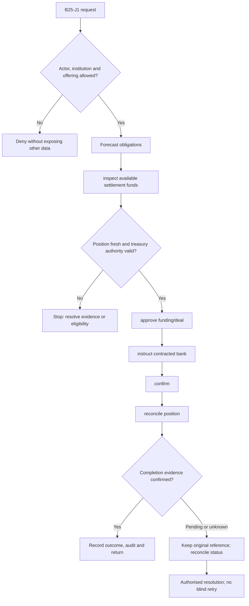
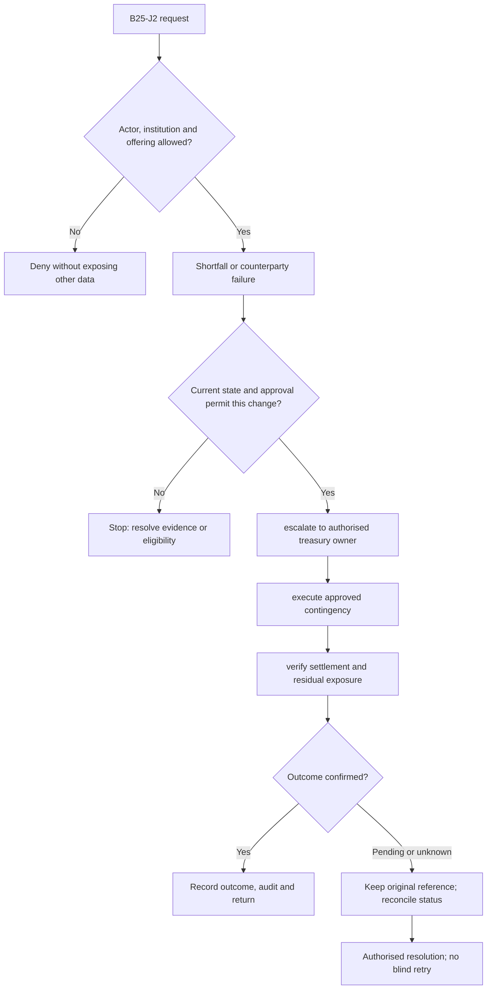

**Review draft • 13 October 2026 • New Banking project • Implementation not started.**

## Purpose and ownership

Manage approved liquidity and settlement obligations with clear separation from retail servicing.

Proposed operating roles: Treasury operator; finance approver; liquidity risk; settlement officer. These titles describe duties for review; they do not grant permissions. The bank or authorised regulated entity owns product policy and financial outcomes. Platform operators receive no automatic customer-data, fund-movement or issuer authority.

## Worked Indian example

**Fictional requirements illustration, not seeded data or approved banking policy.** Reference: POSITION-001 / illustrative funding shortfall.

| Stage | Example |
| --- | --- |
| Starting situation | Approved settlement obligations exceed currently confirmed available settlement funding. |
| Operator/customer actions | Compute the position from authoritative balances/value dates, escalate and obtain authorised funding action. |
| Expected normal outcome | The funded settlement position is confirmed and reconciled; a planned transfer is not available liquidity. |
| Failure or alternate outcome | Stale funding balances or a counterparty failure prevents a false settlement-ready state. |

No real customer, regulator approval, provider connection or bank operation is asserted. Illustrative amounts have currency INR and scale 2; actual economics/authority must be supplied by the institution.

## Module flow diagrams

These are proposed requirements flows. The detailed policy and contracts still need owner confirmation.

### Flow 1: B25 primary journey

### Flow 2: B25 alternate servicing and recovery journey

## Required features

| Feature | Required behaviour |
| --- | --- |
| B25-F1 | Daily liquidity and settlement funding positions. The final field schema, permitted actions and acceptance evidence must be approved for each enabled offering. |
| B25-F2 | Counterparty/deal recording where authorised. The final field schema, permitted actions and acceptance evidence must be approved for each enabled offering. |
| B25-F3 | Cash-flow maturity ladders and ALM inputs. The final field schema, permitted actions and acceptance evidence must be approved for each enabled offering. |
| B25-F4 | Settlement funding instructions and confirmations. The final field schema, permitted actions and acceptance evidence must be approved for each enabled offering. |
| B25-F5 | Valuation, exposure and finance reconciliation. The final field schema, permitted actions and acceptance evidence must be approved for each enabled offering. |

## Configuration to agree

Permitted instruments; counterparties; nostro/vostro; settlement accounts; liquidity limits; calendars. Store approved values in versioned, effective-dated product/programme policy. Capture the exact configuration version used by an instruction. Missing mandatory configuration blocks the dependent action; enabling a menu cannot grant legal authority.

## End-to-end journey 1

Forecast obligations → inspect available settlement funds → approve funding/deal → instruct contracted bank → confirm → reconcile position.

The journey ends only when its authoritative result, customer/staff-visible result and related book or case history agree. A saved request, queue entry or HTTP acknowledgement is an intermediate state.

## End-to-end journey 2

Shortfall or counterparty failure → escalate to authorised treasury owner → execute approved contingency → verify settlement and residual exposure.

Every transition needs an authorised actor, original version and recorded reason where required. Cancellation or client disconnection does not prove server rollback. Financial corrections retain their original reference and use linked reversal/adjustment entries rather than deleting history.

## Interfaces and data dependencies

Treasury ownership; approved instruments; bank statements; valuation and settlement contracts. Agree stable institution, product, party and operation references; source version; as-of time; completeness; status/finality; retry rules and correction handling. Where no financial posting occurs, record the administrative/case outcome instead of inventing a journal.

All channel requests use server-verified identity and institution scope. Partner, branch and customer access is narrower than institution membership. Lists, details, search, exports, callbacks and files must enforce the same boundary.

## Current implementation and reuse

**New Banking project: proposed, not built.** Excluded from the old project. Included here as a proposed new-project scope area only.

Reviewed legacy feature boundaries: No operational source module was found. Legacy feature presence is a reuse candidate, not acceptance or deployment evidence for this module.

## Acceptance and difficult cases

Explicit cases: Insufficient settlement liquidity; stale valuation; failed counterparty; wrong value date.

- Allowed success: confirm saved/output values, authoritative status and the exact approved actor/channel.
- Denial: reject foreign institution, unauthorised branch/customer/programme and revoked or expired access without information leakage.
- Reliability: prove stale-version rejection and concurrency behaviour; retryable commands apply one economic effect; unknown financial outcomes are reconciled by original reference.
- Records and usability: preserve redacted audit, monetary precision and document integrity; verify keyboard/mobile, direct links, expired sessions, Back/Forward and return navigation. Internal web navigation preserves its workspace.

Apply the [scenario matrix](/banking/scenario-matrix) and the [shared journey rules](/banking/journeys). Timing, amounts and regulatory applicability are institution-owned inputs, not defaults supplied by this document.

## Pending decision

Is full treasury in the new project, or only liquidity/settlement visibility and funding coordination?

The [decision register](/banking/decisions) keeps sequencing separate from approval. No implementation begins because this page describes a proposed capability.

[Module register](/banking/module-register) · [Offering compatibility](/banking/offering-matrix)
