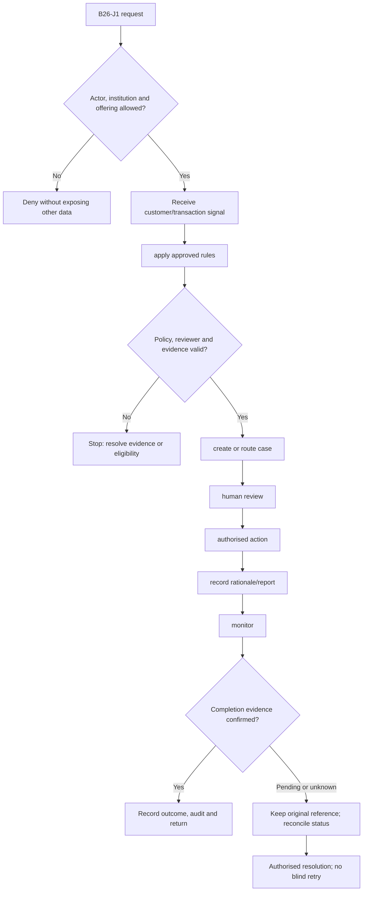
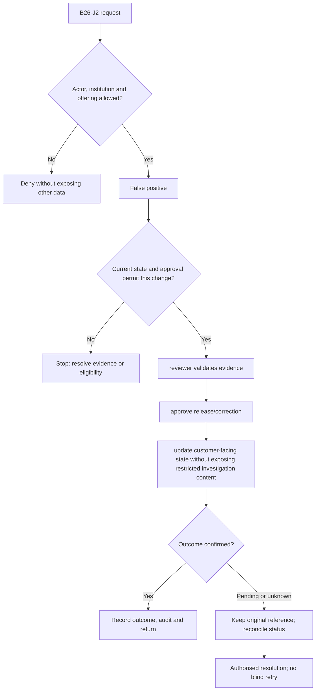

**Review draft • 13 October 2026 • New Banking project • Implementation not started.**

## Purpose and ownership

Apply institution-owned risk controls and handle reviewable cases without silently making autonomous decisions.

Proposed operating roles: Risk analyst; AML investigator; compliance officer; authorised decision maker. These titles describe duties for review; they do not grant permissions. The bank or authorised regulated entity owns product policy and financial outcomes. Platform operators receive no automatic customer-data, fund-movement or issuer authority.

## Worked Indian example

**Fictional requirements illustration, not seeded data or approved banking policy.** Reference: RISK-001 / onboarding name match.

| Stage | Example |
| --- | --- |
| Starting situation | Screening returns a potential match for CUSTOMER-001. |
| Operator/customer actions | Create a restricted investigation case, gather permitted evidence and route to the accountable reviewer. |
| Expected normal outcome | The reviewer records a reasoned release/restriction decision under the institution policy. |
| Failure or alternate outcome | An outage or missing review cannot be silently treated as a cleared screening result. |

No real customer, regulator approval, provider connection or bank operation is asserted. Illustrative amounts have currency INR and scale 2; actual economics/authority must be supplied by the institution.

## Module flow diagrams

These are proposed requirements flows. The detailed policy and contracts still need owner confirmation.

### Flow 1: B26 primary journey

### Flow 2: B26 alternate servicing and recovery journey

## Required features

| Feature | Required behaviour |
| --- | --- |
| B26-F1 | Onboarding and ongoing screening. The final field schema, permitted actions and acceptance evidence must be approved for each enabled offering. |
| B26-F2 | Real-time fraud signals and step-up/decline policy. The final field schema, permitted actions and acceptance evidence must be approved for each enabled offering. |
| B26-F3 | Transaction monitoring and investigation cases. The final field schema, permitted actions and acceptance evidence must be approved for each enabled offering. |
| B26-F4 | Suspicious-activity review and controlled filing. The final field schema, permitted actions and acceptance evidence must be approved for each enabled offering. |
| B26-F5 | Restriction/appeal handling and policy/model governance. The final field schema, permitted actions and acceptance evidence must be approved for each enabled offering. |

## Configuration to agree

Risk scenarios; sanctions screening; monitoring; restrictions; regulatory reporting; review delegation. Store approved values in versioned, effective-dated product/programme policy. Capture the exact configuration version used by an instruction. Missing mandatory configuration blocks the dependent action; enabling a menu cannot grant legal authority.

## End-to-end journey 1

Receive customer/transaction signal → apply approved rules → create or route case → human review → authorised action → record rationale/report → monitor.

The journey ends only when its authoritative result, customer/staff-visible result and related book or case history agree. A saved request, queue entry or HTTP acknowledgement is an intermediate state.

## End-to-end journey 2

False positive → reviewer validates evidence → approve release/correction → update customer-facing state without exposing restricted investigation content.

Every transition needs an authorised actor, original version and recorded reason where required. Cancellation or client disconnection does not prove server rollback. Financial corrections retain their original reference and use linked reversal/adjustment entries rather than deleting history.

## Interfaces and data dependencies

Screening/monitoring contracts; institution policy; case evidence; regulatory submission status. Agree stable institution, product, party and operation references; source version; as-of time; completeness; status/finality; retry rules and correction handling. Where no financial posting occurs, record the administrative/case outcome instead of inventing a journal.

All channel requests use server-verified identity and institution scope. Partner, branch and customer access is narrower than institution membership. Lists, details, search, exports, callbacks and files must enforce the same boundary.

## Current implementation and reuse

**New Banking project: proposed, not built.** Audit/authorization foundations exist; no AML/fraud decisioning or case engine.

Reviewed legacy feature boundaries: `audit`, `staff-audit (traceability foundations only)`. See the source inventory on the [gap page](/banking/current-system-gap). Legacy feature presence is a reuse candidate, not acceptance or deployment evidence for this module.

## Acceptance and difficult cases

Explicit cases: Unavailable screening; false match; conflicting holds; unauthorised investigation access.

- Allowed success: confirm saved/output values, authoritative status and the exact approved actor/channel.
- Denial: reject foreign institution, unauthorised branch/customer/programme and revoked or expired access without information leakage.
- Reliability: prove stale-version rejection and concurrency behaviour; retryable commands apply one economic effect; unknown financial outcomes are reconciled by original reference.
- Records and usability: preserve redacted audit, monetary precision and document integrity; verify keyboard/mobile, direct links, expired sessions, Back/Forward and return navigation. Internal web navigation preserves its workspace.

Apply the [scenario matrix](/banking/scenario-matrix) and the [shared journey rules](/banking/journeys). Timing, amounts and regulatory applicability are institution-owned inputs, not defaults supplied by this document.

## Pending decision

Which institution policies, jurisdictions, reporting duties and accountable reviewers apply?

The [decision register](/banking/decisions) keeps sequencing separate from approval. No implementation begins because this page describes a proposed capability.

[Module register](/banking/module-register) · [Offering compatibility](/banking/offering-matrix)
