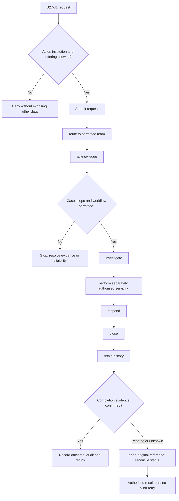
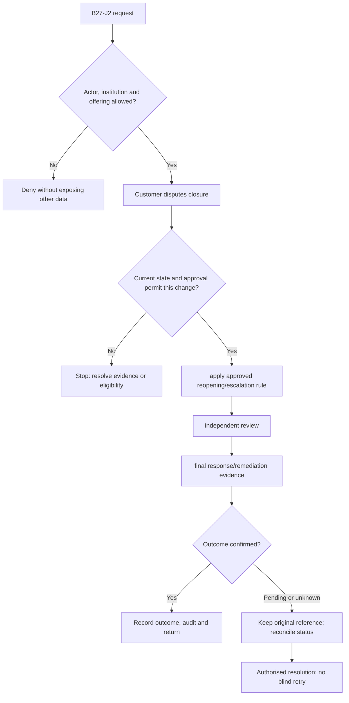

**Review draft • 13 October 2026 • New Banking project • Implementation not started.**

## Purpose and ownership

Let customers and staff resolve servicing problems with ownership and customer-visible outcomes.

Proposed operating roles: Customer; branch service officer; complaint officer; escalation owner. These titles describe duties for review; they do not grant permissions. The bank or authorised regulated entity owns product policy and financial outcomes. Platform operators receive no automatic customer-data, fund-movement or issuer authority.

## Worked Indian example

**Fictional requirements illustration, not seeded data or approved banking policy.** Reference: SR-001 / debit with no ATM cash.

| Stage | Example |
| --- | --- |
| Starting situation | A customer reports an ATM debit without cash delivery. |
| Operator/customer actions | Create a scoped service case, link original transaction/journal evidence, route investigation to ATM/dispute teams and track their authoritative financial result. |
| Expected normal outcome | The customer receives an accurate response; only a confirmed adjustment changes their balance. |
| Failure or alternate outcome | Closing the support case does not itself execute a refund or erase the unresolved ATM exception. |

No real customer, regulator approval, provider connection or bank operation is asserted. Illustrative amounts have currency INR and scale 2; actual economics/authority must be supplied by the institution.

## Module flow diagrams

These are proposed requirements flows. The detailed policy and contracts still need owner confirmation.

### Flow 1: B27 primary journey

### Flow 2: B27 alternate servicing and recovery journey

## Required features

| Feature | Required behaviour |
| --- | --- |
| B27-F1 | Service catalogue and structured request forms. The final field schema, permitted actions and acceptance evidence must be approved for each enabled offering. |
| B27-F2 | Assigned work queues and permissioned private content. The final field schema, permitted actions and acceptance evidence must be approved for each enabled offering. |
| B27-F3 | Complaints, responses and escalation. The final field schema, permitted actions and acceptance evidence must be approved for each enabled offering. |
| B27-F4 | Financial remediation referral with separate approval. The final field schema, permitted actions and acceptance evidence must be approved for each enabled offering. |
| B27-F5 | Customer status, evidence and closure quality. The final field schema, permitted actions and acceptance evidence must be approved for each enabled offering. |

## Configuration to agree

Request types; routing; ownership; complaint stages; deadlines; reopening; escalation; remediation authority. Store approved values in versioned, effective-dated product/programme policy. Capture the exact configuration version used by an instruction. Missing mandatory configuration blocks the dependent action; enabling a menu cannot grant legal authority.

## End-to-end journey 1

Submit request → route to permitted team → acknowledge → investigate → perform separately authorised servicing → respond → close → retain history.

The journey ends only when its authoritative result, customer/staff-visible result and related book or case history agree. A saved request, queue entry or HTTP acknowledgement is an intermediate state.

## End-to-end journey 2

Customer disputes closure → apply approved reopening/escalation rule → independent review → final response/remediation evidence.

Every transition needs an authorised actor, original version and recorded reason where required. Cancellation or client disconnection does not prove server rollback. Financial corrections retain their original reference and use linked reversal/adjustment entries rather than deleting history.

## Interfaces and data dependencies

Approved request/complaint state policy; case ownership; action outcomes; notice delivery. Agree stable institution, product, party and operation references; source version; as-of time; completeness; status/finality; retry rules and correction handling. Where no financial posting occurs, record the administrative/case outcome instead of inventing a journal.

All channel requests use server-verified identity and institution scope. Partner, branch and customer access is narrower than institution membership. Lists, details, search, exports, callbacks and files must enforce the same boundary.

## Current implementation and reuse

**New Banking project: proposed, not built.** General support is built within bounds; complaints, private notes and reassignment remain explicitly held in the old project.

Reviewed legacy feature boundaries: `service-requests`, `service-request-routing`, `staff-support`. See the source inventory on the [gap page](/banking/current-system-gap). Legacy feature presence is a reuse candidate, not acceptance or deployment evidence for this module.

## Acceptance and difficult cases

Explicit cases: Inactive case owner; foreign branch; close without response; customer cannot see private note.

- Allowed success: confirm saved/output values, authoritative status and the exact approved actor/channel.
- Denial: reject foreign institution, unauthorised branch/customer/programme and revoked or expired access without information leakage.
- Reliability: prove stale-version rejection and concurrency behaviour; retryable commands apply one economic effect; unknown financial outcomes are reconciled by original reference.
- Records and usability: preserve redacted audit, monetary precision and document integrity; verify keyboard/mobile, direct links, expired sessions, Back/Forward and return navigation. Internal web navigation preserves its workspace.

Apply the [scenario matrix](/banking/scenario-matrix) and the [shared journey rules](/banking/journeys). Timing, amounts and regulatory applicability are institution-owned inputs, not defaults supplied by this document.

## Pending decision

Which held workflows should be newly commissioned, and what are their exact states and owners?

The [decision register](/banking/decisions) keeps sequencing separate from approval. No implementation begins because this page describes a proposed capability.

[Module register](/banking/module-register) · [Offering compatibility](/banking/offering-matrix)
