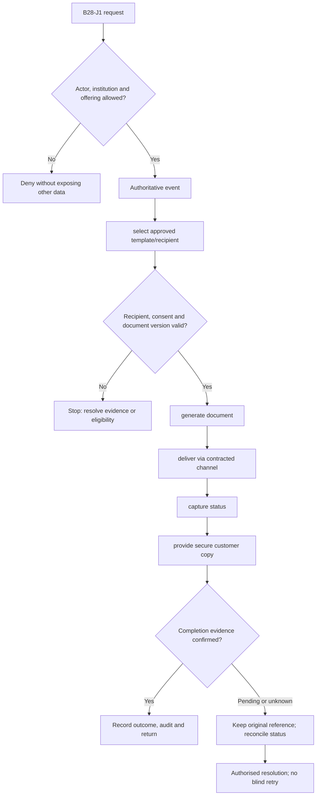
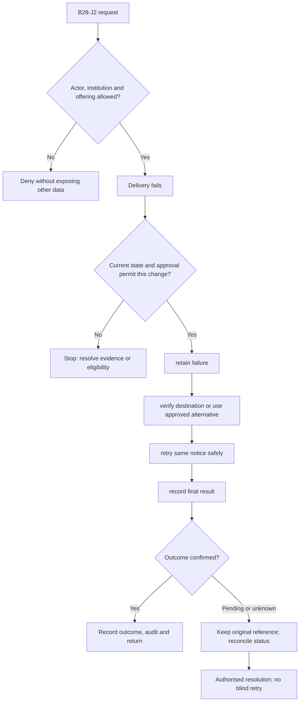

**Review draft • 13 October 2026 • New Banking project • Implementation not started.**

## Purpose and ownership

Deliver the correct disclosures and documents through verified channels and retain evidence.

Proposed operating roles: Customer; communication owner; document reviewer; service operator. These titles describe duties for review; they do not grant permissions. The bank or authorised regulated entity owns product policy and financial outcomes. Platform operators receive no automatic customer-data, fund-movement or issuer authority.

## Worked Indian example

**Fictional requirements illustration, not seeded data or approved banking policy.** Reference: DOC-001 / loan agreement version 1.

| Stage | Example |
| --- | --- |
| Starting situation | A borrower has accepted a verified loan agreement. |
| Operator/customer actions | Generate the signed version, deliver to the verified permitted destination and retain secure access and delivery evidence. |
| Expected normal outcome | The downloaded document hash/version matches the accepted agreement; delivery failure is visible. |
| Failure or alternate outcome | Changing the email destination or template cannot silently resend another customer's document. |

No real customer, regulator approval, provider connection or bank operation is asserted. Illustrative amounts have currency INR and scale 2; actual economics/authority must be supplied by the institution.

## Module flow diagrams

These are proposed requirements flows. The detailed policy and contracts still need owner confirmation.

### Flow 1: B28 primary journey

### Flow 2: B28 alternate servicing and recovery journey

## Required features

| Feature | Required behaviour |
| --- | --- |
| B28-F1 | Disclosures, agreements, statements and certificates. The final field schema, permitted actions and acceptance evidence must be approved for each enabled offering. |
| B28-F2 | Secure document generation/download and integrity. The final field schema, permitted actions and acceptance evidence must be approved for each enabled offering. |
| B28-F3 | Transactional notices and permitted campaigns. The final field schema, permitted actions and acceptance evidence must be approved for each enabled offering. |
| B28-F4 | Delivery status, bounce/failure handling and manual follow-up. The final field schema, permitted actions and acceptance evidence must be approved for each enabled offering. |
| B28-F5 | Consent/preferences and template approval history. The final field schema, permitted actions and acceptance evidence must be approved for each enabled offering. |

## Configuration to agree

Templates/version; event/recipient; consent; verified destination; delivery retry; document access/retention. Store approved values in versioned, effective-dated product/programme policy. Capture the exact configuration version used by an instruction. Missing mandatory configuration blocks the dependent action; enabling a menu cannot grant legal authority.

## End-to-end journey 1

Authoritative event → select approved template/recipient → generate document → deliver via contracted channel → capture status → provide secure customer copy.

The journey ends only when its authoritative result, customer/staff-visible result and related book or case history agree. A saved request, queue entry or HTTP acknowledgement is an intermediate state.

## End-to-end journey 2

Delivery fails → retain failure → verify destination or use approved alternative → retry same notice safely → record final result.

Every transition needs an authorised actor, original version and recorded reason where required. Cancellation or client disconnection does not prove server rollback. Financial corrections retain their original reference and use linked reversal/adjustment entries rather than deleting history.

## Interfaces and data dependencies

Template owner; delivery connector; signature; secure storage; verified destination. Agree stable institution, product, party and operation references; source version; as-of time; completeness; status/finality; retry rules and correction handling. Where no financial posting occurs, record the administrative/case outcome instead of inventing a journal.

All channel requests use server-verified identity and institution scope. Partner, branch and customer access is narrower than institution membership. Lists, details, search, exports, callbacks and files must enforce the same boundary.

## Current implementation and reuse

**New Banking project: proposed, not built.** Existing private document/notification foundations exist; no complete outbound-delivery platform.

Reviewed legacy feature boundaries: `documents`, `consumer-notifications`, `staff-notifications`. See the source inventory on the [gap page](/banking/current-system-gap). Legacy feature presence is a reuse candidate, not acceptance or deployment evidence for this module.

## Acceptance and difficult cases

Explicit cases: Wrong recipient; expired download; duplicate notice; attachment mismatch; consent revoked.

- Allowed success: confirm saved/output values, authoritative status and the exact approved actor/channel.
- Denial: reject foreign institution, unauthorised branch/customer/programme and revoked or expired access without information leakage.
- Reliability: prove stale-version rejection and concurrency behaviour; retryable commands apply one economic effect; unknown financial outcomes are reconciled by original reference.
- Records and usability: preserve redacted audit, monetary precision and document integrity; verify keyboard/mobile, direct links, expired sessions, Back/Forward and return navigation. Internal web navigation preserves its workspace.

Apply the [scenario matrix](/banking/scenario-matrix) and the [shared journey rules](/banking/journeys). Timing, amounts and regulatory applicability are institution-owned inputs, not defaults supplied by this document.

## Pending decision

Which events/channels/templates and retention rules are mandatory for each offering?

The [decision register](/banking/decisions) keeps sequencing separate from approval. No implementation begins because this page describes a proposed capability.

[Module register](/banking/module-register) · [Offering compatibility](/banking/offering-matrix)
