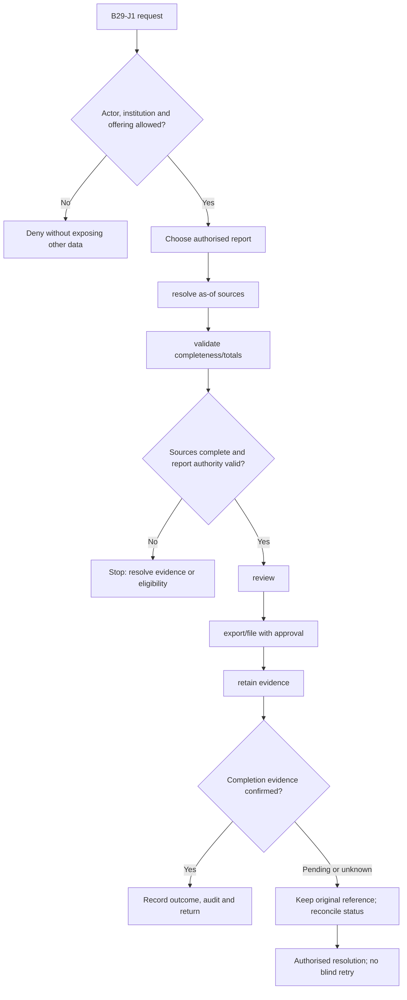
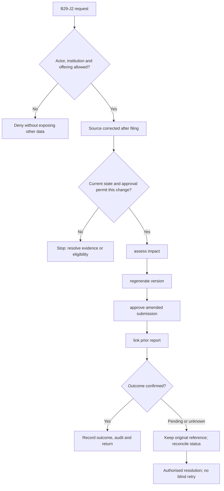

**Review draft • 13 October 2026 • New Banking project • Implementation not started.**

## Purpose and ownership

Produce traceable financial, operational and regulatory reports from controlled source data.

Proposed operating roles: Operations manager; finance; regulatory reporter; auditor. These titles describe duties for review; they do not grant permissions. The bank or authorised regulated entity owns product policy and financial outcomes. Platform operators receive no automatic customer-data, fund-movement or issuer authority.

## Worked Indian example

**Fictional requirements illustration, not seeded data or approved banking policy.** Reference: REPORT-001 / DEMOBANK business date.

| Stage | Example |
| --- | --- |
| Starting situation | Finance prepares a daily closing balance report. |
| Operator/customer actions | Read reconciled authoritative books for the declared date/currency, validate totals and obtain required sign-off. |
| Expected normal outcome | Report figures reproduce from the stated source/version and filing/export evidence. |
| Failure or alternate outcome | An incomplete close or corrected source marks the report pending/restated, not final. |

No real customer, regulator approval, provider connection or bank operation is asserted. Illustrative amounts have currency INR and scale 2; actual economics/authority must be supplied by the institution.

## Module flow diagrams

These are proposed requirements flows. The detailed policy and contracts still need owner confirmation.

### Flow 1: B29 primary journey

### Flow 2: B29 alternate servicing and recovery journey

## Required features

| Feature | Required behaviour |
| --- | --- |
| B29-F1 | Operational workloads and queue ageing. The final field schema, permitted actions and acceptance evidence must be approved for each enabled offering. |
| B29-F2 | Financial balances, revenue and portfolio reports. The final field schema, permitted actions and acceptance evidence must be approved for each enabled offering. |
| B29-F3 | Regulatory data preparation/validation and submission workflow. The final field schema, permitted actions and acceptance evidence must be approved for each enabled offering. |
| B29-F4 | Governed exports with masking and formula-injection protection. The final field schema, permitted actions and acceptance evidence must be approved for each enabled offering. |
| B29-F5 | Report version, completeness, lineage and restatement. The final field schema, permitted actions and acceptance evidence must be approved for each enabled offering. |

## Configuration to agree

Measures; audience; business/as-of date; currency; corrections; export; filing approval. Store approved values in versioned, effective-dated product/programme policy. Capture the exact configuration version used by an instruction. Missing mandatory configuration blocks the dependent action; enabling a menu cannot grant legal authority.

## End-to-end journey 1

Choose authorised report → resolve as-of sources → validate completeness/totals → review → export/file with approval → retain evidence.

The journey ends only when its authoritative result, customer/staff-visible result and related book or case history agree. A saved request, queue entry or HTTP acknowledgement is an intermediate state.

## End-to-end journey 2

Source corrected after filing → assess impact → regenerate version → approve amended submission → link prior report.

Every transition needs an authorised actor, original version and recorded reason where required. Cancellation or client disconnection does not prove server rollback. Financial corrections retain their original reference and use linked reversal/adjustment entries rather than deleting history.

## Interfaces and data dependencies

Approved definitions; ledger/source lineage; report/form versions; regulator submission receipts. Agree stable institution, product, party and operation references; source version; as-of time; completeness; status/finality; retry rules and correction handling. Where no financial posting occurs, record the administrative/case outcome instead of inventing a journal.

All channel requests use server-verified identity and institution scope. Partner, branch and customer access is narrower than institution membership. Lists, details, search, exports, callbacks and files must enforce the same boundary.

## Current implementation and reuse

**New Banking project: proposed, not built.** General-support workload and Bank Admin CSV are built within bounds; financial/regulatory reporting is absent.

Reviewed legacy feature boundaries: `staff-support-workload`, `audit`. See the source inventory on the [gap page](/banking/current-system-gap). Legacy feature presence is a reuse candidate, not acceptance or deployment evidence for this module.

## Acceptance and difficult cases

Explicit cases: Incomplete source; cross-tenant export; wrong cutoff; corrected period; mismatched totals.

- Allowed success: confirm saved/output values, authoritative status and the exact approved actor/channel.
- Denial: reject foreign institution, unauthorised branch/customer/programme and revoked or expired access without information leakage.
- Reliability: prove stale-version rejection and concurrency behaviour; retryable commands apply one economic effect; unknown financial outcomes are reconciled by original reference.
- Records and usability: preserve redacted audit, monetary precision and document integrity; verify keyboard/mobile, direct links, expired sessions, Back/Forward and return navigation. Internal web navigation preserves its workspace.

Apply the [scenario matrix](/banking/scenario-matrix) and the [shared journey rules](/banking/journeys). Timing, amounts and regulatory applicability are institution-owned inputs, not defaults supplied by this document.

## Pending decision

Which exact reports, recipients, filing formats and accountable signers are launch requirements?

The [decision register](/banking/decisions) keeps sequencing separate from approval. No implementation begins because this page describes a proposed capability.

[Module register](/banking/module-register) · [Offering compatibility](/banking/offering-matrix)
