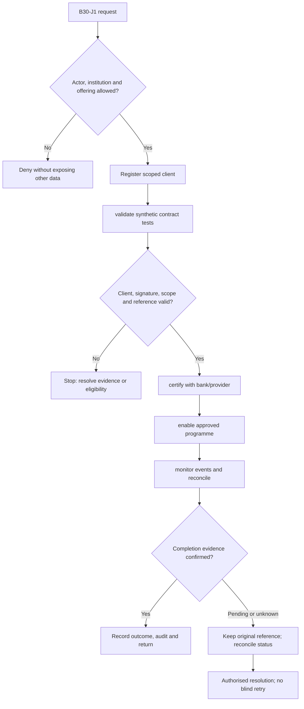
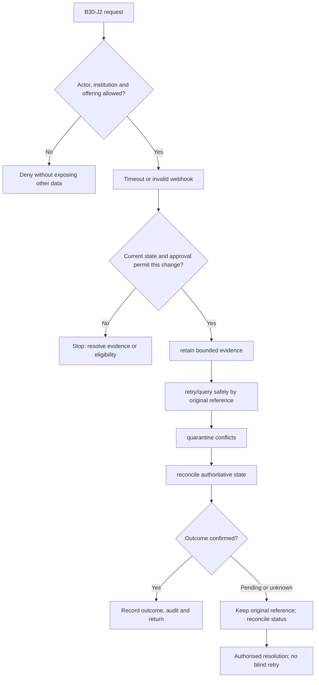

**Review draft • 13 October 2026 • New Banking project • Implementation not started.**

## Purpose and ownership

Expose stable APIs and reconcile external facts without confusing transport success with banking execution.

Proposed operating roles: Client integration team; API operator; source owner; operations exception officer. These titles describe duties for review; they do not grant permissions. The bank or authorised regulated entity owns product policy and financial outcomes. Platform operators receive no automatic customer-data, fund-movement or issuer authority.

## Worked Indian example

**Fictional requirements illustration, not seeded data or approved banking policy.** Reference: OP-001 / provider timeout.

| Stage | Example |
| --- | --- |
| Starting situation | A mobile-originated authorised instruction loses its response after reaching the provider. |
| Operator/customer actions | Persist the original idempotency/reference, verify callbacks, query authoritative status and reconcile conflicts. |
| Expected normal outcome | The app sees one operation and its resolved financial effect; web/mobile show the same status. |
| Failure or alternate outcome | A duplicate or forged callback is rejected; an automatic second financial instruction is prohibited. |

No real customer, regulator approval, provider connection or bank operation is asserted. Illustrative amounts have currency INR and scale 2; actual economics/authority must be supplied by the institution.

## Module flow diagrams

These are proposed requirements flows. The detailed policy and contracts still need owner confirmation.

### Flow 1: B30 primary journey

### Flow 2: B30 alternate servicing and recovery journey

## Required features

| Feature | Required behaviour |
| --- | --- |
| B30-F1 | Versioned read/quote/instruction/status contracts. The final field schema, permitted actions and acceptance evidence must be approved for each enabled offering. |
| B30-F2 | Scoped integration credentials and rotation. The final field schema, permitted actions and acceptance evidence must be approved for each enabled offering. |
| B30-F3 | Signed callbacks with replay/order protection. The final field schema, permitted actions and acceptance evidence must be approved for each enabled offering. |
| B30-F4 | Source completeness, health and correction history. The final field schema, permitted actions and acceptance evidence must be approved for each enabled offering. |
| B30-F5 | Sandbox certification and integration ownership. The final field schema, permitted actions and acceptance evidence must be approved for each enabled offering. |

## Configuration to agree

API scopes; versions; source authority; retry; idempotency; webhooks; ordering; freshness; rate limits. Store approved values in versioned, effective-dated product/programme policy. Capture the exact configuration version used by an instruction. Missing mandatory configuration blocks the dependent action; enabling a menu cannot grant legal authority.

## End-to-end journey 1

Register scoped client → validate synthetic contract tests → certify with bank/provider → enable approved programme → monitor events and reconcile.

The journey ends only when its authoritative result, customer/staff-visible result and related book or case history agree. A saved request, queue entry or HTTP acknowledgement is an intermediate state.

## End-to-end journey 2

Timeout or invalid webhook → retain bounded evidence → retry/query safely by original reference → quarantine conflicts → reconcile authoritative state.

Every transition needs an authorised actor, original version and recorded reason where required. Cancellation or client disconnection does not prove server rollback. Financial corrections retain their original reference and use linked reversal/adjustment entries rather than deleting history.

## Interfaces and data dependencies

Named bank/provider contracts; connector owner; signed event schemas; status/finality; commissioning evidence. Agree stable institution, product, party and operation references; source version; as-of time; completeness; status/finality; retry rules and correction handling. Where no financial posting occurs, record the administrative/case outcome instead of inventing a journal.

All channel requests use server-verified identity and institution scope. Partner, branch and customer access is narrower than institution membership. Lists, details, search, exports, callbacks and files must enforce the same boundary.

## Current implementation and reuse

**New Banking project: proposed, not built.** Versioned APIs, scoped source clients/mappings and snapshot ingestion are reusable foundations; no execution connectors.

Reviewed legacy feature boundaries: `source-clients`, `source-mappings`, `account-snapshots`, `health`. See the source inventory on the [gap page](/banking/current-system-gap). Legacy feature presence is a reuse candidate, not acceptance or deployment evidence for this module.

## Acceptance and difficult cases

Explicit cases: Forged callback; key rotation in flight; sequence gap; duplicate callback; stale account projection.

- Allowed success: confirm saved/output values, authoritative status and the exact approved actor/channel.
- Denial: reject foreign institution, unauthorised branch/customer/programme and revoked or expired access without information leakage.
- Reliability: prove stale-version rejection and concurrency behaviour; retryable commands apply one economic effect; unknown financial outcomes are reconciled by original reference.
- Records and usability: preserve redacted audit, monetary precision and document integrity; verify keyboard/mobile, direct links, expired sessions, Back/Forward and return navigation. Internal web navigation preserves its workspace.

Apply the [scenario matrix](/banking/scenario-matrix) and the [shared journey rules](/banking/journeys). Timing, amounts and regulatory applicability are institution-owned inputs, not defaults supplied by this document.

## Pending decision

Who builds each connector, and which interface/version owns the final outcome?

The [decision register](/banking/decisions) keeps sequencing separate from approval. No implementation begins because this page describes a proposed capability.

[Module register](/banking/module-register) · [Offering compatibility](/banking/offering-matrix)
