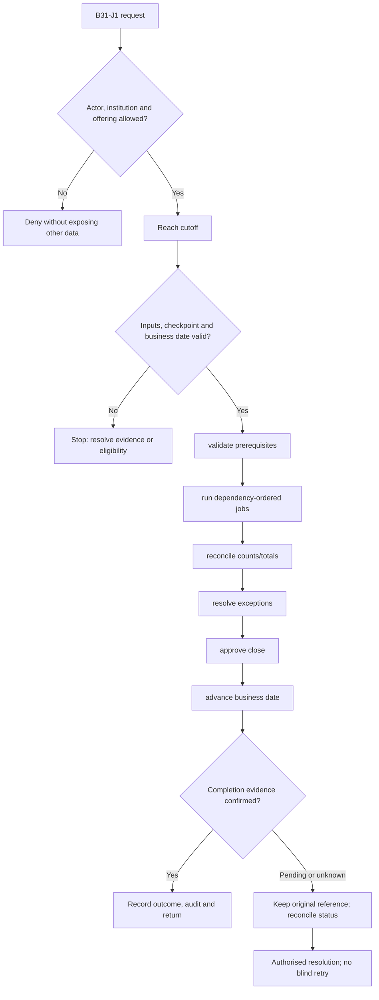
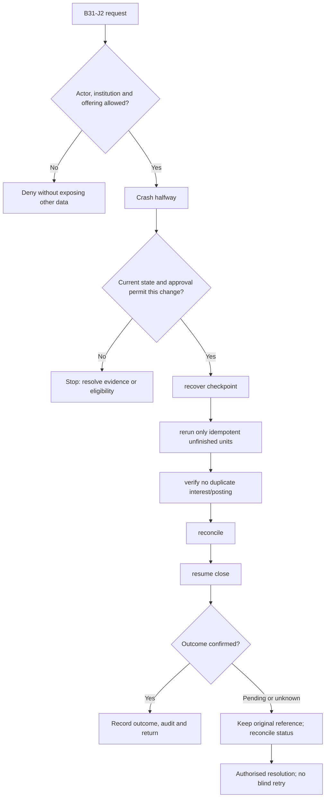

**Review draft • 13 October 2026 • New Banking project • Implementation not started.**

## Purpose and ownership

Run financial and operational cycles exactly once per institution business date with controlled restart.

Proposed operating roles: Operations controller; finance reviewer; job operator. These titles describe duties for review; they do not grant permissions. The bank or authorised regulated entity owns product policy and financial outcomes. Platform operators receive no automatic customer-data, fund-movement or issuer authority.

## Worked Indian example

**Fictional requirements illustration, not seeded data or approved banking policy.** Reference: RUN-001 / accrual batch interrupted.

| Stage | Example |
| --- | --- |
| Starting situation | The adopted EOD job stops after posting 700 of 1,000 eligible account units. |
| Operator/customer actions | Recover the checkpoint, verify posting references, process only remaining eligible units and reconcile counts/totals. |
| Expected normal outcome | Exactly 1,000 intended units have one accepted effect each; close advances only after required controls pass. |
| Failure or alternate outcome | Rerunning all 1,000 without idempotency would duplicate 700 units and must fail acceptance. |

No real customer, regulator approval, provider connection or bank operation is asserted. Illustrative amounts have currency INR and scale 2; actual economics/authority must be supplied by the institution.

## Module flow diagrams

These are proposed requirements flows. The detailed policy and contracts still need owner confirmation.

### Flow 1: B31 primary journey

### Flow 2: B31 alternate servicing and recovery journey

## Required features

| Feature | Required behaviour |
| --- | --- |
| B31-F1 | Institution business-date and holiday management. The final field schema, permitted actions and acceptance evidence must be approved for each enabled offering. |
| B31-F2 | EOD/BOD dependency graph and checkpoints. The final field schema, permitted actions and acceptance evidence must be approved for each enabled offering. |
| B31-F3 | Interest, billing, maturity and standing-instruction jobs. The final field schema, permitted actions and acceptance evidence must be approved for each enabled offering. |
| B31-F4 | Failed-run diagnosis and safe resume. The final field schema, permitted actions and acceptance evidence must be approved for each enabled offering. |
| B31-F5 | Close sign-off, backlog and downstream report readiness. The final field schema, permitted actions and acceptance evidence must be approved for each enabled offering. |

## Configuration to agree

Timezone; business calendar; cutoff; dependencies; accrual/billing schedules; lock policy; rerun permissions. Store approved values in versioned, effective-dated product/programme policy. Capture the exact configuration version used by an instruction. Missing mandatory configuration blocks the dependent action; enabling a menu cannot grant legal authority.

## End-to-end journey 1

Reach cutoff → validate prerequisites → run dependency-ordered jobs → reconcile counts/totals → resolve exceptions → approve close → advance business date.

The journey ends only when its authoritative result, customer/staff-visible result and related book or case history agree. A saved request, queue entry or HTTP acknowledgement is an intermediate state.

## End-to-end journey 2

Crash halfway → recover checkpoint → rerun only idempotent unfinished units → verify no duplicate interest/posting → reconcile → resume close.

Every transition needs an authorised actor, original version and recorded reason where required. Cancellation or client disconnection does not prove server rollback. Financial corrections retain their original reference and use linked reversal/adjustment entries rather than deleting history.

## Interfaces and data dependencies

Authoritative clock/calendar; job inputs; ledger posting; control totals; operator approvals. Agree stable institution, product, party and operation references; source version; as-of time; completeness; status/finality; retry rules and correction handling. Where no financial posting occurs, record the administrative/case outcome instead of inventing a journal.

All channel requests use server-verified identity and institution scope. Partner, branch and customer access is narrower than institution membership. Lists, details, search, exports, callbacks and files must enforce the same boundary.

## Current implementation and reuse

**New Banking project: proposed, not built.** No financial EOD/BOD scheduler or business-date engine exists.

Reviewed legacy feature boundaries: No operational source module was found. Legacy feature presence is a reuse candidate, not acceptance or deployment evidence for this module.

## Acceptance and difficult cases

Explicit cases: Holiday rollover; duplicate scheduler; partial batch; failed accrual; leap day; backdated event after close.

- Allowed success: confirm saved/output values, authoritative status and the exact approved actor/channel.
- Denial: reject foreign institution, unauthorised branch/customer/programme and revoked or expired access without information leakage.
- Reliability: prove stale-version rejection and concurrency behaviour; retryable commands apply one economic effect; unknown financial outcomes are reconciled by original reference.
- Records and usability: preserve redacted audit, monetary precision and document integrity; verify keyboard/mobile, direct links, expired sessions, Back/Forward and return navigation. Internal web navigation preserves its workspace.

Apply the [scenario matrix](/banking/scenario-matrix) and the [shared journey rules](/banking/journeys). Timing, amounts and regulatory applicability are institution-owned inputs, not defaults supplied by this document.

## Pending decision

Which cycles and cutoffs apply, and which failures must block advancing the business date?

The [decision register](/banking/decisions) keeps sequencing separate from approval. No implementation begins because this page describes a proposed capability.

[Module register](/banking/module-register) · [Offering compatibility](/banking/offering-matrix)
