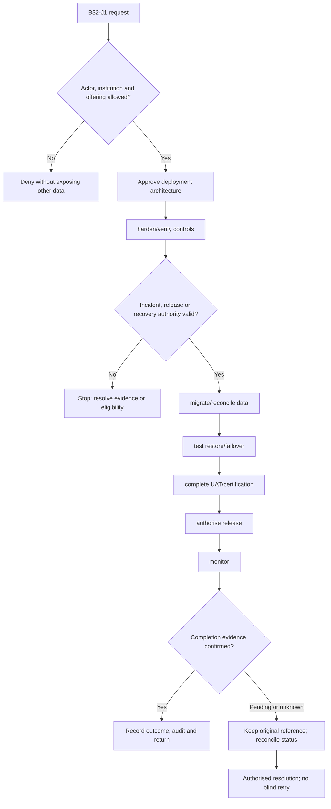
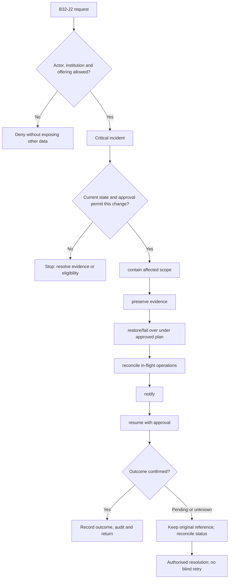

**Review draft • 13 October 2026 • New Banking project • Implementation not started.**

## Purpose and ownership

Prove the release protects bank data and can be operated, recovered and audited.

Proposed operating roles: Security owner; Tech Ops; bank UAT owner; incident commander; auditor. These titles describe duties for review; they do not grant permissions. The bank or authorised regulated entity owns product policy and financial outcomes. Platform operators receive no automatic customer-data, fund-movement or issuer authority.

## Worked Indian example

**Fictional requirements illustration, not seeded data or approved banking policy.** Reference: DR-001 / primary environment lost.

| Stage | Example |
| --- | --- |
| Starting situation | The production primary becomes unavailable with several financial operations pending. |
| Operator/customer actions | Contain, preserve evidence, restore/fail over under the accepted plan, query original operation outcomes and reconcile before reopening. |
| Expected normal outcome | Confirmed postings survive within accepted recovery objectives; pending operations have a controlled resolution owner. |
| Failure or alternate outcome | A restored screen displaying balances does not prove books, callbacks, pending instructions or audit are recovered. |

No real customer, regulator approval, provider connection or bank operation is asserted. Illustrative amounts have currency INR and scale 2; actual economics/authority must be supplied by the institution.

## Module flow diagrams

These are proposed requirements flows. The detailed policy and contracts still need owner confirmation.

### Flow 1: B32 primary journey

### Flow 2: B32 alternate servicing and recovery journey

## Required features

| Feature | Required behaviour |
| --- | --- |
| B32-F1 | Tenant/channel isolation and least privilege. The final field schema, permitted actions and acceptance evidence must be approved for each enabled offering. |
| B32-F2 | Secret/key management and protected card-data boundary. The final field schema, permitted actions and acceptance evidence must be approved for each enabled offering. |
| B32-F3 | Immutable/redacted audit and monitored security events. The final field schema, permitted actions and acceptance evidence must be approved for each enabled offering. |
| B32-F4 | Backup, restore, disaster recovery and incident exercises. The final field schema, permitted actions and acceptance evidence must be approved for each enabled offering. |
| B32-F5 | Migration, certification, UAT and release evidence. The final field schema, permitted actions and acceptance evidence must be approved for each enabled offering. |

## Configuration to agree

Isolation/deployment model; encryption/keys; audit retention; RPO/RTO; capacity; release and incident authority. Store approved values in versioned, effective-dated product/programme policy. Capture the exact configuration version used by an instruction. Missing mandatory configuration blocks the dependent action; enabling a menu cannot grant legal authority.

## End-to-end journey 1

Approve deployment architecture → harden/verify controls → migrate/reconcile data → test restore/failover → complete UAT/certification → authorise release → monitor.

The journey ends only when its authoritative result, customer/staff-visible result and related book or case history agree. A saved request, queue entry or HTTP acknowledgement is an intermediate state.

## End-to-end journey 2

Critical incident → contain affected scope → preserve evidence → restore/fail over under approved plan → reconcile in-flight operations → notify → resume with approval.

Every transition needs an authorised actor, original version and recorded reason where required. Cancellation or client disconnection does not prove server rollback. Financial corrections retain their original reference and use linked reversal/adjustment entries rather than deleting history.

## Interfaces and data dependencies

Named owners; bank-approved security/retention; PCI assessment scope; infrastructure; backup/DR; release criteria. Agree stable institution, product, party and operation references; source version; as-of time; completeness; status/finality; retry rules and correction handling. Where no financial posting occurs, record the administrative/case outcome instead of inventing a journal.

All channel requests use server-verified identity and institution scope. Partner, branch and customer access is narrower than institution membership. Lists, details, search, exports, callbacks and files must enforce the same boundary.

## Current implementation and reuse

**New Banking project: proposed, not built.** Current authorization, session, audit and app separation are foundations; no evidence establishes full core-bank readiness.

Reviewed legacy feature boundaries: `auth`, `audit`, `admin-sessions`, `staff-sessions`, `health`. See the source inventory on the [gap page](/banking/current-system-gap). Legacy feature presence is a reuse candidate, not acceptance or deployment evidence for this module.

## Acceptance and difficult cases

Explicit cases: Restore loses confirmed debit; tenant leakage; privileged compromise; split-brain posting; leaked card/PIN data.

- Allowed success: confirm saved/output values, authoritative status and the exact approved actor/channel.
- Denial: reject foreign institution, unauthorised branch/customer/programme and revoked or expired access without information leakage.
- Reliability: prove stale-version rejection and concurrency behaviour; retryable commands apply one economic effect; unknown financial outcomes are reconciled by original reference.
- Records and usability: preserve redacted audit, monetary precision and document integrity; verify keyboard/mobile, direct links, expired sessions, Back/Forward and return navigation. Internal web navigation preserves its workspace.

Apply the [scenario matrix](/banking/scenario-matrix) and the [shared journey rules](/banking/journeys). Timing, amounts and regulatory applicability are institution-owned inputs, not defaults supplied by this document.

## Pending decision

Which deployment isolation, data residency, RPO/RTO, performance and release requirements must the bank accept?

The [decision register](/banking/decisions) keeps sequencing separate from approval. No implementation begins because this page describes a proposed capability.

[Module register](/banking/module-register) · [Offering compatibility](/banking/offering-matrix)
