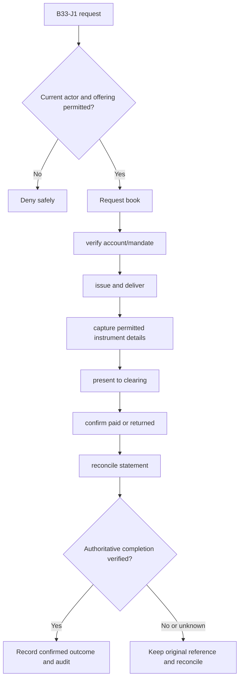
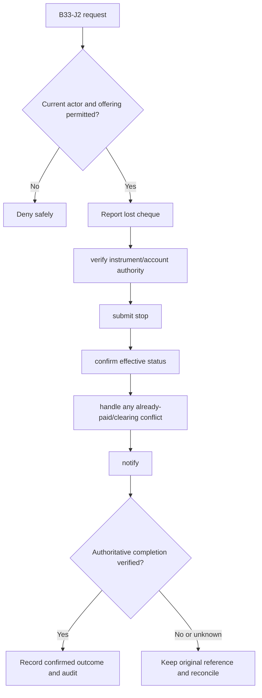

**Review draft • 13 October 2026 • New Banking project • Proposed, not built.**

## Purpose and ownership

Manage cheque books, instruments, clearing and returns with linked financial evidence. Proposed duties: Customer; cheque operations; branch officer; clearing finance. The institution owns rules and authority; this specification grants none.

## Worked Indian example

**Fictional illustration, not seeded data or approved policy.** CHQ-001 / ACC-001 / INR 5,000.00.

| Stage | Example |
| --- | --- |
| Start | A customer reports a cheque lost while its clearing status is not final. |
| Actions | Verify the customer mandate/instrument and submit one stop request; read the clearing authority's effective outcome. |
| Expected outcome | Only a confirmed effective stop is shown as stopped. If already paid, route the customer to the appropriate dispute/servicing path. |
| Failure | A saved stop request cannot be presented as a guaranteed prevented debit. |

## Module flow diagrams

### Flow 1: B33 primary journey

### Flow 2: B33 alternate servicing and recovery journey

## Required features

| Feature | Required behaviour |
| --- | --- |
| B33-F1 | Cheque-book request, inventory and delivery |
| B33-F2 | Issued cheque and stop-payment servicing |
| B33-F3 | Outward/inward clearing with verified images/data |
| B33-F4 | Return reasons, linked charges and controlled correction |
| B33-F5 | Clearing settlement and reconciliation |

## Configuration to agree

Instrument numbering; permitted accounts; positive-pay/proof rules; cutoff; returns; stop authority; fees. Use approved, effective-dated versions; bind each sensitive intent to its original terms and approval. Missing required evidence or policy blocks the dependent action.

## Complete journeys

1. Request book → verify account/mandate → issue and deliver → capture permitted instrument details → present to clearing → confirm paid or returned → reconcile statement.
2. Report lost cheque → verify instrument/account authority → submit stop → confirm effective status → handle any already-paid/clearing conflict → notify.

A request acknowledgement is not a final financial/security result. Reconcile the original reference rather than blindly retrying after an uncertain response. Corrections preserve original history.

## Interfaces and data dependencies

Account/mandate; clearing/image/status contracts; instrument identity; stop finality; return and settlement files. Confirm stable institution/resource IDs, freshness, completeness, status/finality, correction ordering and exact money representation. Web/mobile/ATM must not duplicate policy calculations or widen authority.

## Current implementation and reuse

**New Banking project: not built.** No operational cheque book, stop-payment or clearing implementation exists. Reviewed legacy feature boundary: No operational module found.

## Acceptance and difficult cases

Stop races with clearing; duplicated presentment; signature mismatch; already paid instrument; wrong cheque range. Verify permitted success, foreign institution/branch/customer denial, current revoked authority, stale state, concurrent/repeated actions, outages/unknown outcomes and redacted audit. Test exact book/counter effects where applicable and safe list → detail → action → result → return navigation. Apply [shared journeys](/banking/journeys) and the [scenario matrix](/banking/scenario-matrix).

## Pending decision

Which cheque services, clearing interfaces, proof and stop-payment effectiveness rules apply?

[Module register](/banking/module-register) · [Decision register](/banking/decisions)
