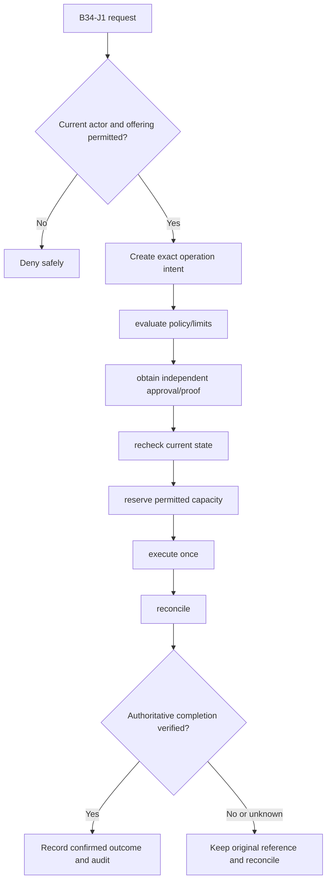
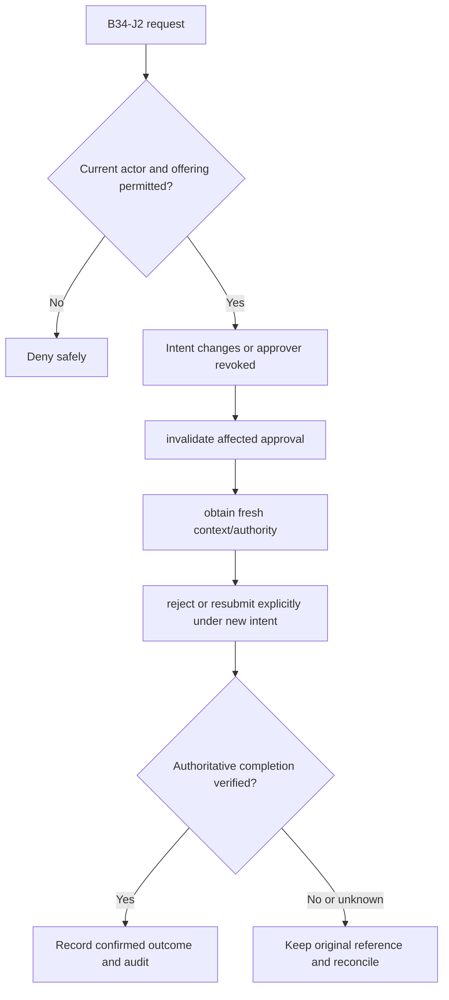

**Review draft • 13 October 2026 • New Banking project • Proposed, not built.**

## Purpose and ownership

Apply cross-channel approval and aggregate controls before a financial or sensitive administrative action can execute. Proposed duties: Operation maker; independent checker; policy owner; risk; finance. The institution owns rules and authority; this specification grants none.

## Worked Indian example

**Fictional illustration, not seeded data or approved policy.** PAY-APP-001 / two channels / illustrative INR 10,000.00 daily limit.

| Stage | Example |
| --- | --- |
| Start | Web and mobile concurrently request INR 6,000.00 each under a fictional shared limit. |
| Actions | Use a single authoritative counter/reservation boundary and independent approval where the adopted matrix requires it. |
| Expected outcome | Both cannot be admitted against the same INR 10,000.00 capacity. The limit value is illustrative, not adopted bank policy. |
| Failure | A screen-local counter or a maker approving their own prohibited payment fails acceptance. |

## Module flow diagrams

### Flow 1: B34 primary journey

### Flow 2: B34 alternate servicing and recovery journey

## Required features

| Feature | Required behaviour |
| --- | --- |
| B34-F1 | Versioned maker-checker and delegation matrices |
| B34-F2 | Exact per-operation and aggregate/daily limits across channels |
| B34-F3 | Approval queues, evidence, reasons and expiry |
| B34-F4 | Bound intent, current eligibility and concurrency checks |
| B34-F5 | Controlled exception authority and complete decision history |

## Configuration to agree

Duty/action/amount matrix; branch/product scope; aggregate limits; proof; approval expiry; exceptions. Use approved, effective-dated versions; bind each sensitive intent to its original terms and approval. Missing required evidence or policy blocks the dependent action.

## Complete journeys

1. Create exact operation intent → evaluate policy/limits → obtain independent approval/proof → recheck current state → reserve permitted capacity → execute once → reconcile.
2. Intent changes or approver revoked → invalidate affected approval → obtain fresh context/authority → reject or resubmit explicitly under new intent.

A request acknowledgement is not a final financial/security result. Reconcile the original reference rather than blindly retrying after an uncertain response. Corrections preserve original history.

## Interfaces and data dependencies

Approved matrix; exact amount/limit counters; current duty/evidence; quote and operation hash; release of reservations. Confirm stable institution/resource IDs, freshness, completeness, status/finality, correction ordering and exact money representation. Web/mobile/ATM must not duplicate policy calculations or widen authority.

## Current implementation and reuse

**New Banking project: not built.** Saved currency-control configuration exists, but no general financial approval/enforcement engine exists. Reviewed legacy feature boundary: transaction-controls (saved settings only).

## Acceptance and difficult cases

Maker checks own operation; two channels exceed shared daily limit; stale approval; changed beneficiary; expired proof. Verify permitted success, foreign institution/branch/customer denial, current revoked authority, stale state, concurrent/repeated actions, outages/unknown outcomes and redacted audit. Test exact book/counter effects where applicable and safe list → detail → action → result → return navigation. Apply [shared journeys](/banking/journeys) and the [scenario matrix](/banking/scenario-matrix).

## Pending decision

Who may make/check/override each action and amount, and when do counters reset or release?

[Module register](/banking/module-register) · [Decision register](/banking/decisions)
