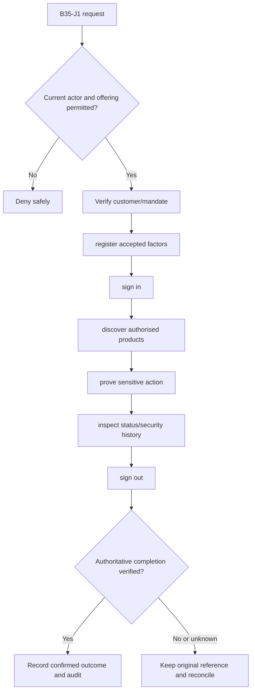
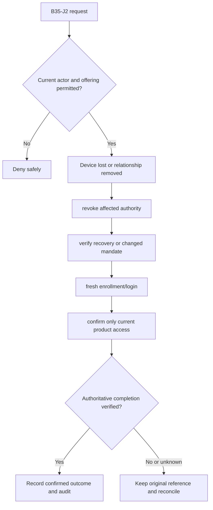

**Review draft • 13 October 2026 • New Banking project • Proposed, not built.**

## Purpose and ownership

Verify customer access to products and secure web/mobile sessions without treating staff access as customer authority. Proposed duties: Customer; verified business signatory; customer security reviewer; recovery officer. The institution owns rules and authority; this specification grants none.

## Worked Indian example

**Fictional illustration, not seeded data or approved policy.** CUSTOMER-001 / old mobile device.

| Stage | Example |
| --- | --- |
| Start | A customer loses a phone that still has an active mobile session. |
| Actions | Revoke the device/session through the approved verified recovery path and require fresh proof/enrollment before restoring sensitive access. |
| Expected outcome | The old device is denied; the new session sees only current linked products and mandates. |
| Failure | Knowledge of the customer's email/phone alone cannot restore financial authority. |

## Module flow diagrams

### Flow 1: B35 primary journey

### Flow 2: B35 alternate servicing and recovery journey

## Required features

| Feature | Required behaviour |
| --- | --- |
| B35-F1 | Customer registration and verified product linking |
| B35-F2 | Web/mobile login, factors and device/session lifecycle |
| B35-F3 | Sensitive-action proof bound to intent |
| B35-F4 | Own-session/device revocation and security history |
| B35-F5 | Verified recovery, fraud containment and relationship-change revocation |

## Configuration to agree

Eligibility/ownership proof; factors; device/session policy; recovery; consent; step-up and notice policy. Use approved, effective-dated versions; bind each sensitive intent to its original terms and approval. Missing required evidence or policy blocks the dependent action.

## Complete journeys

1. Verify customer/mandate → register accepted factors → sign in → discover authorised products → prove sensitive action → inspect status/security history → sign out.
2. Device lost or relationship removed → revoke affected authority → verify recovery or changed mandate → fresh enrollment/login → confirm only current product access.

A request acknowledgement is not a final financial/security result. Reconcile the original reference rather than blindly retrying after an uncertain response. Corrections preserve original history.

## Interfaces and data dependencies

Verified customer relationship; accepted factor/proof policy; mobile device/session contract; recovery evidence/notices. Confirm stable institution/resource IDs, freshness, completeness, status/finality, correction ordering and exact money representation. Web/mobile/ATM must not duplicate policy calculations or widen authority.

## Current implementation and reuse

**New Banking project: not built.** Synthetic customer password/link/session foundations exist; real eligibility, proof/factor and recovery contracts remain incomplete. Reviewed legacy feature boundary: consumer-access, consumer-auth, consumer-sessions, consumer-account-links.

## Acceptance and difficult cases

Stolen device; recycled phone number; joint mandate removed; duplicate proof; weak recovery bypass; app reinstall. Verify permitted success, foreign institution/branch/customer denial, current revoked authority, stale state, concurrent/repeated actions, outages/unknown outcomes and redacted audit. Test exact book/counter effects where applicable and safe list → detail → action → result → return navigation. Apply [shared journeys](/banking/journeys) and the [scenario matrix](/banking/scenario-matrix).

## Pending decision

Which real-customer factors, ownership evidence, device controls and recovery authority are required?

[Module register](/banking/module-register) · [Decision register](/banking/decisions)
