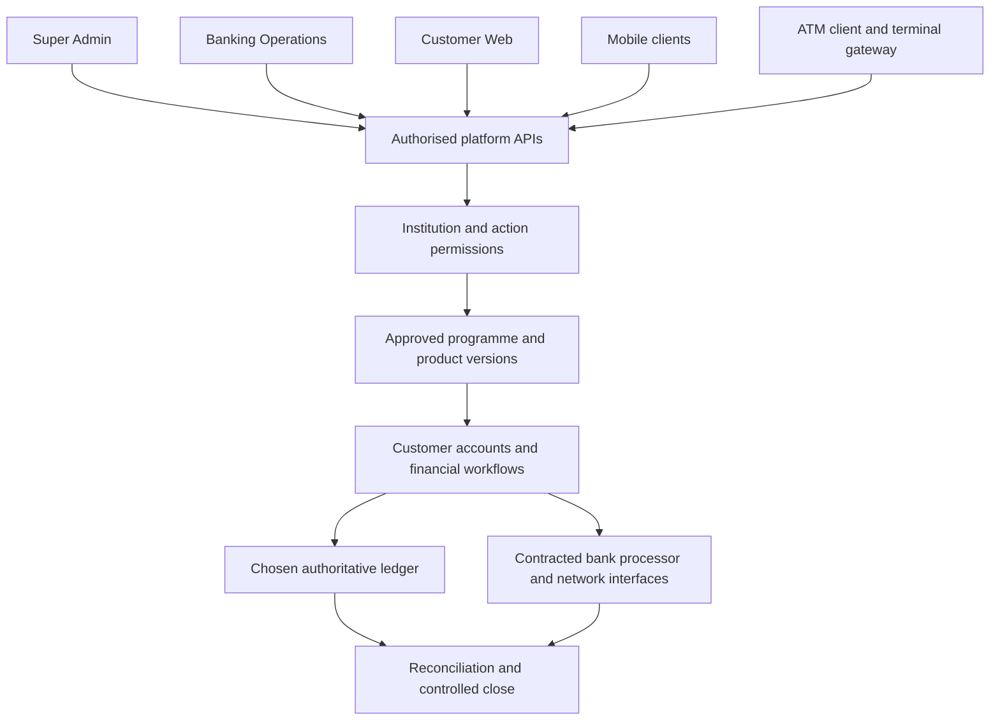

**New project: Banking. Review draft v0.1 • 13 October 2026.**

Banking is proposed as a configurable operating platform for authorised financial institutions. It combines shared customer, product, ledger, workflow and control capabilities with offering-specific deposits, lending, card and channel capabilities.

The current bank application does not execute the financial operations required for this scope. Its administrative and enquiry foundations are reuse candidates. **No module in this new project is implemented or ready to deploy merely because it is documented here.**

## Confirmed request

- A new project named Banking.
- Super Admin, Banking Operations and Customer Web applications.
- APIs for mobile applications and an ATM application.
- Configurable core banking, debit/prepaid/credit-card operations and NBFC offerings.
- Mintlify documentation first, an illustrative Indian bank, detailed features/journeys/scenarios, and owner confirmation before implementation.

## Review structure

| Review area | What you decide |
| --- | --- |
| [Applications](/banking/applications) | Which users and actions belong in each application. |
| [Offerings and compatibility](/banking/offering-matrix) | Which institution can enable which product and under what authority. |
| [32 module documents](/banking/module-register) | Features, configuration, journeys, gaps and acceptance per module. |
| [Configuration model](/banking/configuration) | How approved institution/programme/product policy becomes controlled runtime behaviour. |
| [Indian bank example](/banking/examples/indian-bank) | How an illustrative bank assembles a proposed offering. |
| [Indian NBFC example](/banking/examples/indian-nbfc) | How lending operations differ from bank deposits and card issuing. |
| [Journeys](/banking/journeys) and [scenarios](/banking/scenario-matrix) | Outcomes and combinations that must be tested. |
| [Current gaps](/banking/current-system-gap) | What the old project can contribute and what is absent. |
| [Delivery and release gates](/banking/delivery-plan) | The sequence from approved requirements to bank deployment. |
| [Decisions](/banking/decisions) | Questions to answer one at a time. |
| [References](/banking/references) | M2P patterns, current primary sources and limitations. |

## Working boundaries

“Configurable” means selecting permitted products and versioned rules, not removing financial controls. No tenant may enable an offering it is not authorised to conduct. The regulated institution remains the accountable issuer, lender or deposit holder.

The documentation includes both a platform-owned core option and an external-core orchestration option. The authoritative ledger, account book and card processor must be selected before dependent financial implementation. Describing both does not approve both.

The project is separate from the legacy M01/M02 delivery. This review neither accepts M01 nor starts M02. Existing holds and permissions are recorded as legacy decisions; new-project changes need explicit confirmation. UPI, native mobile app development and building external connectors are not automatically added by researching M2P. Mobile-facing APIs and ATM requirements are expressly included.

M2P is a reference for modular banking, card management and lending coverage. There is no claim of partnership, copied internal design, equivalent certification or implemented integration. [Reference basis](/banking/references).

## Proposed system map

This diagram shows responsibilities, not an approved deployment topology. Read the first decision in the [decision register](/banking/decisions).
