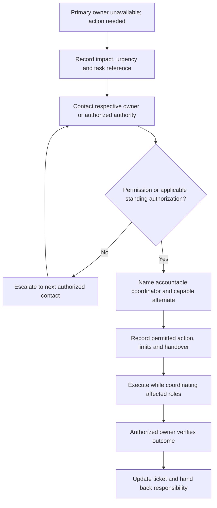

When a primary owner or senior teammate is unavailable, seek permission from the respective owner or authorized authority before an alternate takes over. An available person from the senior or execution line can perform the permitted work with clear responsibility and coordination.

This covers absences, lunch, outside-hours support, and urgent recovery. It does not automatically change reporting lines, approval rights, or system access.

## Exception workflow

Silence or a missed call is not permission. Use the approved backup/escalation route immediately for urgent incidents. A documented standing authorization covers only its stated action and boundaries.

## Permission and responsibility

| Situation | Required action |
| --- | --- |
| Senior Developer unavailable | Tech Ops/Senior Manager (Tech/Ops) coordinates a capable alternate and required technical review; Tech Ops retains release/recovery sign-off |
| Senior Manager (Tech/Ops) unavailable | Seek permission from the designated operational owner or authorized leadership contact; name an acting coordinator and inform the product/development team |
| Tech Ops testing/UAT/release owner unavailable | Use an approved Tech Ops backup or seek permission from the respective owner/authority for an alternate; record who verifies and signs off |
| Requirement or commercial approver unavailable | Route to the designated authorized Founder/CEO, SVP, or VP; a project PO/PM or Developer does not inherit that authority |
| P0 during lunch, outside hours, or absence | Contact the named Tech Ops incident owner and approved backup immediately; Senior Developer/Senior Manager (Tech/Ops) provide recovery help |

## Record permission and hand over

Record the authorizing person, time, communication, permitted action, environment, limits, and duration or completion condition. Name one accountable coordinator, the executor, and the verification/sign-off owner. Confirm access, technical review, and recovery steps.

Record urgent verbal permission promptly in the incident thread with the exact permitted action. Permission to execute work does not authorize unrelated scope or a wider access grant.

The alternate reads the requirement or incident context and confirms the intended outcome. Product Owner/Manager maintains the work record. Technical Operations coordinates operational impact, testing, and sign-off. Senior Developer/Senior Manager (Tech/Ops) provide technical help as available. Inform all affected roles through the accountable coordinator.

Avoid parallel uncoordinated fixes. Keep the current action, owner, status, and next update visible.

## Working hours and coverage

The standard workday is **9:00 AM–6:00 PM**. The **one-hour lunch break is 2:00 PM–3:00 PM**. Arrange necessary task and support handovers before lunch or an absence.

Tech Ops owns the coverage plan: primary and backup contacts, how they are reached, and escalation for each project. Keep names and contacts in the private runbook. Working days and individual on-call assignments follow the approved company/project schedule.

The [SLA clock](/support/cycle-and-sla#how-timing-is-tracked) uses elapsed calendar time and does not pause during lunch or outside office hours. Coverage must support P0 within 1 hour, P1 within 24 hours, and P2 within 7 days; P3/P4 follow the reviewed schedule.

## Close and hand back

Verify service and affected business records, document the outcome, and notify the original owner. Link follow-up work and end the temporary assignment when its scope is complete. Review coverage gaps exposed by the exception.

Use the [exception handover record](/reference/templates#exception-and-handover-record).
