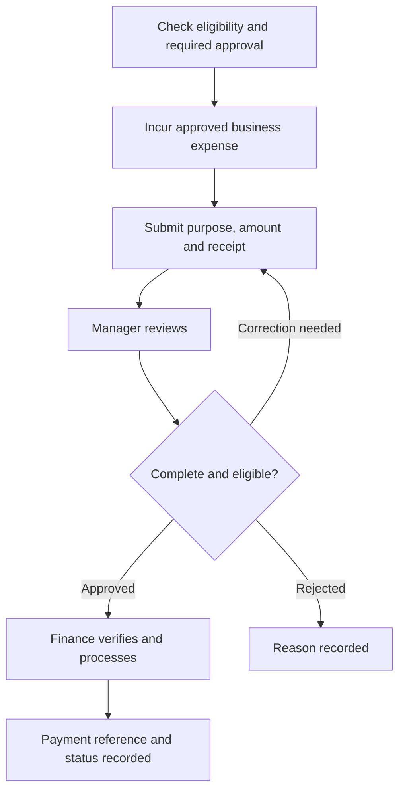

Know the approved process before submitting attendance, expenses, or access requests. Your manager and people/finance owners provide current tools, eligibility rules, approval limits, working hours, leave policy, and reimbursement timelines.

<Info>
  This page defines workflow guidance. It does not set employment terms, leave entitlements, deductions, compensation, or expense limits. Use approved company policies and your employment documents for those details.
</Info>

## Attendance and availability

Record attendance through the approved system. Report a missed or incorrect entry with the date, explanation, and supporting information requested by the authorized owner. Use a correction request so the original record and approval remain traceable.

Notify your manager when an absence or availability change affects shared work. Record a handover for urgent tasks. Leave approval and attendance correction are separate processes.

## Field activity and tracking

Capture the assigned activity, status, exception, and required evidence. Explain why a visit or task could not be completed instead of selecting an inaccurate success status.

Collect only the location and evidence needed for the agreed work purpose. Restricted operational systems should hold employee location histories and customer evidence. If a device is offline, distinguish saved locally from accepted by the server.

## Expense workflow

Use the actual date, currency, business purpose, project where relevant, and receipt. Flag missing evidence or duplicate claims. An approved claim is not the same as a paid claim. Route questions to finance rather than changing a settled record.

## Assets and access

Record issued devices and their custodian in the approved asset system. Report loss, suspicious access, or damage promptly. Use company-approved accounts and secure storage.

When a person changes projects or leaves, the manager coordinates handover, asset return, and access review. Remove access no longer needed and preserve work in the approved shared location.

## Where to ask for help

| Need | Start with |
| --- | --- |
| Attendance, leave, or onboarding administration | People owner and reporting manager |
| Expense status or evidence | Finance owner |
| Task assignment or customer priority | Delivery owner |
| Device, environment, or repository access | Authorized IT/platform owner |
| Security concern or data exposure | Technical/platform owner through the incident route |

Find named contacts in the private team directory supplied during onboarding.
