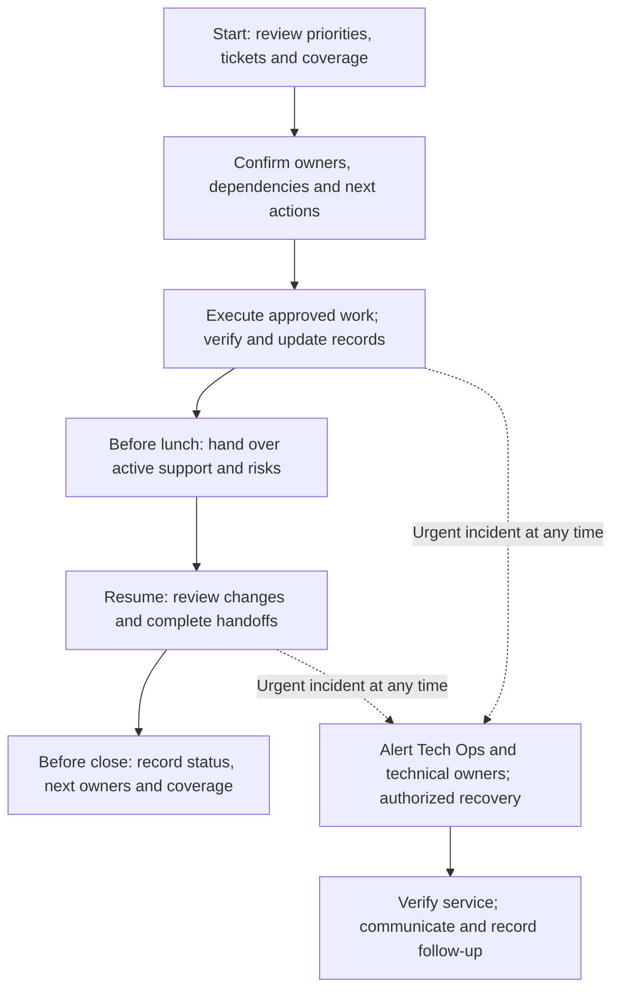
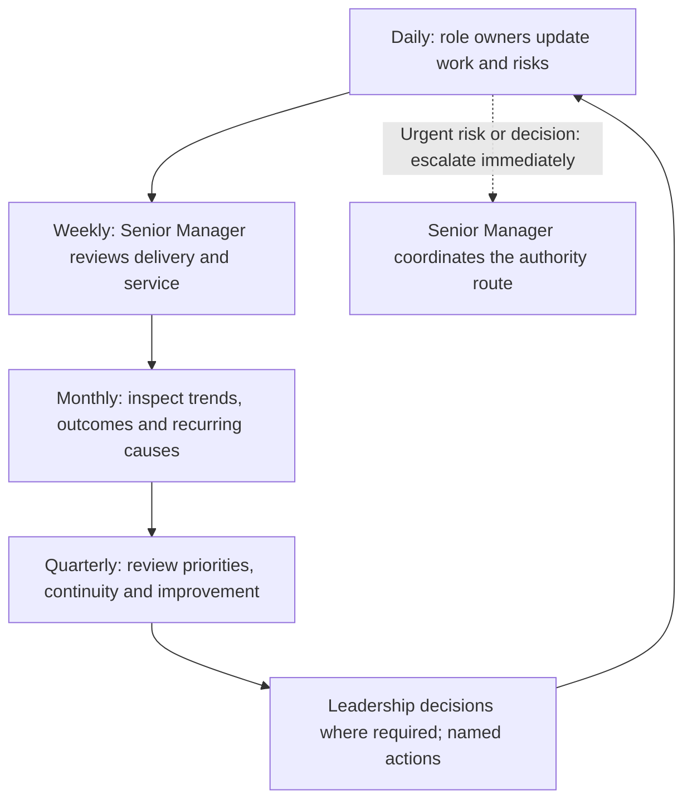

Use this guide with the [role responsibilities](/company/roles-and-responsibilities). Each routine should leave a useful record: current work, evidence, risks, decisions needed, and a named next owner. Update the existing tracker and project workspace rather than creating a second source of status.

Technical Operations, Product Owner/Manager, UI/UX/Product Designer, Senior Developer, and Developer report to **Senior Manager, Technical/Operations**. Product Owner/Manager and Designer are peers. The Senior Manager consolidates their reporting for the designated Founder/CEO, SVP, or VP. See the [organization chart](/company/organization#leadership-and-team-coordination).

<Note>
  These routines are handbook working guidelines. The Senior Manager agrees actual review dates, participants, project measures, and backups. Weekly, monthly, and quarterly reviews do not postpone urgent work, approvals, or support escalation. No individual performance quota or fixed meeting duration is introduced here.
</Note>

## Daily coordination and coverage

The workday is **9:00 AM–6:00 PM**, with lunch **2:00 PM–3:00 PM**. Arrange named support coverage and handovers across lunch and outside office hours. Support targets use elapsed calendar time from receipt: P0 **1 hour**, P1 **24 hours**, P2 **7 calendar days**; the team supplies P3/P4 schedules after review.

Use the [support cycle](/support/cycle-and-sla) for incidents and the [exception process](/company/coverage-and-exceptions) when a primary owner is unavailable. A handover identifies the receiving person and confirms they have accepted responsibility; a message without an accepted owner is an unresolved handover.

## Developer

Report to Senior Manager (Tech/Ops). Coordinate implementation and technical review with Senior Developer, requirement questions with PO/Manager and Tech Ops, and experience questions with Designer.

| Frequency | Responsibilities | Output and review |
| --- | --- | --- |
| Daily | Read the approved ticket, acceptance criteria, and design before starting. Implement the assigned slice and relevant checks. Investigate assigned support issues; provide reproducible findings. Update progress, remaining work, blockers, and support handover before closing the day. | Current tickets, reviewable changes, verification evidence, and next action. Senior Developer reviews technical work; Senior Manager receives status and escalations through the agreed tracker. |
| Weekly | Review unfinished and blocked work with Senior Developer and PO/Manager. Close review feedback and confirmed defects. Check upcoming dependencies and estimates. Share a practical lesson or update a setup/support note where the week's work exposed a gap. | Reviewed implementation, revised remaining estimate, dependency requests, and updated documentation. Raise capacity conflicts to Senior Manager. |
| Monthly | Review defects that escaped implementation checks and recurring support causes. Complete assigned preventive fixes or test improvements. Review relevant module/runbook changes and discuss learning or support needs with the manager. | Evidence of completed improvements and a short learning/support action list; no self-approved change to scope or architecture. |
| Quarterly | Contribute technical findings to module maintenance and improvement planning. Demonstrate an understood business workflow, review knowledge gaps and backup readiness, and update assigned documentation or recovery exercises. | Practical demonstration, documented module knowledge, and prioritized improvement input for Senior Developer and Senior Manager. |

## Senior Developer

Report to Senior Manager (Tech/Ops). Guide implementation and technical review without changing Developers' direct reporting line. Production actions remain subject to named Tech Ops authorization.

| Frequency | Responsibilities | Output and review |
| --- | --- | --- |
| Daily | Review implementation candidates and high-risk changes. Unblock Developers and clarify technical sequencing. Check migrations, permissions, integrations, and relevant verification evidence. Help diagnose incidents and recommend safe recovery with Senior Manager under Tech Ops authorization. | Technical decisions/review results, blocker owners, release or recovery recommendations, and current risks shared with Tech Ops, PO/Manager, and Senior Manager. |
| Weekly | Refine estimates and dependencies for upcoming work. Review aging technical reviews, defect patterns, and support load. Coordinate mentoring and knowledge transfer. Check that upcoming releases have technical verification and recovery evidence. | Technical delivery forecast, review queue actions, readiness gaps, and owned debt/quality tasks for the team and Senior Manager. |
| Monthly | Assess recurring failures, risky dependencies, performance/data integrity issues, and technical debt using project evidence. Review recovery runbooks and technical documentation. Propose bounded improvements with effort, benefit, and delivery impact. | Technical health summary and prioritized proposals to Senior Manager and PO/Manager; Tech Ops receives testing/recovery implications. |
| Quarterly | Review the architecture direction and module boundaries against actual project needs. Assess scalability/security risks with the relevant owners. Coordinate an agreed recovery or migration exercise and review team technical capability and backup gaps. | Architecture/risk recommendations, exercise evidence and follow-up, and a capability plan. Seek required scope approval before implementing additional work. |

## Product Owner/Manager

Report to Senior Manager (Tech/Ops), at the same level as Designer. Maintain the delivery record and backlog; leadership retains final requirement and commercial approval.

| Frequency | Responsibilities | Output and review |
| --- | --- | --- |
| Daily | Check intake links, ticket ownership, blockers, and acceptance criteria with Tech Ops. Keep approved requirement versions and design references attached. Update the delivery forecast when evidence changes; record decisions and client follow-ups. Coordinate design, implementation, testing, and release handoffs. | Current backlog/plan, decision log, changed forecasts, and next actions shared with Senior Manager and affected owners. |
| Weekly | Refine and prioritize ready work with Tech Ops and the team. Review estimates, design readiness, testing capacity, support demand, and dependencies. Run sprint planning/review or Kanban replenishment at the project's agreed cadence. Prepare unresolved scope/priority decisions for Senior Manager. | Ready work, an achievable delivery forecast, demonstration feedback, acceptance gaps, and a decision request with options and impact. |
| Monthly | Reconcile delivered, accepted, and released work with the approved baseline. Review forecast changes, reopened work, customer feedback, and outstanding change approvals. Check that milestones and billing evidence correspond to the authorized commercial record. | Delivery/outcome summary, scope/change register, milestone evidence, and next-month priorities to Senior Manager. Finance receives references to approved terms, not a new approval from PO/Manager. |
| Quarterly | Prepare roadmap options and major dependencies from customer needs, usage/operational evidence, and team capacity. Review delivery-method effectiveness with the team. Consolidate proposed changes and success measures for leadership decisions routed by Senior Manager. | Prioritized roadmap proposal, assumptions, risks, and approval requests; update the baseline and plan only after the applicable decision. |

## Technical Operations

Report **only to Senior Manager, Technical/Operations**. Coordinate daily with PO/Manager, Designer, Senior Developer, and Developers. Share operational evidence with them; submit management reporting and escalation through the Senior Manager.

| Frequency | Responsibilities | Output and review |
| --- | --- | --- |
| Daily | Review the support mailbox/queue and active incidents. Confirm receipt times, severity, owners, next action, and SLA risk. Clarify requirements and operational dependencies with PO/Manager. Execute assigned testing, retest fixes, coordinate UAT, and record release/recovery decisions through the named authority. Verify closure and arrange accepted coverage handovers. | Updated ticket timeline, requirement questions, test/UAT evidence, release/recovery decision references, and immediate risk escalation to Senior Manager. |
| Weekly | Review open/aging tickets, actual SLA outcomes, reopened cases, recurring defects, and missing handoffs. Review upcoming delivery/testing/UAT/release readiness with PO/Manager and engineering/design peers. Check outstanding customer confirmations, training needs, and coverage/backup gaps. | Operational review pack to Senior Manager: exceptions, causes, customer impact, capacity concerns, owners, and due dates. Track actions from the previous review. |
| Monthly | Consolidate support trends and repeated incidents; examine breaches without hiding them behind averages. Review QA/UAT gaps, release outcomes, recovery effectiveness, and overdue permanent fixes. Sample records for intake-to-closure traceability and check runbooks and role/access assignments with authorized owners. | Monthly service/quality report, traceability findings, updated runbooks, and prioritized preventive actions for Senior Manager; unresolved leadership decisions go through the manager. |
| Quarterly | Review end-to-end operational workflows, support capacity, continuity, and client adoption gaps. Coordinate agreed recovery and alternate-owner exercises with engineering. Assess whether improvements reduced repeat issues; propose process, tooling, automation, or training changes with impact and effort. | Quarterly operational improvement and continuity proposal, exercise evidence, capacity/coverage risks, and decisions requested from Senior Manager. New scope or finance/billing changes need leadership approval. |

### Technical Operations daily checklist

| Checkpoint | Checks and action |
| --- | --- |
| Start of day | Read the previous handover; confirm active incident/ticket owners, next updates, and coverage. Review SLA risk and today's customer/testing/release dependencies. Alert urgent owners immediately; do not wait for a scheduled check-in. |
| During delivery | Validate business rules with PO/Manager, check design/technical dependencies, run planned verification, and document defects with expected/actual results and safe reproduction context. Keep the approved requirement and tested build/version linked. |
| Before lunch | Hand over active support, recovery work, pending customer responses, and next updates to the named coverage owner. Record acceptance of the handover so the service clock continues. |
| After lunch | Read changes and actions taken during coverage; confirm ownership and next steps. Complete planned retesting/UAT and resolve readiness gaps with the affected roles. |
| Before a release or recovery | Confirm named Tech Ops authority, permitted action, technical evidence, executor, verification/recovery plan, and communication owner. Record go/no-go or recovery permission; verify the outcome after execution. |
| Before close of day | Update ticket states, remaining work, SLA risk, customer updates, and decision requests. Arrange accepted outside-hours coverage for active support and hand over access/runbook references through approved restricted systems. |

These checkpoints organize normal work; incident monitoring and authorized recovery use the assigned coverage arrangements throughout the elapsed SLA period. A new joiner or alternate does not inherit production authority merely by following the checklist.

## UI/UX/Product Designer

Report to Senior Manager (Tech/Ops), as a peer of Product Owner/Manager. Own experience design and implementation feedback while Tech Ops retains formal testing/UAT and release sign-off.

| Frequency | Responsibilities | Output and review |
| --- | --- | --- |
| Daily | Clarify users, business rules, and edge cases with Tech Ops and PO/Manager. Produce versioned flows/screens and interaction notes. Resolve implementation questions with engineering and review built behavior against the approved design. Flag new requirements or dependencies early. | Updated design reference, handoff notes, design findings, and open decisions shared with delivery peers; capacity/priority conflicts go to Senior Manager. |
| Weekly | Review upcoming work and design readiness with PO/Manager, Tech Ops, and Senior Developer. Demonstrate flows, review feasible alternatives, and close usability/implementation feedback. Check normal, loading, empty, error, permission, and responsive states where relevant. | Ready designs, agreed corrections, dependency/decision log, and a realistic design forecast to Senior Manager. |
| Monthly | Review recurring usability issues and support/customer feedback. Check consistency, accessibility needs, and reusable components across affected journeys. Update the design system and handoff guidance within approved scope; propose larger changes with evidence. | Experience-quality summary, versioned component/guidance updates, and prioritized usability proposals for Senior Manager and PO/Manager. |
| Quarterly | Review important end-to-end journeys and product consistency with Tech Ops and PO/Manager. Propose research or validation priorities, design-system improvements, and training needs. Assess whether previous changes improved the intended user outcome. | Experience improvement proposal, validation findings, and a design capability/coverage action list; business-rule changes return to requirement approval. |

## Senior Manager, Technical/Operations

Manage all five reporting roles and report to the designated Founder/CEO, SVP, or VP. Resolve cross-role conflicts and consolidate evidence for decisions; management responsibility does not transfer leadership's final requirement/commercial authority.

| Frequency | Responsibilities | Output and review |
| --- | --- | --- |
| Daily | Review delivery progress, support impact, SLA risk, blockers, and coverage with role owners. Resolve priority/capacity conflicts and confirm customer communication owners. Coordinate incident recovery with Senior Developer and Tech Ops authority. Escalate urgent requirements/commercial decisions with clear options and impact. | Consolidated status, named next actions, risk/decision log, accepted handovers, and timely updates to leadership/client contacts as appropriate. |
| Weekly | Review the delivery forecast and operational exceptions with all role owners. Balance development, design, testing, support, and planned absences. Review client commitments, pending approvals, and prior action completion. Coordinate coaching and backup readiness. | Weekly delivery/service review with owners and due dates, revised capacity/forecast, and a concise leadership decision package. |
| Monthly | Review combined delivery, service, quality, adoption, and team capability trends. Reconcile milestones and finance/billing evidence against leadership-approved terms with PO/Manager and the relevant finance owner. Review risks, staffing/coverage needs, and improvement action completion. | Monthly management report to leadership with outcomes, forecast changes, significant incidents, commercial decision references, risks, and next-month priorities. |
| Quarterly | Review roadmap options, operating effectiveness, technical/operational continuity, client needs, and team development with the relevant owners. Evaluate results of improvements and recovery exercises. Present investment/capacity options and requirement/commercial decisions to leadership. | Quarterly review and proposed next-quarter priorities, accountable owners, success measures, and recorded leadership decisions. |

## Turn reviews into action

Each review records what changed, why it matters, the evidence, decision needed, accountable owner, due date, and follow-up. Close an action only with evidence of its outcome. Carry unresolved items forward visibly and escalate missed dependencies early.

| Review | Evidence to bring | Outcome to record |
| --- | --- | --- |
| Weekly | Delivery forecast, aging/blocked work, support exceptions, design/test/release readiness, coverage, prior actions | Reprioritized work, resolved handoffs, decision requests, owners and dates |
| Monthly | Delivered/accepted/released outcomes, SLA breaches and trends, reopened defects, customer feedback, repeated causes, approved milestone/billing references | Preventive actions, forecast/capacity changes, unresolved risks and leadership decisions |
| Quarterly | Outcome trends, roadmap options, architecture/operational risks, recovery exercise evidence, adoption and capability gaps | Approved priorities where required, proposed improvements, success measures, ownership and follow-up |

Use actual records and agreed definitions. Useful measures include receipt-to-restore/resolve time by priority, breach count and cause, aging/blocked work, escaped/reopened defects, acceptance gaps, forecast changes, and completed preventive actions. Separate a restored service from a permanently resolved root cause. Do not use a raw ticket or commit count as a substitute for quality or business outcomes.

Keep named staffing, employee feedback, customer records, commercial terms, and incident evidence in the restricted project workspace. Use the [role review and action record](/reference/templates#role-review-and-action-record) to capture the review without publishing private details in this handbook.
