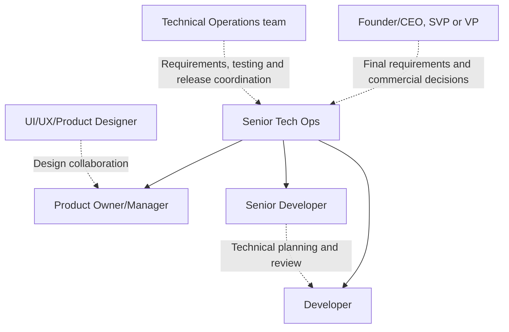

NextEdge's delivery model uses six roles: Developer, Senior Developer, Product Owner/Manager, Technical Operations, UI/UX/Product Designer, and Senior Tech Ops. Requirements and delivery are managed by Product Owner/Manager and Technical Operations. Development, implementation, and technical support are handled by Senior Developer and Developer. Senior Tech Ops coordinates the client, support, and delivery.

Read the [detailed role responsibilities](/company/roles-and-responsibilities) for each role's inputs, outputs, and boundaries.

<Note>
  Product Owner/Manager, Senior Developer, and Developer report to Senior Tech Ops. Founder/CEO, SVP, and VP are the authorized requirement and commercial approvers. The Tech Ops team owns testing, UAT, and release sign-off. Record named people and backups in the private project directory.
</Note>

## Leadership and team coordination

Solid arrows show the confirmed reporting lines to Senior Tech Ops. Dotted arrows show decision or working relationships. The chart does not establish a reporting hierarchy among Founder/CEO, SVP, and VP or assign the Designer and Technical Operations an unconfirmed direct manager.

Only Founder/CEO, SVP, and VP may finalize requirements and approve out-of-scope work and financial/billing terms. Record the designated authorized approver and the project's required approval route. Product Owner/Manager documents the finalized requirement and manages execution; Senior Tech Ops manages operations, team coordination, client expectations, and delivery risk.

## Responsibility overview

| Role | Main responsibility | Primary output |
| --- | --- | --- |
| Developer | Implement assigned work, investigate support issues, provide verification evidence | Reviewed implementation and support findings |
| Senior Developer | Technical feasibility, implementation planning, review, mentoring, technical support coordination | Technical approach, review result, release/recovery evidence |
| Product Owner/Manager | Document finalized requirements, manage tickets, plan and track delivery | Versioned baseline, backlog, delivery and acceptance record |
| Technical Operations | Clarify requirements, triage requests, coordinate readiness, own testing/UAT and release sign-off | Workflow input, verification evidence, acceptance/release decisions |
| UI/UX/Product Designer | User journeys, interaction design, implementation handoff, experience review | Versioned designs, states, and design verification |
| Senior Tech Ops | Client coordination, support oversight, team handoffs, delivery risk and escalation | Delivery/support overview and coordinated decisions |

The Tech Ops team owns QA/testing sign-off, UAT acceptance, production release, and rollback/hotfix authorization. Senior Developer and Senior Tech Ops provide technical recovery help. Name the accountable Tech Ops owner for each decision; Developers provide implementation and test evidence.

## Decision rights and boundaries

| Decision or record | Responsible owner or authority | Required input |
| --- | --- | --- |
| Requirement clarification | Technical Operations with Product Owner/Manager | Client process, examples, rules, risks |
| Requirement finalization | Designated authorized approver from Founder/CEO, SVP, or VP | Senior Tech Ops coordination, operational, design, and technical input |
| Requirement document and version history | Product Owner/Manager | Recorded finalization decision |
| Delivery backlog and plan | Product Owner/Manager with Technical Operations; Senior Tech Ops coordinates risks | Senior Developer estimates, design readiness, dependencies |
| Technical approach and review | Assigned technical owner, normally Senior Developer | Developer findings, data/security implications, acceptance criteria |
| Experience design | UI/UX/Product Designer with requirement owner review | Approved business rules and technical constraints |
| QA/testing sign-off | Named Tech Ops team owner | Test results and evidence against acceptance criteria |
| UAT/business acceptance | Tech Ops team coordinates and signs off UAT; records customer confirmation where required | Demonstration, user feedback, verification evidence |
| Production release or P0 rollback/hotfix | Named Tech Ops authority, with Senior Developer and Senior Tech Ops technical help | Technical recommendation, risk, checks, recovery plan |
| Out-of-scope work and financial/billing terms | Designated authorized approver from Founder/CEO, SVP, or VP only | Scope, estimate, financial impact, billing proposal, customer agreement |

A person may fill more than one role, but each work item still needs a clear owner and review boundary. A job title alone does not grant commercial approval or production access.

## Intake and escalation

All change requests and requests for new changes enter through [support@nextlabsonline.com](mailto:support@nextlabsonline.com). Technical Operations captures context; Product Owner/Manager maintains the linked work record; Senior Tech Ops coordinates ownership, client updates, and escalation.

For P0, alert the named incident and technical owners immediately. Investigation and authorized recovery run alongside administration. Follow the [support cycle and SLA](/support/cycle-and-sla).

Raise unresolved workflow questions with Technical Operations and Product Owner/Manager, technical blockers with Senior Developer, and cross-team/client/priority conflicts with Senior Tech Ops. Senior Tech Ops routes decisions to the named leadership authority.

Record actual people, backups, reporting lines, and approval references in the private [project ownership record](/reference/templates#project-ownership-record). Use the [handoff workflow](/delivery/requirements-and-handoffs) to move work between roles.

If a senior person or primary owner is unavailable, follow [coverage and exceptions](/company/coverage-and-exceptions): obtain permission from the respective owner or authorized authority, name a capable alternate, and coordinate execution and verification. Absence does not create automatic approval authority.
