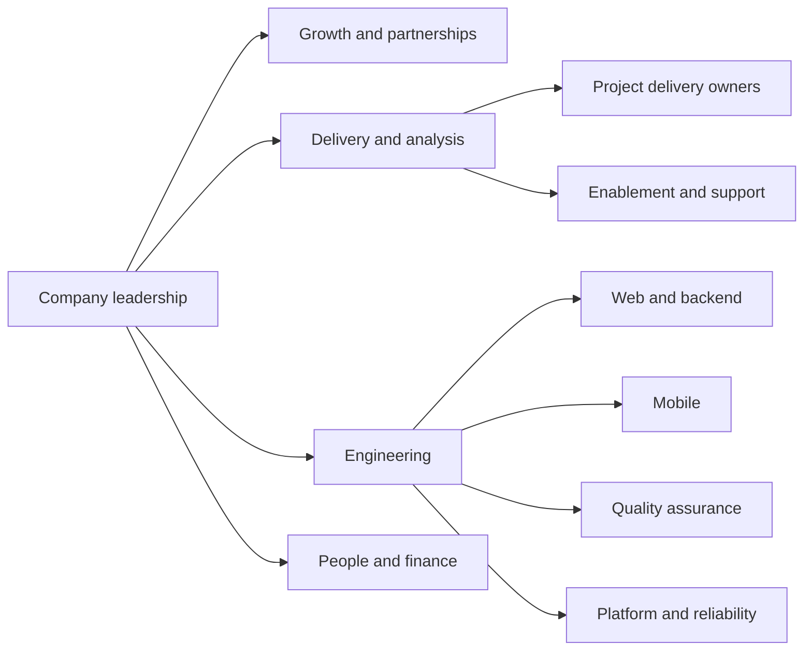
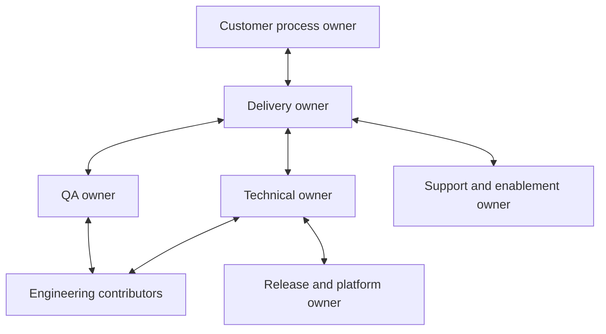

Use this model to make responsibility explicit as NextEdge grows. A person may cover more than one function. Each project still needs named owners and a backup for critical responsibilities.

<Note>
  This is a proposed functional structure, not a verified reporting chart or headcount plan. Leadership should confirm reporting lines and name current owners in the private team directory. No employee names or personal contacts belong in this public handbook.
</Note>

## Functional structure

The diagram groups responsibilities. It does not require a separate department or manager for every box.

## What each function owns

| Function | Responsibility | Typical handoff |
| --- | --- | --- |
| Leadership | Direction, priorities, commercial authority, unresolved tradeoffs | Confirmed priorities and accountable owners |
| Growth and partnerships | Customer relationship, opportunity context, commercial coordination | Discovery brief and agreed commercial scope |
| Delivery and analysis | Workflow understanding, requirements, plan, dependencies, acceptance coordination | Ready work with rules and acceptance criteria |
| Engineering | Technical design, implementation, maintainability, data integrity | Reviewed increment and operational guidance |
| Quality assurance | Risk coverage, test evidence, defect visibility, release recommendation | Evidence against agreed acceptance criteria |
| Platform and reliability | Environments, deployment, monitoring, recovery readiness | Repeatable release and recovery procedures |
| Enablement and support | Training, issue intake, feedback, adoption | Reproducible issues and follow-up evidence |
| People and finance | Joiner coordination, approved people processes, assets, expenses | Requests routed to authorized owners |

## A project team

Delivery owns the plan and communication. The technical owner owns design coherence. QA makes risk and verification visible. The customer process owner confirms the agreed business need.

## Decision rights

Assign one accountable role for each decision. Review and consultation do not transfer accountability.

| Decision | Accountable role | Consult before deciding |
| --- | --- | --- |
| Commercial scope or contractual commitment | Leadership or authorized commercial owner | Growth, delivery, technical owner |
| Out-of-scope work and its financial/billing terms, including discounts or no-charge exceptions | Founder/Product Owner | Delivery, technical owner, finance, growth where relevant |
| Backlog priority within agreed scope | Delivery owner | Customer process owner, technical owner, QA |
| Technical design | Technical owner | Implementers, QA, platform |
| Business acceptance | Designated customer process owner | Delivery, QA |
| Release execution | Named release owner | Technical owner, QA, delivery |
| People or reimbursement decisions | Authorized people/finance owner | Reporting manager, affected employee |

The Founder/Product Owner approval rule for out-of-scope work is a confirmed company requirement. Delivery coordinates the request, engineering estimates it, and finance supports costing and billing. None of those steps substitutes for written approval. Follow the [scope-change workflow](/company/ways-of-working#handle-a-change-in-scope) before committing to or starting additional work.

## Raise a blocker

Take the issue to its functional owner with the impact, decision needed, and next useful action. If ownership is missing or two functions cannot resolve a tradeoff, delivery routes it to leadership. Report security or data-integrity incidents immediately through the [incident flow](/engineering/releases-and-incidents).

Record project owners before kickoff using the [project brief](/reference/templates).
