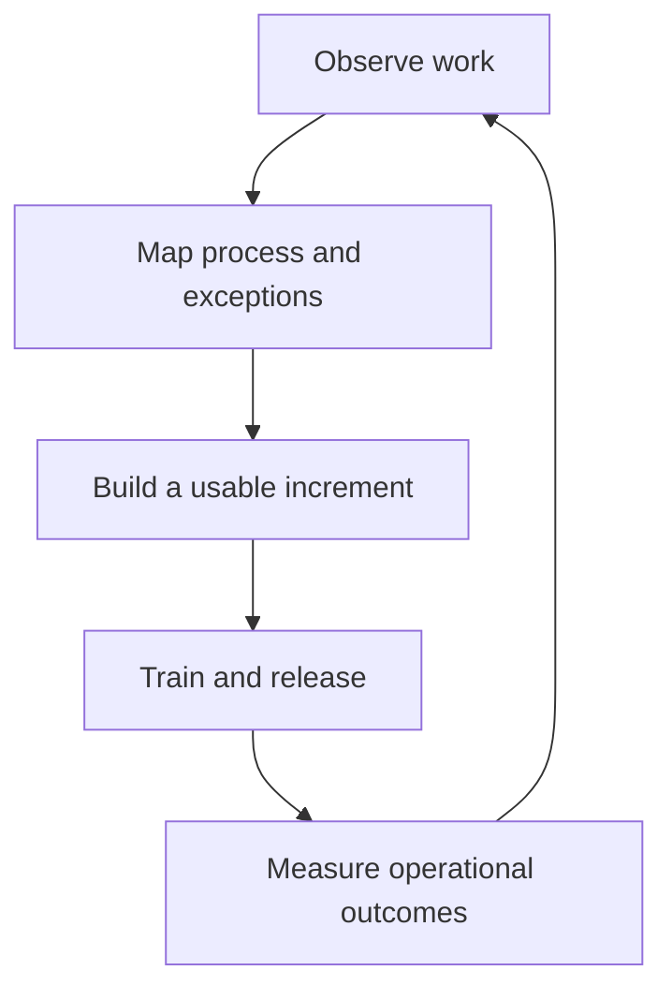

NextEdge builds ERP systems and mobile applications that help businesses automate work and increase productivity. With eight years of company experience, our focus spans both customer-facing experiences and internal operations.

## What we build

We work across order capture, fulfillment, inventory, financial visibility, workforce operations, and core banking modules. Internal workflows can include attendance, field activity tracking, expense requests, approvals, and management reporting. Within Pharma ERP, customer engagement includes memberships, milestone-based programs, and spin-the-wheel reward experiences.

| Area | Business problem | Outcome to define with the customer |
| --- | --- | --- |
| ERP and workflow automation | Teams repeat work across disconnected records | Less re-entry and a traceable process |
| Mobile and field operations | Ground activity reaches management late or incompletely | Reliable capture and visible exceptions |
| Order and fulfillment systems | Demand grows faster than manual coordination | Clear order status and fewer avoidable delays |
| Pharma ERP membership and loyalty | Stockist engagement lacks a consistent program | Understandable eligibility, rewards, and redemption |
| Core banking modules | Customer, account, and transaction workflows need connected controls | Traceable records, approvals, and reconciliation |
| Management visibility | Reports do not explain the operational situation | Timely information with clear ownership |

These outcomes guide discovery. They are not performance claims or promised improvements for every project.

## Where we have worked

- **Urban sustainability and waste management:** operational systems for city waste management and sustainability work.
- **Pharma ERP:** distribution, orders, fulfillment, collections, field-force operations, and membership/loyalty modules.
- **Food and beverages ERP:** POS, inventory, procurement, kitchen/factory production, finance, and outlet operations.
- **Core banking:** customer, account, deposit, loan, transaction, approval, and reporting module context; implementation scope varies by project.

The [domain playbooks](/domains/overview) turn this experience into questions, workflow diagrams, and acceptance checks. Examples describe how to reason about a system; they do not assert that every listed capability is deployed in every customer account.

## Our operating principles

1. **Start with the business process.** Observe who does the work, what changes hands, and where it gets stuck.
2. **Keep ownership visible.** Every deliverable, approval, and operational exception needs an owner.
3. **Deliver useful increments.** Make the smallest complete workflow work before expanding its scope.
4. **Treat records as business assets.** Preserve the history behind stock, money, attendance, and rewards.
5. **Build for the next teammate.** Prefer understandable code, documented decisions, and repeatable environments.
6. **Close the feedback loop.** Follow the work into production and learn from the people using it.

## The business loop

