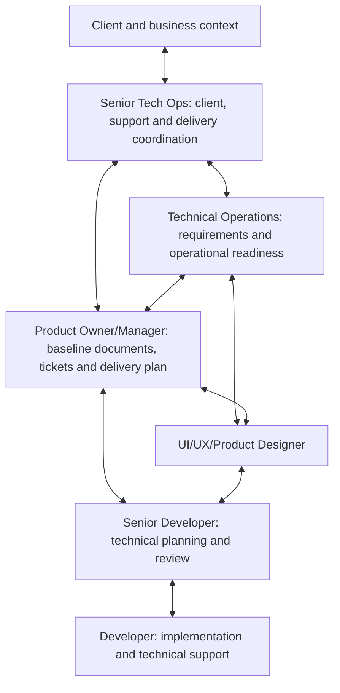

NextEdge's delivery team uses six roles: Developer, Senior Developer, Product Owner/Manager, Technical Operations, UI/UX/Product Designer, and Senior Technical/Operations (Senior Tech Ops).

Product Owner/Manager and Technical Operations manage requirements and delivery. Developers and Senior Developers focus on development, implementation, and technical support. Senior Tech Ops coordinates the client, support, and delivery across the team.

Product Owner/Manager, Senior Developer, and Developer report to Senior Tech Ops. Technical Operations and Designer collaborate with this delivery group; record their named reporting arrangements in the project directory. Name role holders, access, and approval responsibilities in each project's [ownership record](/reference/templates#project-ownership-record).

## How the roles collaborate

This is a collaboration map. Formal reporting lines and leadership approval routing belong in the [organization guide](/company/organization).

## Developer

**Purpose:** turn a ready, approved work item into a working and verifiable implementation.

**Own**

- Read the linked requirement version, design, acceptance criteria, and technical plan before starting.
- Implement the assigned behavior, including permissions, validation, data integrity, and failure states.
- Add relevant checks and provide reproducible verification evidence.
- Keep the work item current; raise unclear rules, blockers, and estimate changes early.
- Investigate assigned support issues, reproduce defects, and implement reviewed fixes.
- Record setup, migration, compatibility, and support notes affected by the change.

**Hand over**

| Output | Receiver | Evidence |
| --- | --- | --- |
| Reviewed implementation candidate | Senior Developer | Change reference, explanation, relevant checks, known risks |
| Verification package | Assigned verification owner | Steps, expected results, test data context, affected areas |
| Support investigation or fix | Senior Developer and ticket owner | Diagnosis, action taken, evidence, remaining questions |

Do not invent a business rule, silently expand scope, promise a customer date, or deploy using another person's credentials. Return ambiguity to the Product Owner/Manager and Technical Operations.

## Senior Developer

**Purpose:** make implementation technically coherent and supportable, and guide Developers through delivery.

**Own**

- Assess feasibility, dependencies, data effects, and technical risks before commitment.
- Break approved work into a technical approach and reviewable implementation tasks.
- Review code, architecture boundaries, security, data migrations, retries, and compatibility.
- Mentor Developers and unblock implementation decisions.
- Coordinate technical diagnosis and recovery work when assigned to a support incident.
- Provide technical rollback/hotfix help with Senior Tech Ops, under Tech Ops authorization.
- Supply release readiness evidence, smoke checks, and a recovery plan to the Tech Ops sign-off owner.

**Hand over**

| Output | Receiver | Evidence |
| --- | --- | --- |
| Technical estimate and risks | Product Owner/Manager and Technical Operations | Assumptions, dependencies, scope of estimate, unresolved decisions |
| Implementation plan | Developers | Module boundaries, data/API changes, sequencing, checks |
| Technical review result | Verification and release owners | Review reference, checks, limitations, migration/recovery notes |
| Incident diagnosis and recovery recommendation | Senior Tech Ops and authorized incident/release owner | Impact, safest action, verification, follow-up |

A technical estimate is input to the delivery plan; it is not approval of extra scope or billing. Seniority alone does not authorize a production release or a P0 rollback.

## Product Owner/Manager

**Purpose:** maintain the finalized requirement record, a traceable backlog, and the delivery plan.

**Own**

- Work with Technical Operations to clarify the business outcome and missing decisions.
- Write and maintain the requirement document after the designated authority finalizes the scope and rules.
- Link the approved requirement version, designs, acceptance criteria, support thread, and decision references.
- Create and manage epics/tasks/tickets with owners, dependencies, priorities, and readiness criteria.
- Plan delivery with Technical Operations and Senior Developer estimates; track progress and risks.
- Coordinate demonstrations, verification, customer acceptance, release handover, and ticket closure.
- Maintain change history so a later request cannot silently replace the approved baseline.

**Hand over**

| Output | Receiver | Evidence |
| --- | --- | --- |
| Requirement baseline | Designer, Senior Developer, Technical Operations | Approved version, rules, boundaries, acceptance criteria |
| Delivery backlog and plan | Implementation team and Senior Tech Ops | Owners, sequence, dependencies, dates supported by estimates |
| Status and decision request | Senior Tech Ops and relevant leadership | Progress, risks, options, impact, decision needed |
| Acceptance and closure record | Support/client coordination owner | Verified outcome, customer decision, release and follow-up references |

Writing a requirement does not by itself finalize a business decision. Backlog priority does not grant authority over commercial scope, discounts, billing, or production access. Use the recorded decision rights.

## Technical Operations

**Purpose:** connect the client's operating process with clear requirements, support triage, and delivery readiness.

**Own**

- Capture the current workflow, actors, business rules, exceptions, data sources, and expected outcome.
- Record requests through the support mailbox and preserve the original context.
- Reproduce operational issues and distinguish incidents, defects, questions, and change requests.
- Work with the Product Owner/Manager to resolve requirement gaps and prepare decisions for finalization.
- Coordinate operational dependencies such as test access, sample data, integrations, training, and rollout readiness.
- Track delivery blockers, support impact, and handoffs with Senior Tech Ops.
- Verify that a proposed solution addresses the operating process, not only a screen or an endpoint.
- Own QA/testing verification, UAT coordination and sign-off, and production release decisions through a named Tech Ops owner.
- Authorize rollback/hotfix actions using Senior Developer and Senior Tech Ops technical input; record permission, execution, and verification.

**Hand over**

| Output | Receiver | Evidence |
| --- | --- | --- |
| Requirement input and workflow map | Product Owner/Manager, Designer, Senior Developer | Actors, examples, rules, exceptions, source records |
| Support triage | Senior Developer and accountable ticket owner | Impact, reproduction, priority recommendation, timestamps |
| Readiness check | Product Owner/Manager and Senior Tech Ops | Dependencies resolved, missing decisions, operational risks |
| Rollout and support context | Release/support owners | Training needs, affected users, verification and follow-up |
| Testing/UAT and release sign-off | Product Owner/Manager, Senior Tech Ops, and implementation team | Verification results, acceptance decision, release or recovery authorization |

Here, Technical Operations is a requirement and delivery role. Infrastructure, database administration, or DevOps privileges must be assigned explicitly; they are not implied by the title.

## UI/UX/Product Designer

**Purpose:** make the approved workflow understandable and usable for the person performing it.

**Own**

- Understand users, tasks, operating conditions, and constraints with Technical Operations and the Product Owner/Manager.
- Map journeys, information structure, screen flows, and important decisions.
- Design normal, empty, loading, error, permission-denied, offline, and recovery states where relevant.
- Provide interaction notes, responsive behavior, accessibility guidance, and reusable components.
- Review feasibility with the Senior Developer before a design becomes a delivery dependency.
- Review the implemented experience against the approved design and record discrepancies.

**Hand over**

| Output | Receiver | Evidence |
| --- | --- | --- |
| User flow and design proposal | Product Owner/Manager and Technical Operations | Problem addressed, alternatives, open rules, edge states |
| Implementation-ready design | Senior Developer and Developers | Versioned design, interaction details, assets, acceptance notes |
| Design verification result | Verification owner and Product Owner/Manager | Observed behavior, usability gaps, agreed corrections |

A prototype is not approval of a new business rule. Material changes discovered during design return to requirement review and change control.

## Senior Technical/Operations (Senior Tech Ops)

**Purpose:** coordinate client expectations, support performance, and delivery across the Product Owner/Manager and development team.

**Own**

- Maintain the client-facing delivery context and ensure requests have an accountable owner.
- Coordinate Technical Operations, Product Owner/Manager, Designer, Senior Developer, and Developer handoffs.
- Bring unresolved requirements, priority conflicts, capacity risks, and commitments to the relevant leadership authority.
- Review the delivery plan, dependencies, support load, and risk to agreed outcomes.
- Ensure P0–P4 tickets have owners, escalation, communication, and verification.
- Coordinate customer demonstrations, acceptance discussions, rollout, and support handover.
- Keep scope and financial decisions traceable to the authorized approver.
- Manage the product and development roles that report to Senior Tech Ops.
- Provide technical recovery help with Senior Developer and coordinate an authorized alternate when a primary owner is unavailable.

**Hand over**

| Output | Receiver | Evidence |
| --- | --- | --- |
| Requirement finalization package | Designated requirements authority | Options, impact, technical input, unresolved decisions |
| Delivery and support overview | Leadership and client contacts as appropriate | Outcomes, dates, risks, decisions, next update |
| Escalation and recovery coordination | Incident/technical owners and leadership | Impact, owner, target, action, dependency |
| Customer handover | Product Owner/Manager and support team | Acceptance status, training, operational notes, follow-up |

Product Owner/Manager, Senior Developer, and Developer report to Senior Tech Ops. Managing operations does not grant commercial approval authority. Requirement/commercial decisions remain with Founder/CEO, SVP, and VP; Tech Ops owns testing/UAT and release sign-off.

## The leadership interface

Only Founder/CEO, SVP, and VP may give final requirement approval and approve out-of-scope work and financial/billing terms. Senior Tech Ops coordinates the package and escalation. A work item identifies the designated authorized approver and decision reference.

The project Product Owner/Manager writes the finalized requirement document and manages delivery/tickets. That role does not independently approve requirements or commercial changes. The same applies to Developers, Senior Developer, Designer, and Technical Operations.

Delivery Head involvement and any additional leadership routing should be recorded per project; the title does not add another final approver outside Founder/CEO, SVP, and VP.

## When a primary owner is unavailable

Follow the [exception workflow](/company/coverage-and-exceptions). Seek permission from the respective owner or authorized authority, name a capable person from the available senior or execution line, and keep one accountable coordinator. Record the permitted action, limits, and verification.

An alternate may perform authorized work; the assignment does not transfer restricted requirement or commercial approval authority. P0 recovery uses the Tech Ops authorization route and existing support clock.

## Review outcomes, not activity alone

Use evidence such as requirement clarity, traceable tickets, predictable handoffs, reviewed implementation, reopened defects, support recovery, and completed follow-up. Agree role-specific expectations with the manager; this handbook does not introduce headcount, utilization quotas, or performance ratings.

Continue with the [requirement and delivery handoff workflow](/delivery/requirements-and-handoffs).
