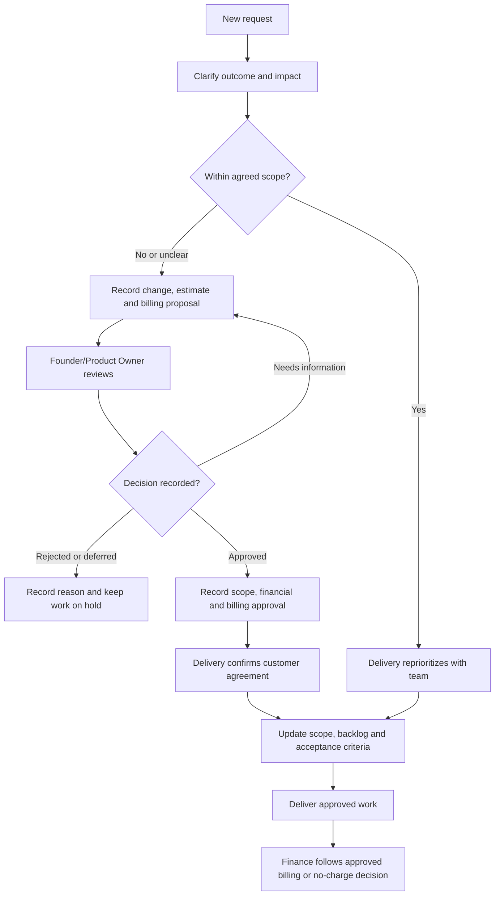

Use a shared work tracker for the plan, a written record for decisions, and a conversation when a quick clarification can prevent rework. Your delivery owner supplies the actual tools and communication channels.

## Make a useful work item

Describe the business problem, user, expected outcome, acceptance criteria, dependencies, and owner. Attach examples using fictional or approved test data. Link the design, change, test evidence, and release note.

A status update should answer four questions:

- What outcome moved forward?
- What is the next action?
- What is blocked, and who can unblock it?
- Has the expected delivery or customer impact changed?

## Suggested team rhythm

This is a starting cadence. Delivery adjusts it for the project and records the agreed rhythm.

| Conversation | Purpose | Written output |
| --- | --- | --- |
| Regular team check-in | Surface progress, dependencies, and blockers | Updated work items and next actions |
| Planning and refinement | Agree scope and clarify acceptance | Ready backlog and known risks |
| Demonstration | Show a working business workflow | Feedback and acceptance gaps |
| Retrospective | Improve how the team delivers | A small set of owned actions |
| Customer checkpoint | Confirm scope, outcomes, and decisions | Decision log and revised plan where needed |

## Handle a change in scope

Compare every new request with the agreed project scope. A new feature, integration, report, workflow, or material change to accepted requirements may be out of scope. If the boundary is unclear, delivery records the question and seeks a decision before implementation.

**The Founder/Product Owner must approve out-of-scope work and its financial and billing terms in writing before the team commits to or starts the additional work.** Customer interest, a technical estimate, or a delivery discussion does not replace this approval.

## Out-of-scope finance and billing approval

Delivery coordinates the change request. Engineering estimates effort, dependencies, and risk. Finance prepares or checks the financial and billing proposal. The Founder/Product Owner makes the approval decision.

| Approval item | What to record |
| --- | --- |
| Scope | Additional deliverables, exclusions, and acceptance criteria |
| Delivery impact | Effort estimate, dependencies, and timeline changes |
| Financial impact | Additional cost, proposed customer charge, and any discount or no-charge exception |
| Billing terms | Billing basis, currency, invoice trigger or milestone, and payment terms |
| Decision | Approved, rejected, deferred, or returned for clarification; approver, date, and written reference |
| Customer agreement | Confirmation of the approved change and commercial terms before work begins |

Keep written approval and commercial details in the restricted project record. Link that reference from the work item. A no-charge change still needs Founder/Product Owner approval because it consumes capacity and affects delivery.

Finance prepares and processes billing against the approved change; it does not independently authorize extra work, a discount, or a billing waiver. If scope, price, or billing terms change after approval, return the revised request to the Founder/Product Owner before proceeding.

Use the [change request template](/reference/templates#out-of-scope-change-request). Clarification and estimation can inform the decision; implementation remains on hold until approval and customer agreement are recorded.

## Work respectfully

Give feedback about the work and its impact. Ask when a business rule is unclear. Flag a mistake early and help recover it. Raise concerns privately with the appropriate manager or people owner when a team discussion is unsuitable.

Hand over unfinished work with its state, open questions, relevant links, and next responsible person. See [everyday operations](/company/everyday-operations) for attendance, expenses, and assets.
